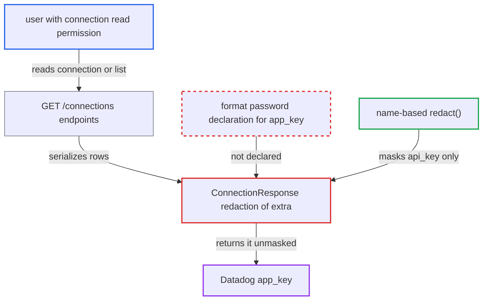

# Datadog application key conn-field not declared sensitive, returned unmasked by connections API

| Field | Value |
|---|---|
| ID | `find_0183VqKweD2hqE2FR49GLoY5` |
| Severity | **Medium** |
| Status | open |
| CWE | CWE-522 — Insufficiently protected credentials |
| Created | 2026-10-27T21:43:50.778229Z |
| Claude Security | https://claude.ai/security/findings/find_0183VqKweD2hqE2FR49GLoY5 |

## Description

A signed-in user with connection read permission can read the Datadog Application key of every Datadog connection in clear text through the connections API. Airflow's security model says such users cannot view stored credentials. The provider metadata never declares `app_key` as a password field, and its name is not on the redaction name list. Only half of the credential leaks, because `api_key` stays masked.

1. **Datadog provider metadata** declares `app_key` as a plain string field. The field has no `format: password`, so nothing marks it as a secret, unlike secret fields in other providers such as pagerduty `routing_key` and zendesk `token`. ([`providers/datadog/provider.yaml:100-105`](https://github.com/cx-benchmark/airflow/blob/a462d683469bb9f55646b0515ef84c41e16650fb/providers/datadog/provider.yaml#L100-L105))
2. **`ProvidersManager._add_widgets`** registers the field with `is_sensitive=False`. A widget is marked sensitive only when its schema format is `password`. ([`airflow-core/src/airflow/providers_manager.py:1003`](https://github.com/cx-benchmark/airflow/blob/a462d683469bb9f55646b0515ef84c41e16650fb/airflow-core/src/airflow/providers_manager.py#L1003))
3. **authenticated user with connection read permission** calls `GET /api/v2/connections/{conn_id}` or lists connections. These endpoints need only connection read permission and serialize every row through `ConnectionResponse`. ([`airflow-core/src/airflow/api_fastapi/core_api/routes/public/connections.py:200-257`](https://github.com/cx-benchmark/airflow/blob/a462d683469bb9f55646b0515ef84c41e16650fb/airflow-core/src/airflow/api_fastapi/core_api/routes/public/connections.py#L200-L257))
4. **name-based `redact()`** masks `api_key` but not `app_key`. It substring-matches key names against `DEFAULT_SENSITIVE_FIELDS` plus `[core] sensitive_var_conn_names`, which is empty by default, and no entry is a substring of `app_key`. ([`shared/secrets_masker/src/airflow_shared/secrets_masker/secrets_masker.py:51-76`](https://github.com/cx-benchmark/airflow/blob/a462d683469bb9f55646b0515ef84c41e16650fb/shared/secrets_masker/src/airflow_shared/secrets_masker/secrets_masker.py#L51-L76))
5. **`redact_provider_sensitive_extra`** skips `app_key`. It masks only keys of provider fields registered as sensitive, and `app_key` is not one, so `ConnectionResponse` returns its value verbatim in `extra`. ([`airflow-core/src/airflow/api_fastapi/core_api/datamodels/connections.py:98-120`](https://github.com/cx-benchmark/airflow/blob/a462d683469bb9f55646b0515ef84c41e16650fb/airflow-core/src/airflow/api_fastapi/core_api/datamodels/connections.py#L98-L120))

## Assessment

The attacker is an authenticated user who holds connection read permission: FAB `Op` or `Admin`, SimpleAuthManager `OP`, or a custom role with connection read. They call `GET /api/v2/connections/{datadog_conn_id}` or list the connections. No victim action or special state is needed. The leak holds while `[core] sensitive_var_conn_names` is at its empty default and no provider declares `app_key` as `format: password`.

Impact: The attacker recovers the Datadog Application key of each Datadog connection, a credential that Datadog shows only once and that carries the scopes of the user who created it. The disclosure is limited to that one half of the credential, because the paired `api_key` stays masked. Nothing is modified and service is not affected.

## Recommendation

The Datadog `app_key` credential sits in an `extra` key that is neither on the sensitive-name list nor declared `format: password` in the provider metadata, so connection redaction in the API does not protect it.

Fix criteria: `GET /connections/{id}` and `GET /connections` return the Datadog `app_key` masked, and a PATCH that sends back the mask keeps the stored value. To verify, create a Datadog connection with both keys and read it with a connection-read role. Neither `api_key` nor `app_key` may appear in clear text in the response.

## Evidence

**https://github.com/cx-benchmark/airflow**

- [`providers/datadog/provider.yaml:100-105`](https://github.com/cx-benchmark/airflow/blob/a462d683469bb9f55646b0515ef84c41e16650fb/providers/datadog/provider.yaml#L100-L105)
- [`providers/datadog/src/airflow/providers/datadog/get_provider_info.py:50-51`](https://github.com/cx-benchmark/airflow/blob/a462d683469bb9f55646b0515ef84c41e16650fb/providers/datadog/src/airflow/providers/datadog/get_provider_info.py#L50-L51)
- [`airflow-core/src/airflow/providers_manager.py:1003`](https://github.com/cx-benchmark/airflow/blob/a462d683469bb9f55646b0515ef84c41e16650fb/airflow-core/src/airflow/providers_manager.py#L1003)
- [`airflow-core/src/airflow/api_fastapi/core_api/datamodels/connections.py:98-120`](https://github.com/cx-benchmark/airflow/blob/a462d683469bb9f55646b0515ef84c41e16650fb/airflow-core/src/airflow/api_fastapi/core_api/datamodels/connections.py#L98-L120)
- [`shared/secrets_masker/src/airflow_shared/secrets_masker/secrets_masker.py:51-76`](https://github.com/cx-benchmark/airflow/blob/a462d683469bb9f55646b0515ef84c41e16650fb/shared/secrets_masker/src/airflow_shared/secrets_masker/secrets_masker.py#L51-L76)
- [`airflow-core/src/airflow/api_fastapi/core_api/routes/public/connections.py:200-257`](https://github.com/cx-benchmark/airflow/blob/a462d683469bb9f55646b0515ef84c41e16650fb/airflow-core/src/airflow/api_fastapi/core_api/routes/public/connections.py#L200-L257)
- [`providers/datadog/src/airflow/providers/datadog/hooks/datadog.py:50-63`](https://github.com/cx-benchmark/airflow/blob/a462d683469bb9f55646b0515ef84c41e16650fb/providers/datadog/src/airflow/providers/datadog/hooks/datadog.py#L50-L63)

