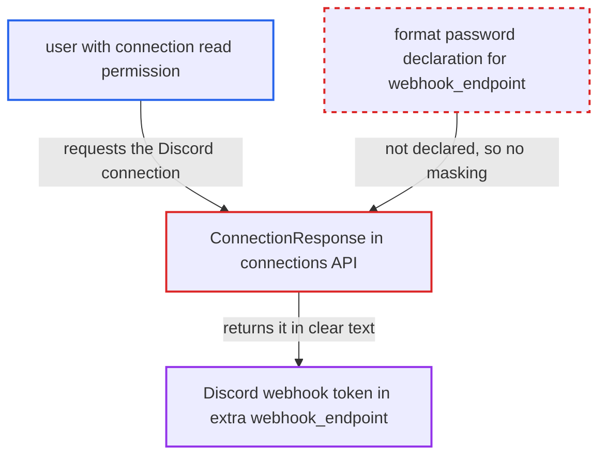

# Discord webhook token in connection extra not declared sensitive, returned in clear by connections API

| Field | Value |
|---|---|
| ID | `find_0178fcbo6eZtdxqdoHtNun4u` |
| Severity | **Medium** |
| Status | open |
| CWE | CWE-522 — Insufficiently protected credentials |
| Created | 2026-10-27T21:44:06.445973Z |
| Claude Security | https://claude.ai/security/findings/find_0178fcbo6eZtdxqdoHtNun4u |

## Description

A logged-in user with connection read permission can read the full Discord webhook token in clear text from the connections API or UI. The security model says this role cannot view stored credentials. The token sits in the connection `extra` key `webhook_endpoint`. The Discord provider does not declare that key `format: password`, and its name is not on the sensitive-name list, so `ConnectionResponse` does not mask it.

1. **Discord provider metadata** declares `webhook_endpoint` as a plain string. The schema in `provider.yaml` and the generated `get_provider_info.py` has no `format: password`, and the connection has no `password` field. ([`providers/discord/provider.yaml:90-96`](https://github.com/cx-benchmark/airflow/blob/a462d683469bb9f55646b0515ef84c41e16650fb/providers/discord/provider.yaml#L90-L96))
2. **`ProvidersManager`** registers the field as not sensitive. `is_sensitive` is set only when the schema format is `password`, so this field gets `is_sensitive=False`. ([`airflow-core/src/airflow/providers_manager.py:999-1004`](https://github.com/cx-benchmark/airflow/blob/a462d683469bb9f55646b0515ef84c41e16650fb/airflow-core/src/airflow/providers_manager.py#L999-L1004))
3. **user with connection read permission** requests the Discord connection from the API or UI. The call is `GET /api/v2/connections/{conn_id}`, or the connection list. No victim action is needed.
4. **`ConnectionResponse`** skips masking of `webhook_endpoint` in `extra`. It masks a key only if its name matches the sensitive-name list or the provider declared it `format: password`. `webhook_endpoint` meets neither rule. ([`airflow-core/src/airflow/api_fastapi/core_api/datamodels/connections.py:98-120`](https://github.com/cx-benchmark/airflow/blob/a462d683469bb9f55646b0515ef84c41e16650fb/airflow-core/src/airflow/api_fastapi/core_api/datamodels/connections.py#L98-L120))
5. **`DEFAULT_SENSITIVE_FIELDS`** does not match the key name. The list has `webhook_url` and `token` but nothing that matches `webhook_endpoint`. ([`task-sdk/src/airflow/sdk/_shared/secrets_masker/secrets_masker.py:51-76`](https://github.com/cx-benchmark/airflow/blob/a462d683469bb9f55646b0515ef84c41e16650fb/task-sdk/src/airflow/sdk/_shared/secrets_masker/secrets_masker.py#L51-L76))
6. **connections API** returns `webhooks/<id>/<token>` unmasked. The caller now holds the token, which authenticates every webhook call.

## Assessment

The attacker is an authenticated user who can read connections, such as the FAB `Op` role or the SimpleAuthManager `OP` role. The security model calls this a connection-configuration user who cannot view stored credentials. The attacker calls `GET /api/v2/connections/{discord_conn_id}`, the connection list, or opens the connection in the UI. No victim action and no special deployment state are needed. A Discord connection with `webhook_endpoint` set must exist.

Impact: The attacker recovers the stored Discord webhook credential that this role is documented as unable to view. Only the Discord connection's credential is exposed. No other Airflow data or behaviour is affected. The token is also never registered with the secrets masker at execution time, which a separate candidate on log exposure covers.

Subsequent-system impact: The webhook token needs no further authentication. With it the attacker can post arbitrary messages into the organisation's Discord channel as the Airflow integration. They can also read the webhook metadata and edit or delete messages it posted. They can modify or delete the webhook itself, which would silence alerting.

## Recommendation

The Discord credential lives in the `extra` key `webhook_endpoint`. That name is not on the sensitive-name list, and the provider schema lacks `format: password`, so API-level connection redaction does not treat it as a secret.

Fix criteria: `GET /connections/{id}` and `GET /connections` return the Discord webhook endpoint and token masked (`***`) for the Discord connection type. PATCH round-trips of the masked value restore the stored secret. To verify, create a Discord connection with `webhook_endpoint` set and confirm the API responses no longer contain the token. Declaring the conn-field with `format: password` or moving the token into the connection `password` field would both achieve this.

## Evidence

**https://github.com/cx-benchmark/airflow**

- [`providers/discord/provider.yaml:90-96`](https://github.com/cx-benchmark/airflow/blob/a462d683469bb9f55646b0515ef84c41e16650fb/providers/discord/provider.yaml#L90-L96)
- [`providers/discord/src/airflow/providers/discord/get_provider_info.py:50-57`](https://github.com/cx-benchmark/airflow/blob/a462d683469bb9f55646b0515ef84c41e16650fb/providers/discord/src/airflow/providers/discord/get_provider_info.py#L50-L57)
- [`providers/discord/src/airflow/providers/discord/hooks/discord_webhook.py:39-63`](https://github.com/cx-benchmark/airflow/blob/a462d683469bb9f55646b0515ef84c41e16650fb/providers/discord/src/airflow/providers/discord/hooks/discord_webhook.py#L39-L63)
- [`providers/discord/src/airflow/providers/discord/hooks/discord_webhook.py:169-184`](https://github.com/cx-benchmark/airflow/blob/a462d683469bb9f55646b0515ef84c41e16650fb/providers/discord/src/airflow/providers/discord/hooks/discord_webhook.py#L169-L184)
- [`airflow-core/src/airflow/providers_manager.py:999-1004`](https://github.com/cx-benchmark/airflow/blob/a462d683469bb9f55646b0515ef84c41e16650fb/airflow-core/src/airflow/providers_manager.py#L999-L1004)
- [`airflow-core/src/airflow/api_fastapi/core_api/datamodels/connections.py:98-120`](https://github.com/cx-benchmark/airflow/blob/a462d683469bb9f55646b0515ef84c41e16650fb/airflow-core/src/airflow/api_fastapi/core_api/datamodels/connections.py#L98-L120)
- [`task-sdk/src/airflow/sdk/_shared/secrets_masker/secrets_masker.py:51-76`](https://github.com/cx-benchmark/airflow/blob/a462d683469bb9f55646b0515ef84c41e16650fb/task-sdk/src/airflow/sdk/_shared/secrets_masker/secrets_masker.py#L51-L76)

