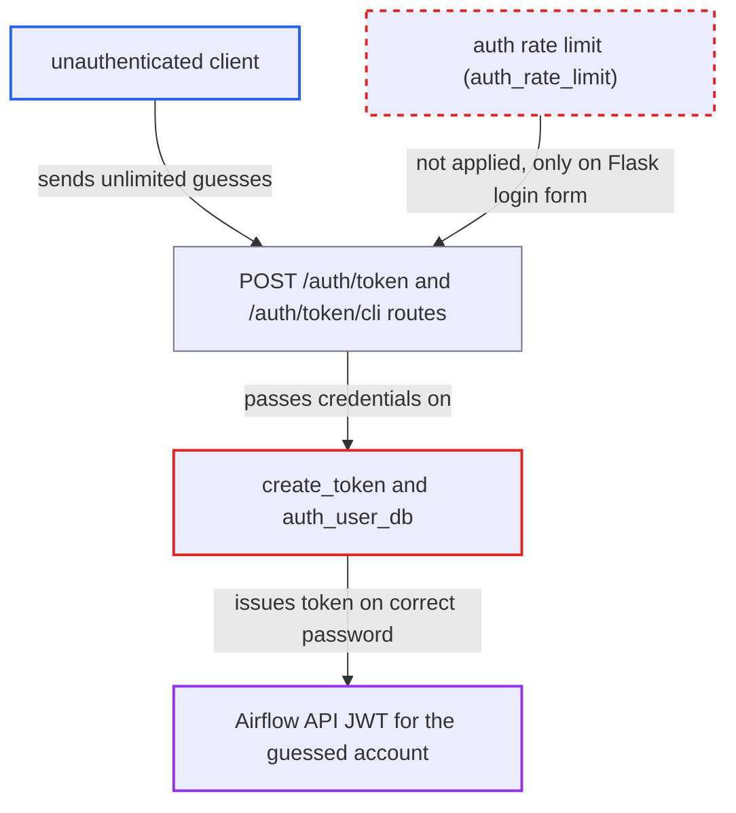

# FAB token endpoints bypass the auth rate limiter, allowing unthrottled password guessing

| Field | Value |
|---|---|
| ID | `find_015nK4EbvAUyrwyAr9HCBZRn` |
| Severity | **Medium** |
| Status | open |
| CWE | CWE-307 — Improper Restriction of Excessive Authentication Attempts |
| Created | 2026-10-27T21:17:45.926948Z |
| Claude Security | https://claude.ai/security/findings/find_015nK4EbvAUyrwyAr9HCBZRn |

## Description

An unauthenticated client who can reach the API server can guess passwords for FAB accounts without any limit. A correct guess returns a full Airflow API token for that account, up to Admin. Success still depends on the account having a guessable or leaked password. The configured rate limit is attached only to the Flask login form, so `POST /auth/token` and `POST /auth/token/cli`, which reach `create_token`, are never throttled.

1. **attacker** sends repeated login requests to `POST /auth/token` or `POST /auth/token/cli`. Each request carries a JSON body with `username` and `password` for a known or guessed account such as `admin`, and the routes have no authentication, rate-limit or lockout dependency. ([`providers/fab/src/airflow/providers/fab/auth_manager/api_fastapi/routes/login.py:70-95`](https://github.com/cx-benchmark/airflow/blob/a462d683469bb9f55646b0515ef84c41e16650fb/providers/fab/src/airflow/providers/fab/auth_manager/api_fastapi/routes/login.py#L70-L95))
2. **the method `create_token`** checks the body credentials directly with `auth_user_ldap` and/or `auth_user_db`. No attempt accounting happens here, and `create_token` falls back to `auth_user_db` even when `AUTH_TYPE` is not DB. ([`providers/fab/src/airflow/providers/fab/auth_manager/fab_auth_manager.py:412-436`](https://github.com/cx-benchmark/airflow/blob/a462d683469bb9f55646b0515ef84c41e16650fb/providers/fab/src/airflow/providers/fab/auth_manager/fab_auth_manager.py#L412-L436))
3. **the method `auth_user_db`** checks the password and, on failure, only calls `update_user_auth_stat`. This increments `fail_login_count` but never locks, delays or rejects the account, so the number of guesses is unbounded. ([`providers/fab/src/airflow/providers/fab/auth_manager/security_manager/override.py:2272-2299`](https://github.com/cx-benchmark/airflow/blob/a462d683469bb9f55646b0515ef84c41e16650fb/providers/fab/src/airflow/providers/fab/auth_manager/security_manager/override.py#L2272-L2299))
4. **Flask-Limiter rule** is applied only to `self.auth_view.blueprint`. That blueprint is the Flask login form, and a rule on it cannot see FastAPI routes, so `[fab] auth_rate_limited` and `[fab] auth_rate_limit` do not apply to the token endpoints. ([`providers/fab/src/airflow/providers/fab/auth_manager/security_manager/override.py:527-530`](https://github.com/cx-benchmark/airflow/blob/a462d683469bb9f55646b0515ef84c41e16650fb/providers/fab/src/airflow/providers/fab/auth_manager/security_manager/override.py#L527-L530))
5. **the login service** returns 401 for a wrong password and 201 with an `access_token` for a correct one. The two responses tell the attacker which guess worked, and the token is a usable Airflow API JWT for that user. ([`providers/fab/src/airflow/providers/fab/auth_manager/api_fastapi/services/login.py:38-52`](https://github.com/cx-benchmark/airflow/blob/a462d683469bb9f55646b0515ef84c41e16650fb/providers/fab/src/airflow/providers/fab/auth_manager/api_fastapi/services/login.py#L38-L52))

## Assessment

The attacker needs no account and no victim action. They only need network access to the API server and a target username, such as `admin`, whose password is guessable or leaked. They send repeated requests to `POST /auth/token` or `POST /auth/token/cli`. The report also names a possible second route that it did not trace, because `flask-appbuilder==5.2.2` is not in the checkout. This is the FAB `SecurityApi` registered unconditionally at `override.py:498` (`/auth/api/v1/security/login`), which is also a password-checking endpoint outside the limited blueprint.

Impact: The attacker can recover a password and obtain an API JWT with that account's role, up to Admin, allowing reads and changes through the public API. The code only removes the attempt bound and does not bypass the password check, so the outcome depends on the password's strength.

## Recommendation

The configured authentication rate limit is bound to one Flask blueprint. The FastAPI token endpoints check the same FAB credentials but sit outside it, so the brute-force control does not cover every password-checking path.

Fix criteria: With `[fab] auth_rate_limited` enabled, every endpoint that checks a FAB username and password enforces the configured attempt limit, or an equivalent per-client or per-account back-off, before the password check. This covers `/auth/token`, `/auth/token/cli`, the Flask login form and any FAB `SecurityApi` login that is kept. A test sends more than `auth_rate_limit` attempts within the window against `/auth/token`. Those attempts are refused (for example with HTTP 429) without the credentials being checked.

## Evidence

**https://github.com/cx-benchmark/airflow**

- [`providers/fab/src/airflow/providers/fab/auth_manager/api_fastapi/routes/login.py:70-95`](https://github.com/cx-benchmark/airflow/blob/a462d683469bb9f55646b0515ef84c41e16650fb/providers/fab/src/airflow/providers/fab/auth_manager/api_fastapi/routes/login.py#L70-L95)
- [`providers/fab/src/airflow/providers/fab/auth_manager/security_manager/override.py:527-530`](https://github.com/cx-benchmark/airflow/blob/a462d683469bb9f55646b0515ef84c41e16650fb/providers/fab/src/airflow/providers/fab/auth_manager/security_manager/override.py#L527-L530)
- [`providers/fab/src/airflow/providers/fab/auth_manager/fab_auth_manager.py:412-436`](https://github.com/cx-benchmark/airflow/blob/a462d683469bb9f55646b0515ef84c41e16650fb/providers/fab/src/airflow/providers/fab/auth_manager/fab_auth_manager.py#L412-L436)
- [`providers/fab/src/airflow/providers/fab/auth_manager/api_fastapi/services/login.py:38-52`](https://github.com/cx-benchmark/airflow/blob/a462d683469bb9f55646b0515ef84c41e16650fb/providers/fab/src/airflow/providers/fab/auth_manager/api_fastapi/services/login.py#L38-L52)
- [`providers/fab/src/airflow/providers/fab/auth_manager/security_manager/override.py:2272-2299`](https://github.com/cx-benchmark/airflow/blob/a462d683469bb9f55646b0515ef84c41e16650fb/providers/fab/src/airflow/providers/fab/auth_manager/security_manager/override.py#L2272-L2299)
- [`providers/fab/src/airflow/providers/fab/get_provider_info.py:89-102`](https://github.com/cx-benchmark/airflow/blob/a462d683469bb9f55646b0515ef84c41e16650fb/providers/fab/src/airflow/providers/fab/get_provider_info.py#L89-L102)
- [`airflow-core/src/airflow/api_fastapi/core_api/security.py:105-114`](https://github.com/cx-benchmark/airflow/blob/a462d683469bb9f55646b0515ef84c41e16650fb/airflow-core/src/airflow/api_fastapi/core_api/security.py#L105-L114)
- [`airflow-core/docs/security/security_model.rst:1095-1102`](https://github.com/cx-benchmark/airflow/blob/a462d683469bb9f55646b0515ef84c41e16650fb/airflow-core/docs/security/security_model.rst#L1095-L1102)

