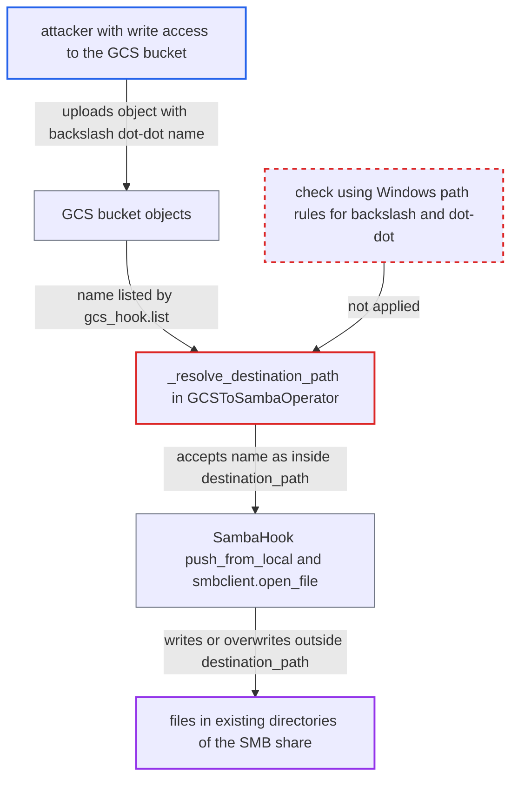

# GCSToSambaOperator destination confinement bypassed by backslash path segments in object names

| Field | Value |
|---|---|
| ID | `find_01R1hbgYAQXVNokQsFGPXosi` |
| Severity | **Medium** |
| Status | open |
| CWE | CWE-29 — Path Traversal |
| Created | 2026-10-27T21:35:09.447673Z |
| Claude Security | https://claude.ai/security/findings/find_01R1hbgYAQXVNokQsFGPXosi |

## Description

Someone who can upload objects to a GCS bucket can make `GCSToSambaOperator` write attacker-chosen file content to other directories on the SMB share, overwriting existing files such as scripts or config. It needs a DAG that uses the operator with a wildcard `source_object` on a bucket the attacker can write to. The check in `_resolve_destination_path` uses `/`-only path rules, so backslash `..` segments get through.

1. **attacker** uploads an object with backslash `..` segments in its name. Backslashes are legal in GCS object names, for example `incoming/x\..\..\..\scripts\run.bat` under the task's prefix, and the attacker needs no Airflow account.
2. **the operator `GCSToSambaOperator`** lists the bucket objects and passes each name on for resolving. With a wildcard `source_object`, every name returned by `gcs_hook.list` goes to `_resolve_destination_path`, and that data is written by whoever can write the bucket. ([`providers/samba/src/airflow/providers/samba/transfers/gcs_to_samba.py:146-168`](https://github.com/cx-benchmark/airflow/blob/a462d683469bb9f55646b0515ef84c41e16650fb/providers/samba/src/airflow/providers/samba/transfers/gcs_to_samba.py#L146-L168))
3. **the method `_resolve_destination_path`** accepts the crafted name as inside `destination_path`. On a Linux worker `os.path` only splits on `/`, so `media/evil\..\..\secret.txt` is one opaque component, `os.path.normpath` leaves it unchanged, and it still starts with `media/`. ([`providers/samba/src/airflow/providers/samba/transfers/gcs_to_samba.py:176-192`](https://github.com/cx-benchmark/airflow/blob/a462d683469bb9f55646b0515ef84c41e16650fb/providers/samba/src/airflow/providers/samba/transfers/gcs_to_samba.py#L176-L192))
4. **the method `_copy_single_object`** calls `push_from_local` with the accepted string. The `makedirs` call only sees the configured directory, because `os.path.dirname` also ignores backslashes on POSIX. ([`providers/samba/src/airflow/providers/samba/transfers/gcs_to_samba.py:194-223`](https://github.com/cx-benchmark/airflow/blob/a462d683469bb9f55646b0515ef84c41e16650fb/providers/samba/src/airflow/providers/samba/transfers/gcs_to_samba.py#L194-L223))
5. **the hook `SambaHook`** adds the host and share prefix without resolving `..`. `_join_posix_path` and `_join_windows_path` use `PurePosixPath` and `PureWindowsPath`, which do not collapse `..`, so the backslash segments reach `smbclient` intact. ([`providers/samba/src/airflow/providers/samba/hooks/samba.py:132-143`](https://github.com/cx-benchmark/airflow/blob/a462d683469bb9f55646b0515ef84c41e16650fb/providers/samba/src/airflow/providers/samba/hooks/samba.py#L132-L143))
6. **`smbclient.open_file`** creates or overwrites the file outside `destination_path`. SMB paths follow Windows rules, where `\` separates and `..` resolves, so the file lands in another existing directory of the share, for example the share root. ([`providers/samba/src/airflow/providers/samba/hooks/samba.py:333-345`](https://github.com/cx-benchmark/airflow/blob/a462d683469bb9f55646b0515ef84c41e16650fb/providers/samba/src/airflow/providers/samba/hooks/samba.py#L333-L345))

## Assessment

The attacker only needs to create objects in a GCS bucket that a `GCSToSambaOperator` task reads with a wildcard `source_object`. No Airflow account is needed. On the next run of the task the crafted name is listed and copied. It works for either `share_type`. The `keep_directory_structure=False` branch is also affected, because `os.path.basename` and `os.path.relpath` do not split on `\` either. Forward-slash `..` and absolute names are correctly rejected. The report assumes `smbprotocol` 1.17.0 (not in the checkout) normalises the UNC path with `ntpath.normpath` in `smbclient._pool.get_smb_tree`. If it did not, Samba's server-side path check would still resolve `..` within the share.

Impact: The operator's guarantee that files stay under `destination_path` is broken. On the Airflow side only that guarantee fails, and the task log records the unresolved destination. Nothing on the worker or in the metadata DB is disclosed, modified or made unavailable.

Subsequent-system impact: On the SMB server the attacker gets an arbitrary-content write or overwrite at any path in the share's existing directories that the connection's SMB account can write. This can replace scripts, configuration or data that other systems consume. The escape stays inside the share and is limited by that account's ACLs. The code creates no way to read data back.

## Recommendation

`_resolve_destination_path` checks the SMB write target with POSIX rules (`os.path.normpath`, `/` only), but the path is used with Windows/SMB rules where `\` separates and `..` resolves. Crafted object names therefore escape `destination_path`.

Fix criteria: Every derived destination stays under `destination_path` under SMB rules. Either the path is normalised with Windows rules (both `\` and `/` as separators, `..` resolved), or any name component equal to `..` is rejected after splitting on both separators. Names with drive or UNC prefixes are also rejected. This happens before the Samba hook is called. A test confirms that objects named `evil\..\..\x`, `evil\../x` and `..\x` raise before any `makedirs` or `push_from_local` call. The test covers both `share_type` values and both `keep_directory_structure` settings.

## Evidence

**https://github.com/cx-benchmark/airflow**

- [`providers/samba/src/airflow/providers/samba/transfers/gcs_to_samba.py:176-192`](https://github.com/cx-benchmark/airflow/blob/a462d683469bb9f55646b0515ef84c41e16650fb/providers/samba/src/airflow/providers/samba/transfers/gcs_to_samba.py#L176-L192)
- [`providers/samba/src/airflow/providers/samba/transfers/gcs_to_samba.py:146-168`](https://github.com/cx-benchmark/airflow/blob/a462d683469bb9f55646b0515ef84c41e16650fb/providers/samba/src/airflow/providers/samba/transfers/gcs_to_samba.py#L146-L168)
- [`providers/samba/src/airflow/providers/samba/transfers/gcs_to_samba.py:194-223`](https://github.com/cx-benchmark/airflow/blob/a462d683469bb9f55646b0515ef84c41e16650fb/providers/samba/src/airflow/providers/samba/transfers/gcs_to_samba.py#L194-L223)
- [`providers/samba/src/airflow/providers/samba/hooks/samba.py:132-143`](https://github.com/cx-benchmark/airflow/blob/a462d683469bb9f55646b0515ef84c41e16650fb/providers/samba/src/airflow/providers/samba/hooks/samba.py#L132-L143)
- [`providers/samba/src/airflow/providers/samba/hooks/samba.py:333-345`](https://github.com/cx-benchmark/airflow/blob/a462d683469bb9f55646b0515ef84c41e16650fb/providers/samba/src/airflow/providers/samba/hooks/samba.py#L333-L345)

