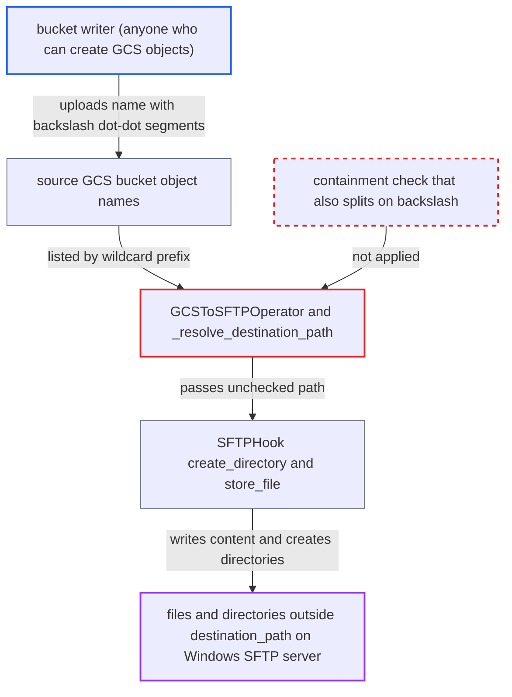

# GCSToSFTP destination containment check ignores backslash '..' segments in GCS object names

| Field | Value |
|---|---|
| ID | `find_01Jyhuurw5Lv6tjSKpcsRQUZ` |
| Severity | **Medium** |
| Status | open |
| CWE | CWE-29 — Path traversal |
| Created | 2026-10-27T21:54:44.921567Z |
| Claude Security | https://claude.ai/security/findings/find_01Jyhuurw5Lv6tjSKpcsRQUZ |

## Description

Someone who can create objects in the source Google Cloud Storage bucket can make `GCSToSFTPOperator` write files with content they choose, and create directories, outside `destination_path` on the SFTP server. This only works if the SFTP server is Windows-hosted. `_resolve_destination_path` checks containment only with `/` separators, so object names with backslash `..` segments pass the check.

1. **bucket writer** uploads an object whose name contains backslash `..` segments. GCS allows any UTF-8 in object names except CR/LF, for example a name ending in `..\..\..\Users\svc\.ssh\authorized_keys`, and the attacker chooses the content. ([`providers/google/src/airflow/providers/google/cloud/transfers/gcs_to_sftp.py:161-171`](https://github.com/cx-benchmark/airflow/blob/a462d683469bb9f55646b0515ef84c41e16650fb/providers/google/src/airflow/providers/google/cloud/transfers/gcs_to_sftp.py#L161-L171))
2. **the operator `GCSToSFTPOperator`** lists the bucket under the wildcard `source_object` prefix and processes every returned name. The names come from the bucket listing, not from the DAG author, and each one goes through `_resolve_destination_path` and `_copy_single_object`. ([`providers/google/src/airflow/providers/google/cloud/transfers/gcs_to_sftp.py:161-171`](https://github.com/cx-benchmark/airflow/blob/a462d683469bb9f55646b0515ef84c41e16650fb/providers/google/src/airflow/providers/google/cloud/transfers/gcs_to_sftp.py#L161-L171))
3. **the method `_resolve_destination_path`** accepts the name and returns the path unchanged. `posixpath.normpath` and `PurePosixPath(...).relative_to(base)` treat only `/` as a separator, so the backslash `..` segments stay part of one ordinary component that is not equal to `..`. ([`providers/google/src/airflow/providers/google/cloud/transfers/gcs_to_sftp.py:179-203`](https://github.com/cx-benchmark/airflow/blob/a462d683469bb9f55646b0515ef84c41e16650fb/providers/google/src/airflow/providers/google/cloud/transfers/gcs_to_sftp.py#L179-L203))
4. **the method `_copy_single_object`** passes the unchecked path to `create_directory` and `store_file`. Folder-marker objects ending in `/` reach `create_directory` with the same unchecked path, and the `keep_directory_structure=False` branch also keeps backslashes. ([`providers/google/src/airflow/providers/google/cloud/transfers/gcs_to_sftp.py:239-250`](https://github.com/cx-benchmark/airflow/blob/a462d683469bb9f55646b0515ef84c41e16650fb/providers/google/src/airflow/providers/google/cloud/transfers/gcs_to_sftp.py#L239-L250))
5. **the hook `SFTPHook`** sends the path unchanged to the server through paramiko. `store_file` hands the remote path to paramiko `SFTPClient.put`, and `create_directory` calls `conn.mkdir(path)` with the backslash path, creating intermediate directories by default (`create_intermediate_dirs=True`). ([`providers/sftp/src/airflow/providers/sftp/hooks/sftp.py:429-442`](https://github.com/cx-benchmark/airflow/blob/a462d683469bb9f55646b0515ef84c41e16650fb/providers/sftp/src/airflow/providers/sftp/hooks/sftp.py#L429-L442))
6. **the Windows SFTP server** treats the backslashes as separators and writes outside `destination_path`. The report assumes Windows OpenSSH resolves `..\` as the parent directory, so the file lands wherever the SFTP account's permissions allow.

## Assessment

The attacker is anyone able to create objects in the source GCS bucket, such as an external partner or upload pipeline. No Airflow privilege and no victim action are needed. A DAG must use `GCSToSFTPOperator` with a wildcard `source_object`, and the attack happens on its next run. The destination SFTP server must be Windows-hosted, for example OpenSSH for Windows. The report assumes that server resolves backslashes as separators, and a POSIX server is not affected. Besides the normal file path, folder-marker objects ending in `/` reach `create_directory` unchecked, and the `keep_directory_structure=False` branch also preserves backslashes.

Impact: On the Airflow worker, the operator performs a write it was configured not to perform, which is a limited integrity effect on the task itself. Nothing is read or modified on Airflow, and no data is returned to the attacker.

Subsequent-system impact: On the SFTP server the attacker can write files with fully chosen content and create directories at any path the SFTP account can reach outside `destination_path`, bounded only by that account's permissions or chroot. Overwriting configuration, scripts or `authorized_keys` is a serious integrity loss. Overwriting files the host depends on can also degrade service.

## Recommendation

`_resolve_destination_path` decides containment with POSIX-only path functions, but the remote server's OS interprets the written path. Backslash-separated `..` segments therefore get past the check.

Fix criteria: Any object name whose segments, split on both `/` and `\`, contain `..` is rejected before `create_directory` or `store_file` is called. Names that are absolute in either convention, such as a leading `\` or a drive letter, are rejected the same way. This holds in both `keep_directory_structure` branches and for folder markers. Listing objects named `a\..\..\x`, `..\x`, `a/..\x` and `C:\x` under the wildcard prefix makes the task raise without issuing any SFTP `mkdir` or `put`. Ordinary names, and `..` in the trusted `destination_path`, still work.

## Evidence

**https://github.com/cx-benchmark/airflow**

- [`providers/google/src/airflow/providers/google/cloud/transfers/gcs_to_sftp.py:179-203`](https://github.com/cx-benchmark/airflow/blob/a462d683469bb9f55646b0515ef84c41e16650fb/providers/google/src/airflow/providers/google/cloud/transfers/gcs_to_sftp.py#L179-L203)
- [`providers/google/src/airflow/providers/google/cloud/transfers/gcs_to_sftp.py:161-171`](https://github.com/cx-benchmark/airflow/blob/a462d683469bb9f55646b0515ef84c41e16650fb/providers/google/src/airflow/providers/google/cloud/transfers/gcs_to_sftp.py#L161-L171)
- [`providers/google/src/airflow/providers/google/cloud/transfers/gcs_to_sftp.py:239-250`](https://github.com/cx-benchmark/airflow/blob/a462d683469bb9f55646b0515ef84c41e16650fb/providers/google/src/airflow/providers/google/cloud/transfers/gcs_to_sftp.py#L239-L250)
- [`providers/sftp/src/airflow/providers/sftp/hooks/sftp.py:429-442`](https://github.com/cx-benchmark/airflow/blob/a462d683469bb9f55646b0515ef84c41e16650fb/providers/sftp/src/airflow/providers/sftp/hooks/sftp.py#L429-L442)
- [`providers/sftp/src/airflow/providers/sftp/hooks/sftp.py:351-373`](https://github.com/cx-benchmark/airflow/blob/a462d683469bb9f55646b0515ef84c41e16650fb/providers/sftp/src/airflow/providers/sftp/hooks/sftp.py#L351-L373)
- [`providers/amazon/src/airflow/providers/amazon/aws/utils/__init__.py:119-141`](https://github.com/cx-benchmark/airflow/blob/a462d683469bb9f55646b0515ef84c41e16650fb/providers/amazon/src/airflow/providers/amazon/aws/utils/__init__.py#L119-L141)

