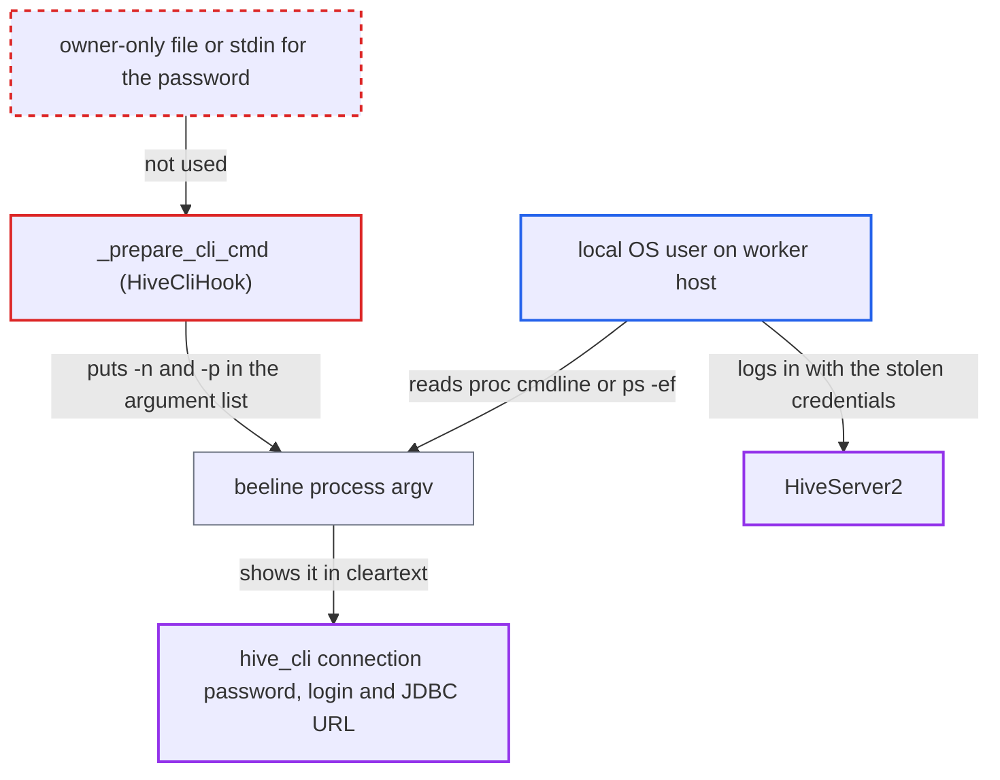

# HiveCliHook exposes hive_cli connection password in beeline process arguments

| Field | Value |
|---|---|
| ID | `find_0135BKyTYAvAMhBfX3GQeHUt` |
| Severity | **Medium** |
| Status | open |
| CWE | CWE-214 — Sensitive data in command line |
| Created | 2026-10-27T21:57:49.611556Z |
| Claude Security | https://claude.ai/security/findings/find_0135BKyTYAvAMhBfX3GQeHUt |

## Description

A local user on a shared Airflow worker host can read the cleartext password of a `hive_cli` connection from the process list. They need no Airflow role. It requires a beeline connection with a password, a concurrent Hive task, and a host where `/proc` is not mounted with `hidepid`. `HiveCliHook._prepare_cli_cmd` puts the password in beeline's `-p` argument, so it stays visible while the query runs.

1. **the operator `HiveOperator.execute`** calls `run_cli` on a beeline connection that has a password. Every `HiveOperator` run on such a connection takes this path, and so do `load_file`, `load_df` and the `*ToHive` transfers. ([`providers/apache/hive/src/airflow/providers/apache/hive/operators/hive.py:145-174`](https://github.com/cx-benchmark/airflow/blob/a462d683469bb9f55646b0515ef84c41e16650fb/providers/apache/hive/src/airflow/providers/apache/hive/operators/hive.py#L145-L174))
2. **the hook method `_prepare_cli_cmd`** adds `-n` with the login and `-p` with the password to the beeline argument list. This happens whenever the connection has `use_beeline` set and a password, and the password is added in cleartext. ([`providers/apache/hive/src/airflow/providers/apache/hive/hooks/hive.py:212-216`](https://github.com/cx-benchmark/airflow/blob/a462d683469bb9f55646b0515ef84c41e16650fb/providers/apache/hive/src/airflow/providers/apache/hive/hooks/hive.py#L212-L216))
3. **the hook method `run_cli`** starts beeline with `subprocess.Popen` and waits for it to exit. Only the logged copy of the command is masked, so the real argument list, with the password, stays in the process's argv until the query finishes. ([`providers/apache/hive/src/airflow/providers/apache/hive/hooks/hive.py:352-367`](https://github.com/cx-benchmark/airflow/blob/a462d683469bb9f55646b0515ef84c41e16650fb/providers/apache/hive/src/airflow/providers/apache/hive/hooks/hive.py#L352-L367))
4. **local OS user on the worker host** polls `/proc/*/cmdline` or runs `ps -ef` while the task runs. Any account in the same PID namespace can read these, unless `/proc` is mounted with `hidepid`. The attacker sees `-u <jdbc url> -n <login> -p <password>`.
5. **local OS user on the worker host** logs in to HiveServer2 with the stolen URL, login and password. The attacker can then run any HQL that the connection's account is allowed to run.

## Assessment

The attacker holds an unprivileged local OS account on an Airflow worker host, or runs a process in its PID namespace. They have no Airflow role. The host must be shared and must not mount `/proc` with `hidepid`. A task must be running `HiveCliHook` against a `hive_cli` connection that has a password and uses beeline. The hook defaults `use_beeline` to `False` when it is absent. The Airflow 3 connection form defaults it to `true`, so connections created in the UI use beeline unless the box is unticked. The attacker needs no victim action. The attacker only has to watch the process list while the task runs. This assumes Hive's `beeline` launcher script passes its arguments to the JVM, and that Java does not scrub argv.

Impact: The attacker learns the cleartext password, login and JDBC URL of the `hive_cli` connection, a stored secret that Airflow otherwise masks. Only connections used by tasks running while the attacker watches are exposed. No Airflow state is changed. Airflow users and Dag authors gain nothing, since they can already read connections through the Execution API.

Subsequent-system impact: The stolen URL, login and password let the attacker authenticate to HiveServer2 as the connection's account. They can run any HQL that account may run. The hook's own `load_file` issues `DROP TABLE IF EXISTS`, which suggests such accounts usually hold DDL rights. Data can therefore be read, changed or dropped.

## Recommendation

`_prepare_cli_cmd` passes `conn.password` to beeline as a command-line argument. This puts the password in the child process's argv, readable by other local accounts, for the whole query.

Fix criteria: The connection password does not appear in the argv of any process `HiveCliHook` spawns. Beeline gets it only through a channel the task's own user can read, such as an owner-only file or stdin, and the job still authenticates. To check, run a `HiveOperator` task on a beeline connection with a password. From another account, confirm that `/proc/<pid>/cmdline` and `ps -ef` show no password. The task log must stay masked.

## Evidence

**https://github.com/cx-benchmark/airflow**

- [`providers/apache/hive/src/airflow/providers/apache/hive/hooks/hive.py:212-216`](https://github.com/cx-benchmark/airflow/blob/a462d683469bb9f55646b0515ef84c41e16650fb/providers/apache/hive/src/airflow/providers/apache/hive/hooks/hive.py#L212-L216)
- [`providers/apache/hive/src/airflow/providers/apache/hive/hooks/hive.py:352-367`](https://github.com/cx-benchmark/airflow/blob/a462d683469bb9f55646b0515ef84c41e16650fb/providers/apache/hive/src/airflow/providers/apache/hive/hooks/hive.py#L352-L367)
- [`providers/apache/hive/src/airflow/providers/apache/hive/operators/hive.py:145-174`](https://github.com/cx-benchmark/airflow/blob/a462d683469bb9f55646b0515ef84c41e16650fb/providers/apache/hive/src/airflow/providers/apache/hive/operators/hive.py#L145-L174)
- [`providers/apache/hive/provider.yaml:173-180`](https://github.com/cx-benchmark/airflow/blob/a462d683469bb9f55646b0515ef84c41e16650fb/providers/apache/hive/provider.yaml#L173-L180)
- [`providers/teradata/src/airflow/providers/teradata/utils/encryption_utils.py:46-48`](https://github.com/cx-benchmark/airflow/blob/a462d683469bb9f55646b0515ef84c41e16650fb/providers/teradata/src/airflow/providers/teradata/utils/encryption_utils.py#L46-L48)
- [`airflow-core/docs/security/kerberos.rst:95-102`](https://github.com/cx-benchmark/airflow/blob/a462d683469bb9f55646b0515ef84c41e16650fb/airflow-core/docs/security/kerberos.rst#L95-L102)

