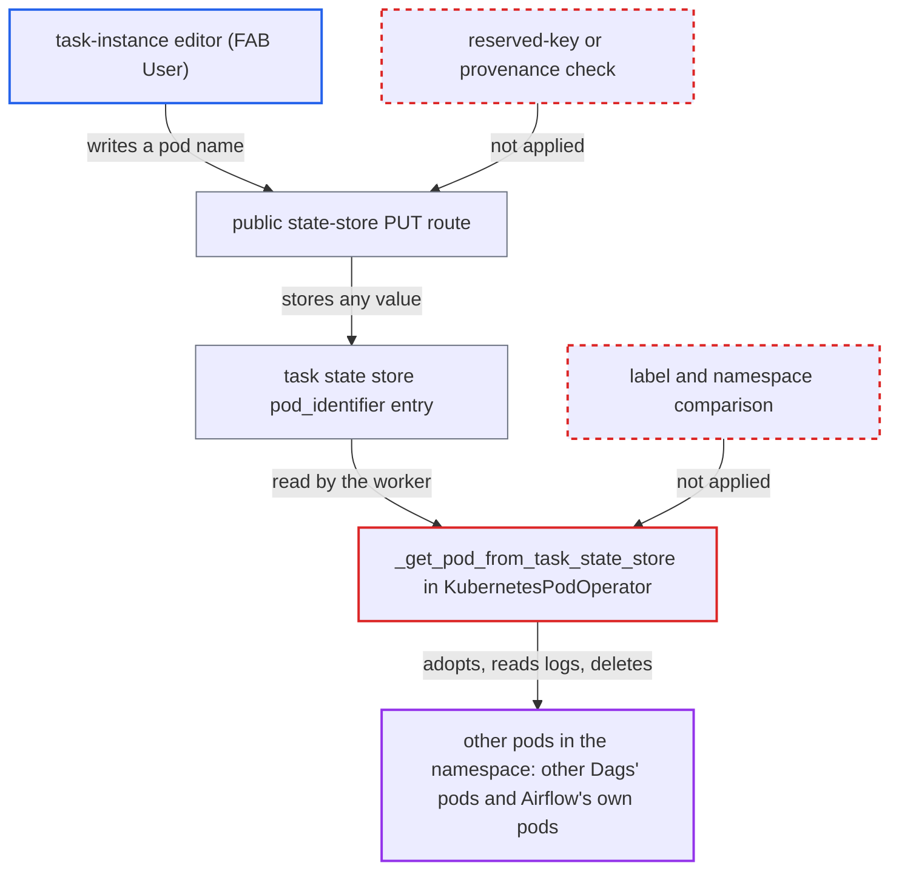

# KubernetesPodOperator adopts, reads and deletes any pod named in API-writable task state store

| Field | Value |
|---|---|
| ID | `find_017X17dWamLbReu4jKmrxGyT` |
| Severity | **Medium** |
| Status | open |
| CWE | CWE-639 — Insecure direct object reference |
| Created | 2026-10-27T21:48:38.713173Z |
| Claude Security | https://claude.ai/security/findings/find_017X17dWamLbReu4jKmrxGyT |

## Description

A user who can edit task instances on one Dag that uses `KubernetesPodOperator` can make the operator read logs from, wait on and delete other pods in its Kubernetes namespace. Those include other Dags' pods and Airflow's own pods. The attack works with the default `durable=True` on Airflow 3.3+. `_get_pod_from_task_state_store` trusts a stored `pod_identifier` and never checks the pod's labels or namespace.

1. **attacker (task-instance editor)** writes a foreign pod's name and namespace under the `pod_identifier` key. The public `PUT` state-store route accepts any JSON value for any key and only requires task-instance `PUT` permission. ([`airflow-core/src/airflow/api_fastapi/core_api/routes/public/task_state_store.py:269-289`](https://github.com/cx-benchmark/airflow/blob/a462d683469bb9f55646b0515ef84c41e16650fb/airflow-core/src/airflow/api_fastapi/core_api/routes/public/task_state_store.py#L269-L289))
2. **attacker** makes the next attempt consume the planted value. `clearTaskInstances` with `keep_task_state=true` keeps the entry. A Dag-run clear also keeps state, and planting before the first attempt works too. ([`airflow-core/src/airflow/api_fastapi/core_api/routes/public/task_instances.py:1318-1322`](https://github.com/cx-benchmark/airflow/blob/a462d683469bb9f55646b0515ef84c41e16650fb/airflow-core/src/airflow/api_fastapi/core_api/routes/public/task_instances.py#L1318-L1322))
3. **worker task runner** reads the planted value through the Execution API. The worker reads the same state-store row, so the API-written value reaches the operator as if the task had saved it. ([`airflow-core/src/airflow/api_fastapi/execution_api/routes/task_state_store.py:67-83`](https://github.com/cx-benchmark/airflow/blob/a462d683469bb9f55646b0515ef84c41e16650fb/airflow-core/src/airflow/api_fastapi/execution_api/routes/task_state_store.py#L67-L83))
4. **the method `_get_pod_from_task_state_store`** fetches the named pod with the operator's Kubernetes credentials and returns it as this task's pod. The only check is the `already_checked` label. Nothing compares the pod's `dag_id`, `task_id`, `run_id` or `map_index` labels, or its namespace, with the operator's. ([`providers/cncf/kubernetes/src/airflow/providers/cncf/kubernetes/operators/pod.py:698-737`](https://github.com/cx-benchmark/airflow/blob/a462d683469bb9f55646b0515ef84c41e16650fb/providers/cncf/kubernetes/src/airflow/providers/cncf/kubernetes/operators/pod.py#L698-L737))
5. **the method `get_or_create_pod`** reuses a non-terminal pod and deletes a terminal one at once. It asks the store first on every attempt. The deletion goes through `process_pod_deletion`, whose default `on_finish_action` is `delete_pod`. ([`providers/cncf/kubernetes/src/airflow/providers/cncf/kubernetes/operators/pod.py:752-789`](https://github.com/cx-benchmark/airflow/blob/a462d683469bb9f55646b0515ef84c41e16650fb/providers/cncf/kubernetes/src/airflow/providers/cncf/kubernetes/operators/pod.py#L752-L789))
6. **the method `execute_sync`** treats the adopted pod as its own, streams its `base` container logs into the task log and polls it until it is terminal. `cleanup` then deletes the pod. If the pod ended `Failed`, `cleanup` puts the whole pod object in the failure message because `log_pod_spec_on_failure` is `True` by default. ([`providers/cncf/kubernetes/src/airflow/providers/cncf/kubernetes/operators/pod.py:860-940`](https://github.com/cx-benchmark/airflow/blob/a462d683469bb9f55646b0515ef84c41e16650fb/providers/cncf/kubernetes/src/airflow/providers/cncf/kubernetes/operators/pod.py#L860-L940))
7. **attacker** marks the running task instance as failed so that `on_kill` deletes the adopted pod. The heartbeat gets a 409 and the supervisor sends SIGTERM. The task runner then calls `on_kill`, which deletes the pod because `on_kill_action` defaults to `delete_pod`. ([`task-sdk/src/airflow/sdk/execution_time/supervisor.py:2058-2072`](https://github.com/cx-benchmark/airflow/blob/a462d683469bb9f55646b0515ef84c41e16650fb/task-sdk/src/airflow/sdk/execution_time/supervisor.py#L2058-L2072))

## Assessment

The attacker needs task-instance edit permission on one Dag that contains a `KubernetesPodOperator`. Under FAB this is the `User` role, which is not a Dag author and has no Kubernetes access. They need a run of that Dag. They plant `pod_identifier`, then clear with `keep_task_state=true` so the next attempt uses it. A Dag-run clear, which keeps state unconditionally, also works, as does planting before the first attempt. The operator then acts with its own Kubernetes identity. In the default chart that is the Celery worker service account, with pods get, list, patch and delete, `pods/log` and `pods/exec` in the release namespace. With `multiNamespaceMode` the rights are cluster-wide. Reachable targets are other Dags' KPO pods, KubernetesExecutor task pods (main container `base`) and Airflow's own StatefulSet pods with deterministic names: `<release>-worker-0`, `<release>-triggerer-0`, `<release>-redis-0` and the bundled `<release>-postgresql-0`. The deferrable path passes the same adopted name to `KubernetesPodTrigger`, but the finding rests on the synchronous path.

Impact: The attacker can delete Airflow's own pods in the release namespace on demand and repeatedly. Deleting a worker pod kills every task on it across Dags, and the bundled database and broker pods can be restarted the same way. They can read the `base` container logs of other Dags' KPO pods and of KubernetesExecutor pods in their own task log. They also see the full pod spec of a pod that ends `Failed`, which per-Dag access rules should withhold. Log reading is limited to what those containers print and covers only containers in `container_logs` (default `base`). A pod without such a container is still adopted, polled indefinitely and deletable through `on_kill`. Foreign pods can also be relabelled `already_checked` or deleted, and the attacker's task outcome is tied to them. With `do_xcom_push=True` the operator also execs into the pod's `airflow-xcom-sidecar`, reads the result and kills the sidecar.

## Recommendation

(1) `_get_pod_from_task_state_store` treats the stored name and namespace as proof that the pod belongs to this task instance. It adopts the pod with the operator's Kubernetes credentials, then streams, polls, relabels and deletes a pod the operator never created.

Fix criteria: A pod from the task state store is adopted only if its namespace is the operator's configured namespace and its labels match those the operator stamps (`dag_id`, `task_id`, `run_id`, map index and the KPO marker). Otherwise the value is ignored and the label search or fresh creation proceeds. To verify, plant `<release>-worker-0` and another Dag's KPO pod. The attempt must create its own pod and never stream, patch or delete the foreign pod. `on_kill` must delete only the operator's own pod.

(2) The public task-state-store `PUT` and `PATCH` routes accept operator-reserved resume keys such as `pod_identifier` from users who may not direct task execution. The worker cannot tell those writes from its own checkpoints.

Fix criteria: Resume keys that operators use to pick an external target (such as `pod_identifier`) cannot be set through the public API by a task-instance editor. Alternatively, values written there are recognisably not task-written and are never used to choose a pod. The task's own writes through the Execution API (`ti:self`) still work. To verify, confirm that a FAB `User` cannot make a KPO attempt act on a pod named through the public API.

## Evidence

**https://github.com/cx-benchmark/airflow**

- [`providers/cncf/kubernetes/src/airflow/providers/cncf/kubernetes/operators/pod.py:698-737`](https://github.com/cx-benchmark/airflow/blob/a462d683469bb9f55646b0515ef84c41e16650fb/providers/cncf/kubernetes/src/airflow/providers/cncf/kubernetes/operators/pod.py#L698-L737)
- [`providers/cncf/kubernetes/src/airflow/providers/cncf/kubernetes/operators/pod.py:752-789`](https://github.com/cx-benchmark/airflow/blob/a462d683469bb9f55646b0515ef84c41e16650fb/providers/cncf/kubernetes/src/airflow/providers/cncf/kubernetes/operators/pod.py#L752-L789)
- [`providers/cncf/kubernetes/src/airflow/providers/cncf/kubernetes/operators/pod.py:1612-1636`](https://github.com/cx-benchmark/airflow/blob/a462d683469bb9f55646b0515ef84c41e16650fb/providers/cncf/kubernetes/src/airflow/providers/cncf/kubernetes/operators/pod.py#L1612-L1636)
- [`providers/cncf/kubernetes/src/airflow/providers/cncf/kubernetes/operators/pod.py:860-940`](https://github.com/cx-benchmark/airflow/blob/a462d683469bb9f55646b0515ef84c41e16650fb/providers/cncf/kubernetes/src/airflow/providers/cncf/kubernetes/operators/pod.py#L860-L940)
- [`providers/cncf/kubernetes/src/airflow/providers/cncf/kubernetes/operators/pod.py:1384-1458`](https://github.com/cx-benchmark/airflow/blob/a462d683469bb9f55646b0515ef84c41e16650fb/providers/cncf/kubernetes/src/airflow/providers/cncf/kubernetes/operators/pod.py#L1384-L1458)
- [`providers/cncf/kubernetes/src/airflow/providers/cncf/kubernetes/operators/pod.py:420-466`](https://github.com/cx-benchmark/airflow/blob/a462d683469bb9f55646b0515ef84c41e16650fb/providers/cncf/kubernetes/src/airflow/providers/cncf/kubernetes/operators/pod.py#L420-L466)
- [`airflow-core/src/airflow/api_fastapi/core_api/routes/public/task_state_store.py:269-289`](https://github.com/cx-benchmark/airflow/blob/a462d683469bb9f55646b0515ef84c41e16650fb/airflow-core/src/airflow/api_fastapi/core_api/routes/public/task_state_store.py#L269-L289)
- [`airflow-core/src/airflow/api_fastapi/execution_api/routes/task_state_store.py:67-83`](https://github.com/cx-benchmark/airflow/blob/a462d683469bb9f55646b0515ef84c41e16650fb/airflow-core/src/airflow/api_fastapi/execution_api/routes/task_state_store.py#L67-L83)
- [`airflow-core/src/airflow/api_fastapi/core_api/routes/public/task_instances.py:1318-1322`](https://github.com/cx-benchmark/airflow/blob/a462d683469bb9f55646b0515ef84c41e16650fb/airflow-core/src/airflow/api_fastapi/core_api/routes/public/task_instances.py#L1318-L1322)
- [`task-sdk/src/airflow/sdk/execution_time/supervisor.py:2058-2072`](https://github.com/cx-benchmark/airflow/blob/a462d683469bb9f55646b0515ef84c41e16650fb/task-sdk/src/airflow/sdk/execution_time/supervisor.py#L2058-L2072)
- [`chart/templates/rbac/pod-launcher-role.yaml:48-79`](https://github.com/cx-benchmark/airflow/blob/a462d683469bb9f55646b0515ef84c41e16650fb/chart/templates/rbac/pod-launcher-role.yaml#L48-L79)
- [`providers/fab/src/airflow/providers/fab/auth_manager/security_manager/override.py:305-316`](https://github.com/cx-benchmark/airflow/blob/a462d683469bb9f55646b0515ef84c41e16650fb/providers/fab/src/airflow/providers/fab/auth_manager/security_manager/override.py#L305-L316)

