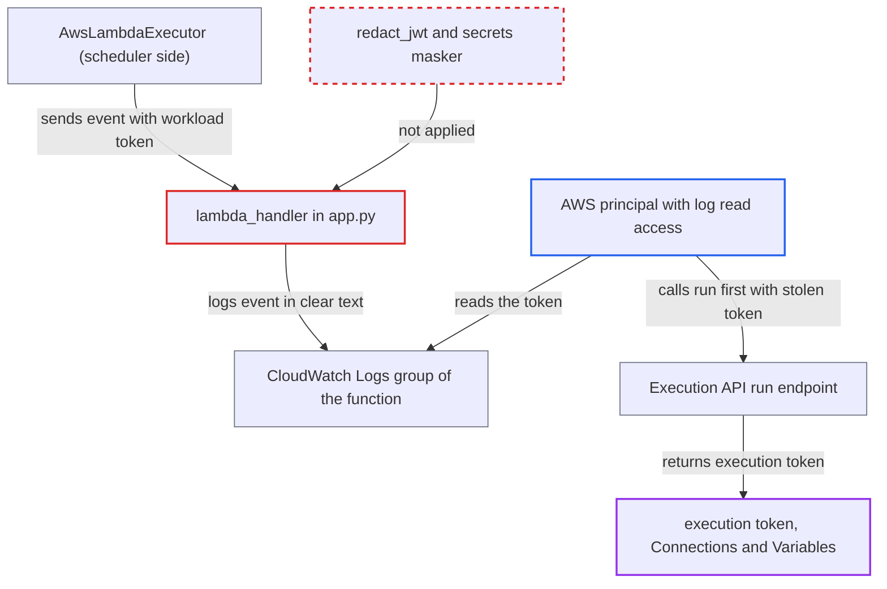

# Lambda executor handler logs workload Execution API JWT to CloudWatch

| Field | Value |
|---|---|
| ID | `find_01SNhPpvr2YogLwsLooFMJ4i` |
| Severity | **Medium** |
| Status | open |
| CWE | CWE-532 — Sensitive information in log |
| Created | 2026-10-27T21:45:48.835154Z |
| Claude Security | https://claude.ai/security/findings/find_01SNhPpvr2YogLwsLooFMJ4i |

## Description

An AWS user who can read the Lambda function's CloudWatch log group can steal a live Execution API token for a queued task. With it they can read every Connection and Variable in plaintext and write Variables. The handler `lambda_handler` logs the whole invocation event at INFO, and that event carries the workload JWT. Airflow's secret masking and JWT redaction do not apply to this logger.

1. **the executor `AwsLambdaExecutor`** builds a command that contains the serialized workload. The command is `--json-string` followed by `workload.model_dump_json()`, and that JSON includes the workload's `token` field, a `workload`-scope Execution API JWT. ([`providers/amazon/src/airflow/providers/amazon/aws/executors/aws_lambda/lambda_executor.py:331-339`](https://github.com/cx-benchmark/airflow/blob/a462d683469bb9f55646b0515ef84c41e16650fb/providers/amazon/src/airflow/providers/amazon/aws/executors/aws_lambda/lambda_executor.py#L331-L339))
2. **the executor `AwsLambdaExecutor`** invokes the Lambda function asynchronously with the command in the payload. Lambda passes this payload to the handler as `event`. ([`providers/amazon/src/airflow/providers/amazon/aws/executors/aws_lambda/lambda_executor.py:367-384`](https://github.com/cx-benchmark/airflow/blob/a462d683469bb9f55646b0515ef84c41e16650fb/providers/amazon/src/airflow/providers/amazon/aws/executors/aws_lambda/lambda_executor.py#L367-L384))
3. **the handler `lambda_handler`** logs the whole event as its first statement. The root logger is at INFO and the call is `log.info("Received event: %s", event)`. It runs before the optional S3 Dag sync and before the task subprocess starts, and the stdlib logger bypasses `redact_jwt` and the sensitive-field masking. ([`providers/amazon/src/airflow/providers/amazon/aws/executors/aws_lambda/docker/app.py:52-66`](https://github.com/cx-benchmark/airflow/blob/a462d683469bb9f55646b0515ef84c41e16650fb/providers/amazon/src/airflow/providers/amazon/aws/executors/aws_lambda/docker/app.py#L52-L66))
4. **attacker** reads the function's CloudWatch log group and copies the token from the `Received event` line. The Lambda runtime forwards the handler's output to CloudWatch Logs, and the Airflow UI's per-Dag log authorization does not govern who can read it. ([`providers/amazon/docs/executors/lambda-executor.rst:273-280`](https://github.com/cx-benchmark/airflow/blob/a462d683469bb9f55646b0515ef84c41e16650fb/providers/amazon/docs/executors/lambda-executor.rst#L273-L280))
5. **attacker** sends `PATCH /task-instances/{id}/run` with the stolen token before the legitimate worker does. The endpoint accepts the start only while the task instance is still `QUEUED`. The worker's own call comes only after its subprocess has started and imported Airflow. ([`airflow-core/src/airflow/api_fastapi/execution_api/routes/task_instances.py:259-270`](https://github.com/cx-benchmark/airflow/blob/a462d683469bb9f55646b0515ef84c41e16650fb/airflow-core/src/airflow/api_fastapi/execution_api/routes/task_instances.py#L259-L270))
6. **the Execution API `/run` route** returns an `execution`-scope token to the attacker. The first caller wins, so the legitimate worker's later `/run` call gets 409. The new token can read every Connection and Variable and keeps renewing while it is presented. ([`airflow-core/src/airflow/api_fastapi/execution_api/routes/task_instances.py:422-424`](https://github.com/cx-benchmark/airflow/blob/a462d683469bb9f55646b0515ef84c41e16650fb/airflow-core/src/airflow/api_fastapi/execution_api/routes/task_instances.py#L422-L424))

## Assessment

The attacker is an AWS principal who can read the function's log group. Examples are a holder of `CloudWatchLogsReadOnlyAccess`, a log-subscription consumer, or task code running in the function under the documented `CloudWatchLogsFullAccess` role, which can read other tasks' logged tokens. The attacker also needs network reach to the Execution API. They must win a race: the token is usable only until the legitimate worker calls `/run`, which takes seconds and longer with the S3 sync. The token is valid for `[scheduler] task_queued_timeout`, 600 s by default. If the handler raises after logging, for example on a failed S3 sync or a function timeout during it, Lambda's asynchronous retry re-invokes it while the task instance stays `QUEUED`. That widens the window to minutes. A failing task subprocess does not cause such a retry. The race is outside the attacker's control.

Impact: A winning attacker gets an `execution` token that reads every Connection and Variable in plaintext. It can also write Variables and the hijacked task's state and XComs, and it keeps renewing while it is presented. The hijacked task does not run as scheduled, because the worker's `/run` gets 409. A lost race yields only task identifiers and `executor_config`, which is logged on the same line.

## Recommendation

The shipped Lambda handler logs the raw invocation event. The event's `command` carries the workload's Execution API bearer token. The handler's stdlib logger bypasses Airflow's sensitive-field masking and JWT redaction, so every reader of the log group gets a usable token.

Fix criteria: No handler log output contains the workload token or the serialized workload that carries it, on a first invocation, a retry or a failure. To verify, invoke the function with a workload payload. The CloudWatch stream must hold no `eyJ` JWT and no `--json-string` value. The task must still run, and the SQS result message must still be sent.

## Evidence

**https://github.com/cx-benchmark/airflow**

- [`providers/amazon/src/airflow/providers/amazon/aws/executors/aws_lambda/docker/app.py:52-66`](https://github.com/cx-benchmark/airflow/blob/a462d683469bb9f55646b0515ef84c41e16650fb/providers/amazon/src/airflow/providers/amazon/aws/executors/aws_lambda/docker/app.py#L52-L66)
- [`providers/amazon/src/airflow/providers/amazon/aws/executors/aws_lambda/lambda_executor.py:331-339`](https://github.com/cx-benchmark/airflow/blob/a462d683469bb9f55646b0515ef84c41e16650fb/providers/amazon/src/airflow/providers/amazon/aws/executors/aws_lambda/lambda_executor.py#L331-L339)
- [`providers/amazon/src/airflow/providers/amazon/aws/executors/aws_lambda/lambda_executor.py:367-384`](https://github.com/cx-benchmark/airflow/blob/a462d683469bb9f55646b0515ef84c41e16650fb/providers/amazon/src/airflow/providers/amazon/aws/executors/aws_lambda/lambda_executor.py#L367-L384)
- [`providers/amazon/src/airflow/providers/amazon/aws/executors/aws_lambda/docker/Dockerfile:108-111`](https://github.com/cx-benchmark/airflow/blob/a462d683469bb9f55646b0515ef84c41e16650fb/providers/amazon/src/airflow/providers/amazon/aws/executors/aws_lambda/docker/Dockerfile#L108-L111)
- [`airflow-core/src/airflow/executors/workloads/base.py:112-127`](https://github.com/cx-benchmark/airflow/blob/a462d683469bb9f55646b0515ef84c41e16650fb/airflow-core/src/airflow/executors/workloads/base.py#L112-L127)
- [`airflow-core/src/airflow/api_fastapi/execution_api/routes/task_instances.py:259-270`](https://github.com/cx-benchmark/airflow/blob/a462d683469bb9f55646b0515ef84c41e16650fb/airflow-core/src/airflow/api_fastapi/execution_api/routes/task_instances.py#L259-L270)
- [`airflow-core/src/airflow/api_fastapi/execution_api/routes/task_instances.py:422-424`](https://github.com/cx-benchmark/airflow/blob/a462d683469bb9f55646b0515ef84c41e16650fb/airflow-core/src/airflow/api_fastapi/execution_api/routes/task_instances.py#L422-L424)
- [`task-sdk/src/airflow/sdk/execution_time/supervisor.py:1745`](https://github.com/cx-benchmark/airflow/blob/a462d683469bb9f55646b0515ef84c41e16650fb/task-sdk/src/airflow/sdk/execution_time/supervisor.py#L1745)
- [`shared/logging/src/airflow_shared/logging/structlog.py:307-313`](https://github.com/cx-benchmark/airflow/blob/a462d683469bb9f55646b0515ef84c41e16650fb/shared/logging/src/airflow_shared/logging/structlog.py#L307-L313)
- [`providers/amazon/docs/executors/lambda-executor.rst:129-133`](https://github.com/cx-benchmark/airflow/blob/a462d683469bb9f55646b0515ef84c41e16650fb/providers/amazon/docs/executors/lambda-executor.rst#L129-L133)
- [`providers/amazon/docs/executors/lambda-executor.rst:273-280`](https://github.com/cx-benchmark/airflow/blob/a462d683469bb9f55646b0515ef84c41e16650fb/providers/amazon/docs/executors/lambda-executor.rst#L273-L280)

