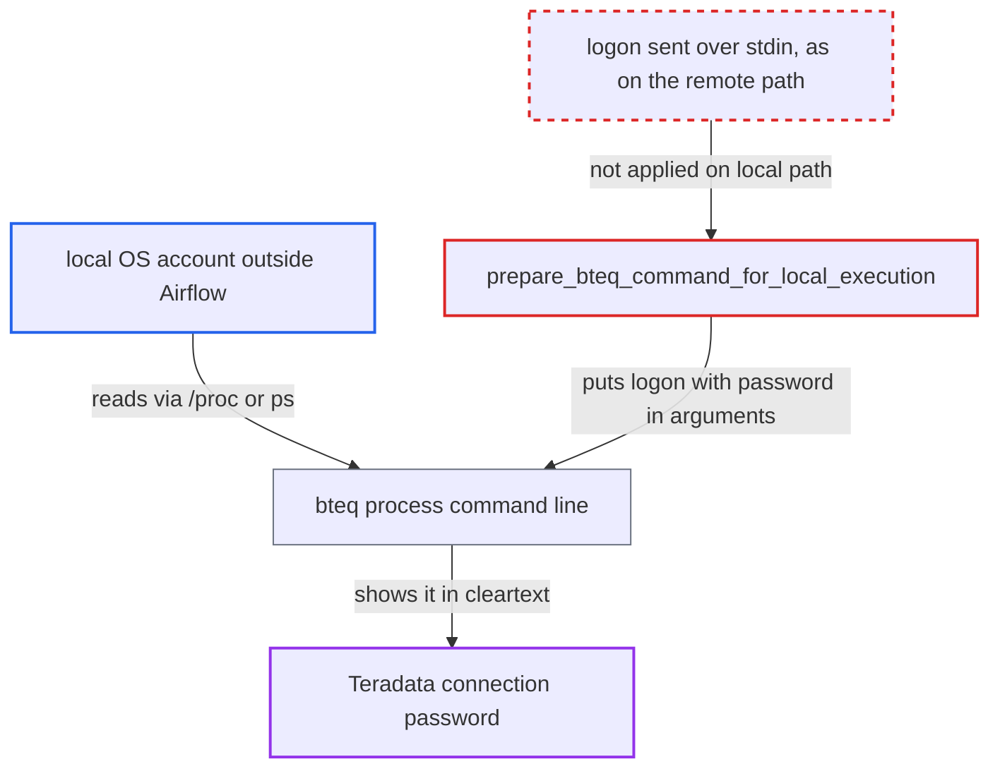

# Local BTEQ execution exposes Teradata connection password in bteq process argv

| Field | Value |
|---|---|
| ID | `find_014De76UjqjgHKmT4bxfjQj3` |
| Severity | **Medium** |
| Status | open |
| CWE | CWE-214 — Sensitive data in command line |
| Created | 2026-10-27T21:40:45.531801Z |
| Claude Security | https://claude.ai/security/findings/find_014De76UjqjgHKmT4bxfjQj3 |

## Description

A local operating-system account on an Airflow worker host that is not part of Airflow can read the Teradata connection password. The attack works only on a multi-user worker host without `hidepid` on `/proc`, while a local `BteqOperator` task runs. `prepare_bteq_command_for_local_execution` puts the cleartext password into the `bteq` command line.

1. **the operator `BteqOperator`** takes the local execution path. This happens whenever `ssh_conn_id` is unset, which is the default, and both `sql` and local `file_path` inputs reach `execute_bteq_script_at_local`. ([`providers/teradata/src/airflow/providers/teradata/operators/bteq.py:139-171`](https://github.com/cx-benchmark/airflow/blob/a462d683469bb9f55646b0515ef84c41e16650fb/providers/teradata/src/airflow/providers/teradata/operators/bteq.py#L139-L171))
2. **the function `prepare_bteq_command_for_local_execution`** appends the logon text to the `bteq` argument list. It adds ` .LOGON {host}/{login},{password}` as the last argument, using the cleartext password of the Airflow Teradata Connection. ([`providers/teradata/src/airflow/providers/teradata/utils/bteq_util.py:151-164`](https://github.com/cx-benchmark/airflow/blob/a462d683469bb9f55646b0515ef84c41e16650fb/providers/teradata/src/airflow/providers/teradata/utils/bteq_util.py#L151-L164))
3. **the hook method `execute_bteq_script_at_local`** starts `bteq` with `subprocess.Popen` and waits with `communicate()`. There is no timeout, so the process and its arguments stay visible for the whole BTEQ job, and only the SQL script goes over stdin. ([`providers/teradata/src/airflow/providers/teradata/hooks/bteq.py:252-272`](https://github.com/cx-benchmark/airflow/blob/a462d683469bb9f55646b0515ef84c41e16650fb/providers/teradata/src/airflow/providers/teradata/hooks/bteq.py#L252-L272))
4. **a local account outside Airflow** reads the command line of the running `bteq` process. On Linux it polls `/proc/<pid>/cmdline` or runs `ps -ef`, which any account in the same PID namespace can do unless `/proc` is mounted with `hidepid`.
5. **the attacker** uses the recovered host, login and password against Teradata. The credentials are valid for the database, so the attacker can act as the connection user.

## Assessment

The attacker holds an unprivileged local OS account on an Airflow worker host where TTU and `bteq` are installed, or runs a process in a shared PID namespace. The account is not an Airflow user. The host must be multi-user, `/proc` must not be mounted with `hidepid`, and a local `BteqOperator` task must be running, which is the default mode. No Airflow privilege and no victim action are needed. The report assumes the proprietary `bteq` binary does not scrub its own arguments. If it did, a short race window between start and scrub would remain.

Impact: The attacker learns the host, login and cleartext password of the Teradata connection, which Airflow otherwise keeps masked. Only connections of tasks that run while the attacker is watching are exposed. No Airflow state changes. Airflow users and task code gain nothing, since they can already read connections by design.

Subsequent-system impact: With the stolen credentials the attacker can log in to the Teradata database as the connection user. They can run any SQL, DDL or administrative BTEQ that the account is allowed. That means reading and changing warehouse data outside Airflow.

## Recommendation

`prepare_bteq_command_for_local_execution` puts the Teradata `.LOGON` credentials into the argument list of the locally started `bteq` process. The operating system shows that list to all local accounts, which exposes the stored connection password.

Fix criteria: The Teradata password reaches `bteq` only through stdin or another channel readable by the owner alone, never as a process argument. One way is to put the `.LOGON` line in the stdin script, as the remote path does. To verify, run a local `BteqOperator` task and read `/proc/<bteq pid>/cmdline` and `ps -ef` from another account. Neither may show the connection password. The job must still authenticate.

## Evidence

**https://github.com/cx-benchmark/airflow**

- [`providers/teradata/src/airflow/providers/teradata/utils/bteq_util.py:151-164`](https://github.com/cx-benchmark/airflow/blob/a462d683469bb9f55646b0515ef84c41e16650fb/providers/teradata/src/airflow/providers/teradata/utils/bteq_util.py#L151-L164)
- [`providers/teradata/src/airflow/providers/teradata/hooks/bteq.py:252-272`](https://github.com/cx-benchmark/airflow/blob/a462d683469bb9f55646b0515ef84c41e16650fb/providers/teradata/src/airflow/providers/teradata/hooks/bteq.py#L252-L272)
- [`providers/teradata/src/airflow/providers/teradata/operators/bteq.py:139-171`](https://github.com/cx-benchmark/airflow/blob/a462d683469bb9f55646b0515ef84c41e16650fb/providers/teradata/src/airflow/providers/teradata/operators/bteq.py#L139-L171)
- [`providers/teradata/src/airflow/providers/teradata/utils/bteq_util.py:91-100`](https://github.com/cx-benchmark/airflow/blob/a462d683469bb9f55646b0515ef84c41e16650fb/providers/teradata/src/airflow/providers/teradata/utils/bteq_util.py#L91-L100)
- [`providers/teradata/src/airflow/providers/teradata/utils/encryption_utils.py:46-48`](https://github.com/cx-benchmark/airflow/blob/a462d683469bb9f55646b0515ef84c41e16650fb/providers/teradata/src/airflow/providers/teradata/utils/encryption_utils.py#L46-L48)

