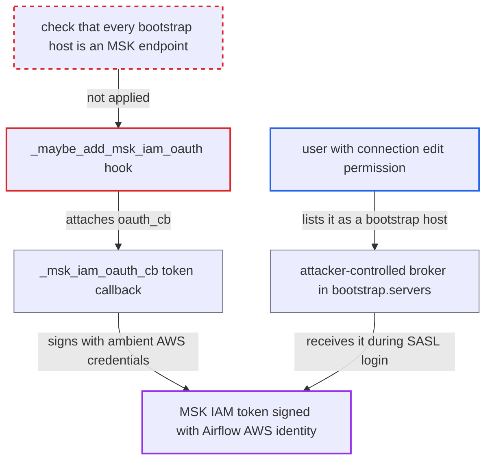

# MSK IAM token sent to arbitrary broker when any bootstrap entry looks like MSK

| Field | Value |
|---|---|
| ID | `find_01SSZNsoEFBg86v4cjowntLs` |
| Severity | **Medium** |
| Status | open |
| CWE | CWE-522 — Insufficiently Protected Credentials |
| Created | 2026-10-27T21:44:57.774158Z |
| Claude Security | https://claude.ai/security/findings/find_01SSZNsoEFBg86v4cjowntLs |

## Description

A user who can edit connections can make Airflow send a replayable Amazon MSK IAM token to a server they control. The token is signed with the Airflow process's own AWS identity. It needs the `msk` extra, AWS credentials on the process, and a Kafka connection using `OAUTHBEARER`. `_maybe_add_msk_iam_oauth` attaches the token callback when any one `bootstrap.servers` entry looks like MSK.

1. **attacker with connection edit permission** edits a Kafka connection used by a DAG. They set `bootstrap.servers` to `attacker.example:9092,b-1.none.c2.kafka.us-east-1.amazonaws.com:9098`, `security.protocol` to `SASL_PLAINTEXT` and `sasl.mechanisms` to `OAUTHBEARER`; the MSK-shaped entry may simply not resolve. ([`providers/apache/kafka/src/airflow/providers/apache/kafka/hooks/base.py:156-183`](https://github.com/cx-benchmark/airflow/blob/a462d683469bb9f55646b0515ef84c41e16650fb/providers/apache/kafka/src/airflow/providers/apache/kafka/hooks/base.py#L156-L183))
2. **the hook `_maybe_add_msk_iam_oauth`** runs `MSK_BOOTSTRAP_SERVERS_REGEX.search` on the whole `bootstrap.servers` string. The regex ends in the lookahead `(?=$|[,\s])`, so it matches one entry inside a list and never requires the other entries to be MSK hosts. ([`providers/apache/kafka/src/airflow/providers/apache/kafka/hooks/base.py:43-46`](https://github.com/cx-benchmark/airflow/blob/a462d683469bb9f55646b0515ef84c41e16650fb/providers/apache/kafka/src/airflow/providers/apache/kafka/hooks/base.py#L43-L46))
3. **the hook `_maybe_add_msk_iam_oauth`** sets `oauth_cb` to `partial(_msk_iam_oauth_cb, region)` on the client config. The other bootstrap entries, including the attacker's host, stay in the config unchanged. ([`providers/apache/kafka/src/airflow/providers/apache/kafka/hooks/base.py:205-228`](https://github.com/cx-benchmark/airflow/blob/a462d683469bb9f55646b0515ef84c41e16650fb/providers/apache/kafka/src/airflow/providers/apache/kafka/hooks/base.py#L205-L228))
4. **a worker, the triggerer, or another Airflow process that builds the client** creates a `Producer` or `Consumer` from the connection on the next run. `get_conn` calls `_build_config`. Workers run the produce and consume operators, and the triggerer runs the Kafka triggers. ([`providers/apache/kafka/src/airflow/providers/apache/kafka/hooks/produce.py:34-39`](https://github.com/cx-benchmark/airflow/blob/a462d683469bb9f55646b0515ef84c41e16650fb/providers/apache/kafka/src/airflow/providers/apache/kafka/hooks/produce.py#L34-L39))
5. **librdkafka with `_msk_iam_oauth_cb`** authenticates to the attacker's broker and presents a freshly signed token. `MSKAuthTokenProvider.generate_auth_token(region)` signs the token with the process's ambient AWS credentials, and librdkafka sends it to whichever broker it connects to. ([`providers/apache/kafka/src/airflow/providers/apache/kafka/hooks/base.py:49-66`](https://github.com/cx-benchmark/airflow/blob/a462d683469bb9f55646b0515ef84c41e16650fb/providers/apache/kafka/src/airflow/providers/apache/kafka/hooks/base.py#L49-L66))
6. **attacker** replays the received token against IAM-auth MSK clusters in that region. The token is a region-scoped presigned `kafka-cluster:Connect` URL, not tied to a cluster, and it is valid for about 900 s.

## Assessment

The attacker needs permission to edit connections (`requires_access_connection(method="PUT")`). The deployment must have the `msk` extra installed and AWS credentials available to the Airflow process (environment, instance role or IRSA). The attacker changes a Kafka connection that a DAG uses, and the token leaks on the next scheduled task or trigger run. The client is built on workers, in the triggerer, in the scheduler or API server when the event-producer plugin is enabled (off by default), and in the API server when `test_connection` is enabled. Setting `oauth_cb` directly as a string is refused unless allowlisted, and the allowlist is empty by default, so this flaw is the way to get the token.

Impact: The attacker obtains a signed MSK IAM token derived from the Airflow component's AWS identity, and a fresh one each time a client is rebuilt from the connection. The connection-editing role is not meant to get this credential material. No Airflow data is modified.

Subsequent-system impact: For about 15 minutes per token, the attacker can authenticate as the Airflow AWS identity to IAM-auth MSK clusters in the region that they can reach over the network. They can use that identity's Kafka permissions, which a DAG's connection typically grants for reading or producing topic data. The token only works for the `kafka-cluster` service and only within what the identity's IAM policy allows.

## Recommendation

The MSK token callback is attached when any one entry of the editable `bootstrap.servers` list looks like an MSK endpoint. The client then authenticates to every entry, so the token can reach arbitrary hosts.

Fix criteria: `oauth_cb` is attached only when every host in `bootstrap.servers` is an MSK endpoint and all entries share one region. The list is split into entries, the host part is taken alone, and the MSK match is anchored at the end of the hostname. A mixed or non-MSK list gets no `oauth_cb`. A test confirms that `attacker.example:9092,b-1.x.c2.kafka.us-east-1.amazonaws.com:9098` gets no callback. A test confirms that an all-MSK list still gets one. The existing test that expects a mixed list to match is updated.

## Evidence

**https://github.com/cx-benchmark/airflow**

- [`providers/apache/kafka/src/airflow/providers/apache/kafka/hooks/base.py:205-228`](https://github.com/cx-benchmark/airflow/blob/a462d683469bb9f55646b0515ef84c41e16650fb/providers/apache/kafka/src/airflow/providers/apache/kafka/hooks/base.py#L205-L228)
- [`providers/apache/kafka/src/airflow/providers/apache/kafka/hooks/base.py:43-46`](https://github.com/cx-benchmark/airflow/blob/a462d683469bb9f55646b0515ef84c41e16650fb/providers/apache/kafka/src/airflow/providers/apache/kafka/hooks/base.py#L43-L46)
- [`providers/apache/kafka/src/airflow/providers/apache/kafka/hooks/base.py:49-66`](https://github.com/cx-benchmark/airflow/blob/a462d683469bb9f55646b0515ef84c41e16650fb/providers/apache/kafka/src/airflow/providers/apache/kafka/hooks/base.py#L49-L66)
- [`providers/apache/kafka/src/airflow/providers/apache/kafka/hooks/base.py:156-183`](https://github.com/cx-benchmark/airflow/blob/a462d683469bb9f55646b0515ef84c41e16650fb/providers/apache/kafka/src/airflow/providers/apache/kafka/hooks/base.py#L156-L183)
- [`providers/apache/kafka/tests/unit/apache/kafka/hooks/test_base.py:294-297`](https://github.com/cx-benchmark/airflow/blob/a462d683469bb9f55646b0515ef84c41e16650fb/providers/apache/kafka/tests/unit/apache/kafka/hooks/test_base.py#L294-L297)
- [`providers/apache/kafka/src/airflow/providers/apache/kafka/hooks/produce.py:34-39`](https://github.com/cx-benchmark/airflow/blob/a462d683469bb9f55646b0515ef84c41e16650fb/providers/apache/kafka/src/airflow/providers/apache/kafka/hooks/produce.py#L34-L39)
- [`providers/apache/kafka/src/airflow/providers/apache/kafka/plugins/event_producer.py:181-202`](https://github.com/cx-benchmark/airflow/blob/a462d683469bb9f55646b0515ef84c41e16650fb/providers/apache/kafka/src/airflow/providers/apache/kafka/plugins/event_producer.py#L181-L202)
- [`airflow-core/docs/security/security_model.rst:1064-1074`](https://github.com/cx-benchmark/airflow/blob/a462d683469bb9f55646b0515ef84c41e16650fb/airflow-core/docs/security/security_model.rst#L1064-L1074)

