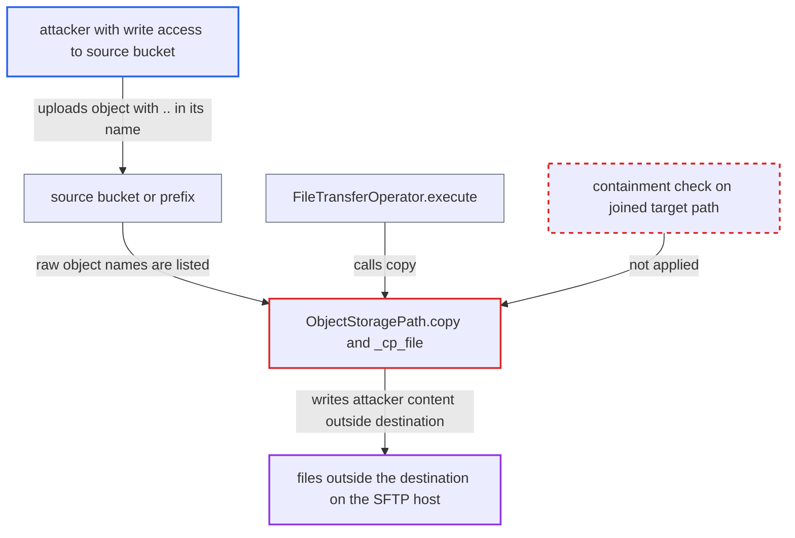

# ObjectStoragePath cross-store copy joins untrusted object keys onto destination, enabling path traversal

| Field | Value |
|---|---|
| ID | `find_01UxGrXP8GobojBRaYY3K9mo` |
| Severity | **Medium** |
| Status | open |
| CWE | CWE-23 — Path traversal |
| Created | 2026-10-27T22:10:13.889699Z |
| Claude Security | https://claude.ai/security/findings/find_01UxGrXP8GobojBRaYY3K9mo |

## Description

Anyone who can create objects in a source bucket or prefix can make an Airflow cross-store copy write files outside the destination directory on an SFTP server. The files have attacker-chosen content and are written with the privileges of Airflow's SFTP connection. This needs a configured transfer such as `FileTransferOperator` copying from an object store to `sftp://` or `ssh://`. The cause is `_cp_file`, which joins the raw object key onto the destination without checking containment.

1. **attacker** uploads an object whose name contains `..` segments to the source bucket or prefix. For example `incoming/../../../home/svc/.ssh/authorized_keys`, with content the attacker chose. GCS forbids only names that are exactly `.` or `..`, and S3 accepts any UTF-8 key.
2. **the DAG task `FileTransferOperator.execute`** calls `src.copy(dst)` with a source prefix on one store and a destination directory on another. The operator passes no `recursive` option, but the branch always expands the prefix. ([`providers/common/io/src/airflow/providers/common/io/operators/file_transfer.py:73-81`](https://github.com/cx-benchmark/airflow/blob/a462d683469bb9f55646b0515ef84c41e16650fb/providers/common/io/src/airflow/providers/common/io/operators/file_transfer.py#L73-L81))
3. **the cross-store branch of `copy()`** lists the source with `expand_path` and wraps each non-directory name in an `ObjectStoragePath`. The call is `self.fs.expand_path(self.path, recursive=True)`, which is always recursive. The raw names, including the attacker's, are passed to `_cp_file(dst)`. ([`task-sdk/src/airflow/sdk/io/path.py:397-423`](https://github.com/cx-benchmark/airflow/blob/a462d683469bb9f55646b0515ef84c41e16650fb/task-sdk/src/airflow/sdk/io/path.py#L397-L423))
4. **the property `key`** returns the object's path with only the leading `/` removed. The `..` segments in the object name are kept. ([`task-sdk/src/airflow/sdk/io/path.py:209-215`](https://github.com/cx-benchmark/airflow/blob/a462d683469bb9f55646b0515ef84c41e16650fb/task-sdk/src/airflow/sdk/io/path.py#L209-L215))
5. **the method `_cp_file`** builds the target as `dst / self.key` and opens it with `dst.open("wb")`. Nothing normalises the joined path or checks that it stays under `dst`. ([`task-sdk/src/airflow/sdk/io/path.py:343-355`](https://github.com/cx-benchmark/airflow/blob/a462d683469bb9f55646b0515ef84c41e16650fb/task-sdk/src/airflow/sdk/io/path.py#L343-L355))
6. **the SFTP backend `sshfs.SSHFileSystem`** sends the path to the SFTP server, which resolves the `..` segments. The file lands outside the destination directory, wherever the connection's account can write. ([`providers/sftp/src/airflow/providers/sftp/fs/sftp.py:26-65`](https://github.com/cx-benchmark/airflow/blob/a462d683469bb9f55646b0515ef84c41e16650fb/providers/sftp/src/airflow/providers/sftp/fs/sftp.py#L26-L65))

## Assessment

The attacker only needs to be able to create objects in the source bucket or prefix. No Airflow privilege and no victim action are needed. A transfer must be configured, such as a DAG with `FileTransferOperator(src="gs://conn@bucket/incoming", dst="sftp://conn@host/dest")`. Any cross-store `ObjectStoragePath.copy`, `move`, `copy_into` or `move_into` reaches the same code, because the last three go through `copy()`. The destination must be a hierarchical filesystem such as the shipped `sftp://` or `ssh://` backend. On a POSIX server the directory `<dst>/<source prefix>` must exist. It does in any deployment where the regular files of the same copy succeed, and the condition does not apply when the source is a bucket root. The report could not check the dependency behaviour it relies on (`universal-pathlib`, `sshfs`, `asyncssh`, `gcsfs`, `botocore`, `aiobotocore`), because the packages were not installed.

Impact: The attacker makes the task write files with chosen content at chosen paths on the destination server. Nothing is read back, and nothing on the Airflow worker is read or overwritten by this branch. The effect on Airflow itself is a limited integrity loss: its own transfer is turned against the destination it was told to confine. Destinations that are flat object stores are not affected.

Subsequent-system impact: On the SFTP host, the attacker can write files anywhere the connection's account can write, bounded only by that account's permissions or a chroot. Overwriting `authorized_keys`, scripts or application data is a serious integrity loss. Truncating files the account owns can disrupt services.

## Recommendation

`_cp_file` trusts the names returned by the source store's listing. It appends the raw key to the destination directory without normalising it or confirming that the result stays inside the destination.

Fix criteria: Every per-object target produced by `copy()` or `move()` resolves to a location strictly inside the caller's destination directory. The check treats both `/` and backslash as separators and handles `..`, empty and absolute components. Objects that fail the check are skipped, or the copy fails with an error naming the key. To verify, copy a `gs://` or `s3://` prefix containing `p/../../x` and a backslash-separated variant of the same name to an `sftp://` destination. Confirm that nothing is written outside the destination.

## Evidence

**https://github.com/cx-benchmark/airflow**

- [`task-sdk/src/airflow/sdk/io/path.py:343-355`](https://github.com/cx-benchmark/airflow/blob/a462d683469bb9f55646b0515ef84c41e16650fb/task-sdk/src/airflow/sdk/io/path.py#L343-L355)
- [`task-sdk/src/airflow/sdk/io/path.py:397-423`](https://github.com/cx-benchmark/airflow/blob/a462d683469bb9f55646b0515ef84c41e16650fb/task-sdk/src/airflow/sdk/io/path.py#L397-L423)
- [`task-sdk/src/airflow/sdk/io/path.py:209-215`](https://github.com/cx-benchmark/airflow/blob/a462d683469bb9f55646b0515ef84c41e16650fb/task-sdk/src/airflow/sdk/io/path.py#L209-L215)
- [`providers/common/io/src/airflow/providers/common/io/operators/file_transfer.py:73-81`](https://github.com/cx-benchmark/airflow/blob/a462d683469bb9f55646b0515ef84c41e16650fb/providers/common/io/src/airflow/providers/common/io/operators/file_transfer.py#L73-L81)
- [`providers/sftp/src/airflow/providers/sftp/fs/sftp.py:26-65`](https://github.com/cx-benchmark/airflow/blob/a462d683469bb9f55646b0515ef84c41e16650fb/providers/sftp/src/airflow/providers/sftp/fs/sftp.py#L26-L65)
- [`task-sdk/src/airflow/sdk/io/path.py:428-483`](https://github.com/cx-benchmark/airflow/blob/a462d683469bb9f55646b0515ef84c41e16650fb/task-sdk/src/airflow/sdk/io/path.py#L428-L483)

