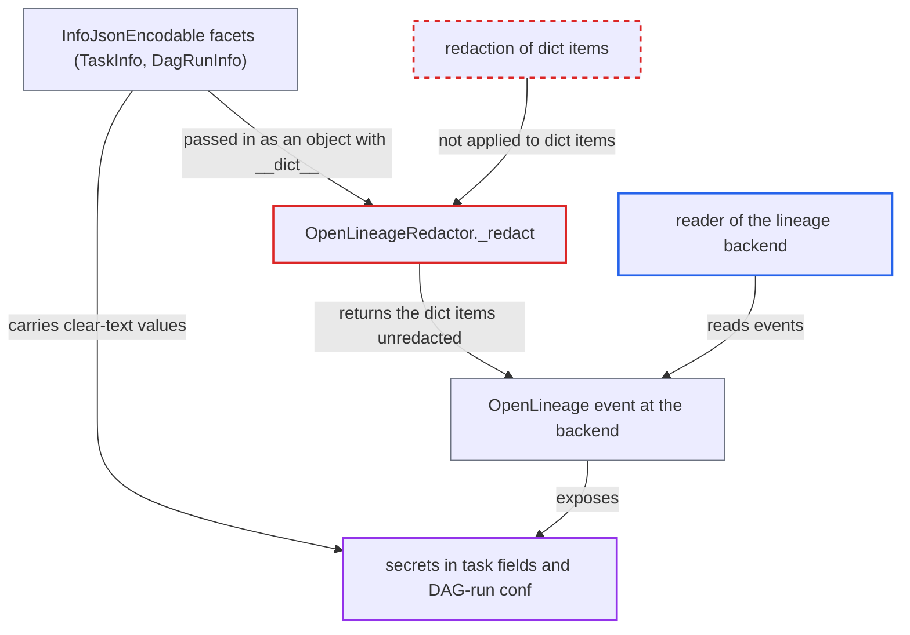

# OpenLineage redactor skips dict content of InfoJsonEncodable facets, leaking secrets to lineage backend

| Field | Value |
|---|---|
| ID | `find_01EwtWUTRgy14JtNi4t7tNR1` |
| Severity | **Medium** |
| Status | open |
| CWE | CWE-212 — Information exposure |
| Created | 2026-10-27T21:40:45.591190Z |
| Claude Security | https://claude.ai/security/findings/find_01EwtWUTRgy14JtNi4t7tNR1 |

## Description

Secrets in Airflow task fields and DAG-run `conf` are sent unmasked in OpenLineage events, so anyone who can read events at the lineage backend sees Connection passwords, Variable values and sensitive-named keys in clear text. It needs an OpenLineage transport to be configured and secret-bearing task fields. The cause is `OpenLineageRedactor._redact`, which skips the dict items of `InfoJsonEncodable` objects.

1. **the task runner** renders templates and redacts them only for the API server. The operator object keeps the clear-text values, such as Connection and Variable values, when the listener hook `on_task_instance_running` fires. ([`task-sdk/src/airflow/sdk/execution_time/task_runner.py:1509-1534`](https://github.com/cx-benchmark/airflow/blob/a462d683469bb9f55646b0515ef84c41e16650fb/task-sdk/src/airflow/sdk/execution_time/task_runner.py#L1509-L1534))
2. **the function `get_airflow_run_facet`** puts `TaskInfo`, `DagRunInfo`, `DagInfo` and `TaskInstanceInfo` into `AirflowRunFacet`. The listener attaches this facet to every task START, COMPLETE and FAIL event. ([`providers/openlineage/src/airflow/providers/openlineage/utils/utils.py:1547-1568`](https://github.com/cx-benchmark/airflow/blob/a462d683469bb9f55646b0515ef84c41e16650fb/providers/openlineage/src/airflow/providers/openlineage/utils/utils.py#L1547-L1568))
3. **the class `InfoJsonEncodable`** stores each field twice, as an instance attribute and as a dict item. It is a `dict` subclass, and only the dict items are serialized, but the object also has a `__dict__`. ([`providers/openlineage/src/airflow/providers/openlineage/utils/utils.py:859-956`](https://github.com/cx-benchmark/airflow/blob/a462d683469bb9f55646b0515ef84c41e16650fb/providers/openlineage/src/airflow/providers/openlineage/utils/utils.py#L859-L956))
4. **the method `OpenLineageAdapter.emit()`** passes the event to `OpenLineageRedactor.redact` as its only sanitizing step. The redacted event is then handed to the client transport. ([`providers/openlineage/src/airflow/providers/openlineage/plugins/adapter.py:172-204`](https://github.com/cx-benchmark/airflow/blob/a462d683469bb9f55646b0515ef84c41e16650fb/providers/openlineage/src/airflow/providers/openlineage/plugins/adapter.py#L172-L204))
5. **the method `OpenLineageRedactor._redact`** redacts only the instance attributes with `setattr` and returns the same object. The dict items that get serialized stay untouched, so neither key-name nor pattern redaction applies. The code reaches `SecretsMasker._redact` only when some value is not JSON-serializable. ([`providers/openlineage/src/airflow/providers/openlineage/utils/utils.py:2486-2502`](https://github.com/cx-benchmark/airflow/blob/a462d683469bb9f55646b0515ef84c41e16650fb/providers/openlineage/src/airflow/providers/openlineage/utils/utils.py#L2486-L2502))
6. **the OpenLineage client** sends the event with the clear-text values over the configured HTTP or Kafka transport. Fields such as `parameters`, `preoperator`, `postoperator`, `pass_value` and the DAG-run `conf` carry the secrets. With `include_full_task_info`, every operator attribute such as `op_kwargs` is included too. ([`providers/openlineage/src/airflow/providers/openlineage/utils/utils.py:1354-1470`](https://github.com/cx-benchmark/airflow/blob/a462d683469bb9f55646b0515ef84c41e16650fb/providers/openlineage/src/airflow/providers/openlineage/utils/utils.py#L1354-L1470))

## Assessment

No action against Airflow is needed. Any task whose included `TaskInfo` fields (for example SQL `parameters`, `preoperator`, or `op_kwargs` with `include_full_task_info`) or whose DAG-run `conf` hold a Connection password, Variable or sensitive-named key has it written into the `airflow` run facet. The OpenLineage transport must be configured. The reader is whoever can read events at the lineage backend, and these readers are not trusted with Airflow secrets. The leak happens whenever the whole object is JSON-serializable, which is the normal case for ordinary operators and for `DagRunInfo` built on the worker. The report assumes `openlineage-python>=1.52.0` serializes dict values by their items.

Impact: Anyone who can read events at the lineage backend gets clear-text Connection passwords, Variable values and other secrets. The same values are masked as `***` in the Airflow UI and API. Airflow's own integrity and availability are not affected.

## Recommendation

(1) `OpenLineageRedactor._redact` treats a JSON-serializable object with `__dict__` as attribute-only. It never redacts the items of `dict` subclasses, so the content of `InfoJsonEncodable` facets escapes key-name and pattern redaction.

Fix criteria: Every mapping placed in an event, including `dict` subclasses such as `InfoJsonEncodable`, has its items redacted by the same rules as a plain dict before emission. The `__dict__` branch no longer shadows mapping handling. A test builds an `AirflowRunFacet` whose `TaskInfo` has `parameters={"password": "x"}` and whose `DagRunInfo.conf` holds a registered secret. It redacts the facet and asserts that the `Serde.to_json` output contains `***` and not the secret, for both JSON-serializable and non-serializable variants.

(2) `InfoJsonEncodable` keeps the emitted data in two places, as instance attributes and as dict items. A redactor that rewrites one can miss the other.

Fix criteria: The serialized form of each Info object has a single source of truth, such as a plain dict, so redaction of what is emitted cannot diverge from what is stored. A regression test asserts that redacting an `InfoJsonEncodable` changes what `json.dumps(obj)` returns.

## Evidence

**https://github.com/cx-benchmark/airflow**

- [`providers/openlineage/src/airflow/providers/openlineage/utils/utils.py:2486-2502`](https://github.com/cx-benchmark/airflow/blob/a462d683469bb9f55646b0515ef84c41e16650fb/providers/openlineage/src/airflow/providers/openlineage/utils/utils.py#L2486-L2502)
- [`providers/openlineage/src/airflow/providers/openlineage/utils/utils.py:859-956`](https://github.com/cx-benchmark/airflow/blob/a462d683469bb9f55646b0515ef84c41e16650fb/providers/openlineage/src/airflow/providers/openlineage/utils/utils.py#L859-L956)
- [`providers/openlineage/src/airflow/providers/openlineage/utils/utils.py:1354-1470`](https://github.com/cx-benchmark/airflow/blob/a462d683469bb9f55646b0515ef84c41e16650fb/providers/openlineage/src/airflow/providers/openlineage/utils/utils.py#L1354-L1470)
- [`providers/openlineage/src/airflow/providers/openlineage/utils/utils.py:1030-1052`](https://github.com/cx-benchmark/airflow/blob/a462d683469bb9f55646b0515ef84c41e16650fb/providers/openlineage/src/airflow/providers/openlineage/utils/utils.py#L1030-L1052)
- [`providers/openlineage/src/airflow/providers/openlineage/plugins/adapter.py:172-204`](https://github.com/cx-benchmark/airflow/blob/a462d683469bb9f55646b0515ef84c41e16650fb/providers/openlineage/src/airflow/providers/openlineage/plugins/adapter.py#L172-L204)
- [`providers/openlineage/src/airflow/providers/openlineage/utils/utils.py:1547-1568`](https://github.com/cx-benchmark/airflow/blob/a462d683469bb9f55646b0515ef84c41e16650fb/providers/openlineage/src/airflow/providers/openlineage/utils/utils.py#L1547-L1568)
- [`task-sdk/src/airflow/sdk/execution_time/task_runner.py:1509-1534`](https://github.com/cx-benchmark/airflow/blob/a462d683469bb9f55646b0515ef84c41e16650fb/task-sdk/src/airflow/sdk/execution_time/task_runner.py#L1509-L1534)

