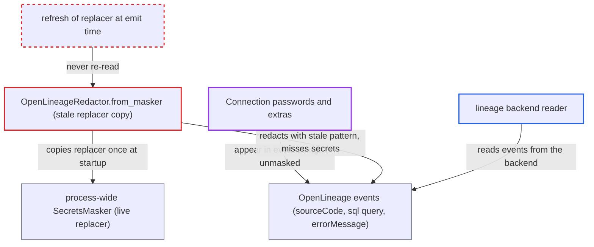

# OpenLineage redactor snapshots a stale secrets-masker replacer, so task-time secrets reach lineage events

| Field | Value |
|---|---|
| ID | `find_01GtA73X4d3mRJ43kc2Lc1NS` |
| Severity | **Medium** |
| Status | open |
| CWE | CWE-212 — Improper removal of sensitive information |
| Created | 2026-10-27T21:44:57.695759Z |
| Claude Security | https://claude.ai/security/findings/find_01GtA73X4d3mRJ43kc2Lc1NS |

## Description

Anyone who can read the configured lineage backend can see Connection passwords and extras in clear in OpenLineage events, while Airflow's own logs and UI mask the same values. This needs an OpenLineage transport and a secret that lands in an event string. The redactor built by `OpenLineageRedactor.from_masker` keeps a stale copy of the masker's `replacer`, so secrets registered later are not masked.

1. **the task runner `startup()`** loads listener plugins before the Dag is parsed. This builds the cached listener, which creates `OpenLineageAdapter` and its redactor before any Connection or Variable is resolved. ([`task-sdk/src/airflow/sdk/execution_time/task_runner.py:1294-1300`](https://github.com/cx-benchmark/airflow/blob/a462d683469bb9f55646b0515ef84c41e16650fb/task-sdk/src/airflow/sdk/execution_time/task_runner.py#L1294-L1300))
2. **`OpenLineageRedactor.from_masker`** copies `other.replacer` from the process-wide `SecretsMasker` once. The `replacer` is an immutable compiled pattern or `None`, so the copy never sees later changes. ([`providers/openlineage/src/airflow/providers/openlineage/utils/utils.py:2428-2436`](https://github.com/cx-benchmark/airflow/blob/a462d683469bb9f55646b0515ef84c41e16650fb/providers/openlineage/src/airflow/providers/openlineage/utils/utils.py#L2428-L2436))
3. **the task** resolves a Connection or Variable and registers its secret with `mask_secret`. This happens after the snapshot, and `add_mask` rebinds `self.replacer` on the original masker only. ([`shared/secrets_masker/src/airflow_shared/secrets_masker/secrets_masker.py:636-641`](https://github.com/cx-benchmark/airflow/blob/a462d683469bb9f55646b0515ef84c41e16650fb/shared/secrets_masker/src/airflow_shared/secrets_masker/secrets_masker.py#L636-L641))
4. **the task** puts the secret into an event field. By default the rendered `bash_command` is emitted as the `sourceCode` facet, and SQL text and exception text can also carry a secret. ([`providers/openlineage/src/airflow/providers/openlineage/extractors/bash.py:46-54`](https://github.com/cx-benchmark/airflow/blob/a462d683469bb9f55646b0515ef84c41e16650fb/providers/openlineage/src/airflow/providers/openlineage/extractors/bash.py#L46-L54))
5. **the redactor** fails to mask the secret in the string. Value-based masking of strings uses only `self.replacer`, which is stale or `None`, so the string comes back unchanged. ([`shared/secrets_masker/src/airflow_shared/secrets_masker/secrets_masker.py:420-426`](https://github.com/cx-benchmark/airflow/blob/a462d683469bb9f55646b0515ef84c41e16650fb/shared/secrets_masker/src/airflow_shared/secrets_masker/secrets_masker.py#L420-L426))
6. **the adapter `emit()`** sends the event with the secret to the lineage transport. Every event goes through the stale redactor before `self._client.emit(redacted_event)`. ([`providers/openlineage/src/airflow/providers/openlineage/plugins/adapter.py:172`](https://github.com/cx-benchmark/airflow/blob/a462d683469bb9f55646b0515ef84c41e16650fb/providers/openlineage/src/airflow/providers/openlineage/plugins/adapter.py#L172))
7. **lineage backend reader** reads the event and sees the password in clear. Airflow's own rendered-field redaction uses the live masker, so the UI shows `***` for the same value. ([`task-sdk/src/airflow/sdk/execution_time/task_runner.py:1433-1434`](https://github.com/cx-benchmark/airflow/blob/a462d683469bb9f55646b0515ef84c41e16650fb/task-sdk/src/airflow/sdk/execution_time/task_runner.py#L1433-L1434))

## Assessment

The attacker is anyone with read access to the configured lineage backend, such as an authenticated catalog or lineage user. They need no Airflow account and take no action against Airflow. It needs an OpenLineage transport to be configured and a task that puts a Connection password or extra into an event field. Examples are a rendered `BashOperator` command emitted as the `sourceCode` facet, a SQL statement emitted as the `sql` job facet `query`, and an exception text emitted as `errorMessage` on FAIL.

Impact: The attacker can read Connection passwords and extras that tasks use, as clear text in lineage events. They cannot choose which secrets leak, only those that appear by value in events. Key-name redaction still works, and the report names no integrity or availability impact.

## Recommendation

The OpenLineage redactor copies the masker's compiled `replacer` once, when the adapter is built during plugin load, and never re-reads it. Secrets registered later with `mask_secret` are not value-masked in emitted events.

Fix criteria: Events are redacted with the secrets registered with the process masker at emission time, not at adapter construction. To check, construct the adapter, then call `mask_secret("s3cr3t-value")`, then emit an event whose `sourceCode`, `sql` query or `errorMessage` contains that value. The serialized event must contain `***` and not the value.

## Evidence

**https://github.com/cx-benchmark/airflow**

- [`providers/openlineage/src/airflow/providers/openlineage/utils/utils.py:2428-2436`](https://github.com/cx-benchmark/airflow/blob/a462d683469bb9f55646b0515ef84c41e16650fb/providers/openlineage/src/airflow/providers/openlineage/utils/utils.py#L2428-L2436)
- [`shared/secrets_masker/src/airflow_shared/secrets_masker/secrets_masker.py:636-641`](https://github.com/cx-benchmark/airflow/blob/a462d683469bb9f55646b0515ef84c41e16650fb/shared/secrets_masker/src/airflow_shared/secrets_masker/secrets_masker.py#L636-L641)
- [`shared/secrets_masker/src/airflow_shared/secrets_masker/secrets_masker.py:420-426`](https://github.com/cx-benchmark/airflow/blob/a462d683469bb9f55646b0515ef84c41e16650fb/shared/secrets_masker/src/airflow_shared/secrets_masker/secrets_masker.py#L420-L426)
- [`providers/openlineage/src/airflow/providers/openlineage/plugins/adapter.py:81-86`](https://github.com/cx-benchmark/airflow/blob/a462d683469bb9f55646b0515ef84c41e16650fb/providers/openlineage/src/airflow/providers/openlineage/plugins/adapter.py#L81-L86)
- [`providers/openlineage/src/airflow/providers/openlineage/plugins/adapter.py:172`](https://github.com/cx-benchmark/airflow/blob/a462d683469bb9f55646b0515ef84c41e16650fb/providers/openlineage/src/airflow/providers/openlineage/plugins/adapter.py#L172)
- [`providers/openlineage/src/airflow/providers/openlineage/plugins/listener.py:1305-1308`](https://github.com/cx-benchmark/airflow/blob/a462d683469bb9f55646b0515ef84c41e16650fb/providers/openlineage/src/airflow/providers/openlineage/plugins/listener.py#L1305-L1308)
- [`task-sdk/src/airflow/sdk/execution_time/task_runner.py:1294-1300`](https://github.com/cx-benchmark/airflow/blob/a462d683469bb9f55646b0515ef84c41e16650fb/task-sdk/src/airflow/sdk/execution_time/task_runner.py#L1294-L1300)
- [`task-sdk/src/airflow/sdk/execution_time/context.py:187-192`](https://github.com/cx-benchmark/airflow/blob/a462d683469bb9f55646b0515ef84c41e16650fb/task-sdk/src/airflow/sdk/execution_time/context.py#L187-L192)
- [`task-sdk/src/airflow/sdk/execution_time/task_runner.py:1507-1534`](https://github.com/cx-benchmark/airflow/blob/a462d683469bb9f55646b0515ef84c41e16650fb/task-sdk/src/airflow/sdk/execution_time/task_runner.py#L1507-L1534)
- [`providers/openlineage/src/airflow/providers/openlineage/extractors/bash.py:46-54`](https://github.com/cx-benchmark/airflow/blob/a462d683469bb9f55646b0515ef84c41e16650fb/providers/openlineage/src/airflow/providers/openlineage/extractors/bash.py#L46-L54)
- [`task-sdk/src/airflow/sdk/execution_time/task_runner.py:1433-1434`](https://github.com/cx-benchmark/airflow/blob/a462d683469bb9f55646b0515ef84c41e16650fb/task-sdk/src/airflow/sdk/execution_time/task_runner.py#L1433-L1434)

