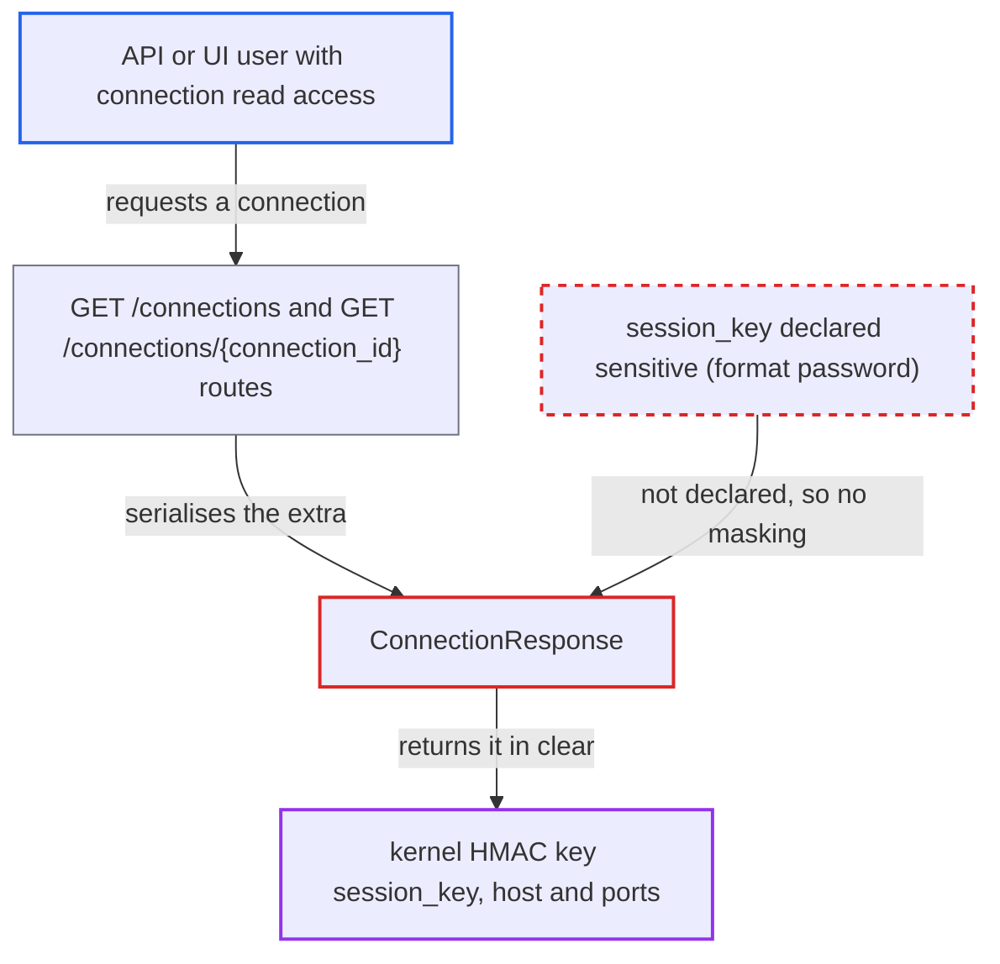

# Papermill `jupyter_kernel` session_key (kernel HMAC key) not declared sensitive, returned in clear by connections API

| Field | Value |
|---|---|
| ID | `find_019EBhvAEmchJHzBoxUvvGFW` |
| Severity | **Medium** |
| Status | open |
| CWE | CWE-212 — Sensitive information exposure |
| Created | 2026-10-27T22:01:18.593210Z |
| Claude Security | https://claude.ai/security/findings/find_019EBhvAEmchJHzBoxUvvGFW |

## Description

A logged-in API or UI user who may read connections, but who is meant to have write-only access to stored credentials, can read the remote Jupyter kernel's signing key in clear. The same response gives the kernel's host and ports. The Papermill `jupyter_kernel` connection type never declares `session_key` sensitive, and the masker does not recognise the name, so the connections API returns it unmasked.

1. **Provider `jupyter_kernel`** stores the kernel signing key in the connection extra `session_key`. The connection type declares no `conn-fields`, so nothing marks `session_key` as a password-format field. ([`providers/papermill/provider.yaml:95-98`](https://github.com/cx-benchmark/airflow/blob/a462d683469bb9f55646b0515ef84c41e16650fb/providers/papermill/provider.yaml#L95-L98))
2. **the hook `KernelHook`** reads `session_key` and uses it as the HMAC key for the remote kernel. The key becomes `key` of `KernelConnectionInfo` with `signature_scheme="hmac-sha256"`, so it is the secret that authenticates messages to the kernel. ([`providers/papermill/src/airflow/providers/papermill/hooks/kernel.py:116-126`](https://github.com/cx-benchmark/airflow/blob/a462d683469bb9f55646b0515ef84c41e16650fb/providers/papermill/src/airflow/providers/papermill/hooks/kernel.py#L116-L126))
3. **the masking code** decides not to mask `session_key`. The name matches no entry in the sensitive-field list, and no provider declared it with `format: password`. ([`shared/secrets_masker/src/airflow_shared/secrets_masker/secrets_masker.py:588-601`](https://github.com/cx-benchmark/airflow/blob/a462d683469bb9f55646b0515ef84c41e16650fb/shared/secrets_masker/src/airflow_shared/secrets_masker/secrets_masker.py#L588-L601))
4. **the attacker** calls `GET /api/v2/connections/{id}` or the list endpoint. These routes require only `requires_access_connection(method="GET")`, which the attacker's role has. ([`airflow-core/src/airflow/api_fastapi/core_api/routes/public/connections.py:200-258`](https://github.com/cx-benchmark/airflow/blob/a462d683469bb9f55646b0515ef84c41e16650fb/airflow-core/src/airflow/api_fastapi/core_api/routes/public/connections.py#L200-L258))
5. **`ConnectionResponse`** returns the extra unchanged. Only `redact_provider_sensitive_extra` and `redact_extra` are applied, and neither matches `session_key`, so the key, host and ports appear in the response. ([`airflow-core/src/airflow/api_fastapi/core_api/datamodels/connections.py:98-128`](https://github.com/cx-benchmark/airflow/blob/a462d683469bb9f55646b0515ef84c41e16650fb/airflow-core/src/airflow/api_fastapi/core_api/datamodels/connections.py#L98-L128))

## Assessment

The attacker is an authenticated API or UI principal who may read connections but is not entitled to read credentials. Examples are a custom FAB role or a Keycloak or AWS auth-manager policy for connection configuration, which the security model makes write-only. Admin and Op users are already allowed to see credentials. The attacker only calls `GET /api/v2/connections/{id}` or the list endpoint, or opens the UI editor that uses them. This works in the default configuration and needs no victim action. Only `session_key` values of connections the principal can read are exposed.

Impact: The attacker reads the kernel's message-signing key in clear, which breaks the write-only rule for connection credentials. Nothing in Airflow is modified and no service is degraded.

Subsequent-system impact: The key is the remote Jupyter kernel's message-authentication secret, and the same record gives the kernel's address and ports. An attacker who can reach those ports can sign execute requests and run arbitrary code in the kernel, with that kernel's access to its host and data. Whether the attacker can reach the kernel depends on the deployment.

## Recommendation

The `jupyter_kernel` connection type keeps its only credential, `session_key`, in an `extra` key that it never declares sensitive and whose name the masker does not recognise. The connections API therefore returns it in clear.

Fix criteria: `GET /api/v2/connections/{id}`, the list endpoint and the UI return `***` for a non-empty `session_key`, in both the plain and the `extra__jupyter_kernel__session_key` forms. A PATCH that sends the mask back keeps the stored key, and `KernelHook` still uses the stored value. To verify, create a connection with extra `{"session_key": "abc123def456"}` and check that no response contains `abc123def456`.

## Evidence

**https://github.com/cx-benchmark/airflow**

- [`providers/papermill/provider.yaml:95-98`](https://github.com/cx-benchmark/airflow/blob/a462d683469bb9f55646b0515ef84c41e16650fb/providers/papermill/provider.yaml#L95-L98)
- [`providers/papermill/src/airflow/providers/papermill/hooks/kernel.py:86`](https://github.com/cx-benchmark/airflow/blob/a462d683469bb9f55646b0515ef84c41e16650fb/providers/papermill/src/airflow/providers/papermill/hooks/kernel.py#L86)
- [`providers/papermill/src/airflow/providers/papermill/hooks/kernel.py:116-126`](https://github.com/cx-benchmark/airflow/blob/a462d683469bb9f55646b0515ef84c41e16650fb/providers/papermill/src/airflow/providers/papermill/hooks/kernel.py#L116-L126)
- [`airflow-core/src/airflow/api_fastapi/core_api/datamodels/connections.py:36-55`](https://github.com/cx-benchmark/airflow/blob/a462d683469bb9f55646b0515ef84c41e16650fb/airflow-core/src/airflow/api_fastapi/core_api/datamodels/connections.py#L36-L55)
- [`airflow-core/src/airflow/api_fastapi/core_api/datamodels/connections.py:98-128`](https://github.com/cx-benchmark/airflow/blob/a462d683469bb9f55646b0515ef84c41e16650fb/airflow-core/src/airflow/api_fastapi/core_api/datamodels/connections.py#L98-L128)
- [`shared/secrets_masker/src/airflow_shared/secrets_masker/secrets_masker.py:588-601`](https://github.com/cx-benchmark/airflow/blob/a462d683469bb9f55646b0515ef84c41e16650fb/shared/secrets_masker/src/airflow_shared/secrets_masker/secrets_masker.py#L588-L601)
- [`airflow-core/src/airflow/models/connection.py:511-512`](https://github.com/cx-benchmark/airflow/blob/a462d683469bb9f55646b0515ef84c41e16650fb/airflow-core/src/airflow/models/connection.py#L511-L512)
- [`airflow-core/src/airflow/api_fastapi/core_api/routes/public/connections.py:200-258`](https://github.com/cx-benchmark/airflow/blob/a462d683469bb9f55646b0515ef84c41e16650fb/airflow-core/src/airflow/api_fastapi/core_api/routes/public/connections.py#L200-L258)

