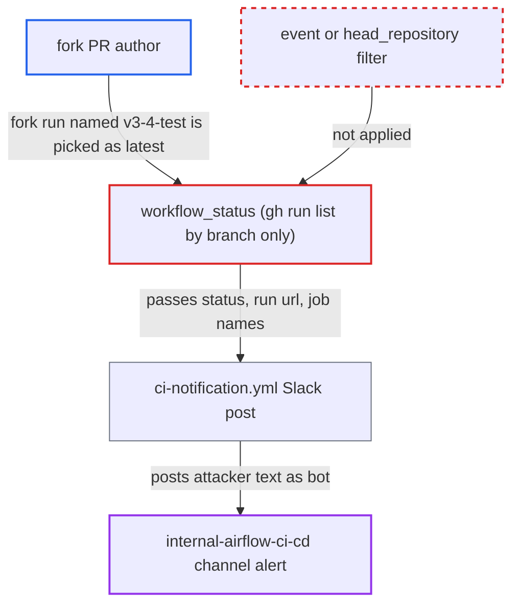

# Release-branch CI notification reads status and job names from fork PR runs matched by branch name

| Field | Value |
|---|---|
| ID | `find_012pCJhXcUdy25hBYwrNfzfT` |
| Severity | **Medium** |
| Status | open |
| CWE | CWE-20 — Improper input validation |
| Created | 2026-10-27T21:24:24.732202Z |
| Claude Security | https://claude.ai/security/findings/find_012pCJhXcUdy25hBYwrNfzfT |

## Description

A GitHub user with a fork pull request can make the Airflow CI bot post a false failure or recovery alert about the release branch `v3-4-test` in the maintainers' Slack channel. The alert carries attacker-chosen text, links and mentions. The attack needs a fork PR run, which a maintainer must approve unless the attacker is an `apache` org member. The cause is `workflow_status`, which picks the latest run by branch name only and does not filter on the run event.

1. **attacker** opens a pull request from a fork branch named `v3-4-test` against `apache:v3-4-test`. `ci-amd.yml` runs on pull requests targeting `v[0-9]+-[0-9]+-test`, and the PR's own workflow files are used, so the attacker can give a failing job a crafted name.
2. **GitHub Actions** records a `pull_request` run whose `head_branch` is `v3-4-test`. For `pull_request` events `head_branch` is the PR head branch in the contributor's fork, so it matches the release branch name.
3. **the function `workflow_status`** lists the latest run with `gh run list --workflow ci-amd.yml --branch v3-4-test --limit 1`. The `branch` filter matches `head_branch` and no `--event` filter is set, so the fork's run can be the newest match and is treated as the release branch's run. ([`dev/breeze/src/airflow_breeze/utils/workflow_status.py:43-76`](https://github.com/cx-benchmark/airflow/blob/a462d683469bb9f55646b0515ef84c41e16650fb/dev/breeze/src/airflow_breeze/utils/workflow_status.py#L43-L76))
4. **the script `workflow_status.py`** reads the run's `conclusion`, `url` and failed job names and writes them to `GITHUB_OUTPUT`. The job names come from the PR's workflow and go through an unquoted `failed-jobs<<EOF` heredoc, so a name line equal to `EOF` ends it early and later lines are parsed as extra `key=value` outputs such as `run-url`. ([`dev/breeze/src/airflow_breeze/utils/workflow_status.py:80-139`](https://github.com/cx-benchmark/airflow/blob/a462d683469bb9f55646b0515ef84c41e16650fb/dev/breeze/src/airflow_breeze/utils/workflow_status.py#L80-L139))
5. **the workflow `ci-notification.yml`** pastes `failed-jobs` and `run-url` into the Slack message and posts it with the project Slack token. The scheduled job runs twice a day on `main`, and the message goes to `internal-airflow-ci-cd` as a trusted bot alert. ([`.github/workflows/ci-notification.yml:50-101`](https://github.com/cx-benchmark/airflow/blob/a462d683469bb9f55646b0515ef84c41e16650fb/.github/workflows/ci-notification.yml#L50-L101))

## Assessment

The attacker is any GitHub user who can get a workflow run for a fork PR to `apache:v3-4-test`. Members of the `apache` org run without approval. Other users need a maintainer to approve one run, because PRs to release branches are not auto-approved. The attacker names the fork branch `v3-4-test` and gives a failing job a crafted name using Slack mrkdwn, a link or a mention. They push shortly before the 06:00 or 17:00 UTC schedule so that their run is the newest with that head branch. The alert can also be a false 'All passing' recovery, if the attacker's run is green while the real branch run is red.

Impact: The attacker can put a false 'Failure Alert' or false 'All passing' message about `v3-4-test` in the maintainers' channel, posted by the trusted CI bot. The text can include links disguised as the failure log and mentions such as `<!channel>`. The real status of the branch is not reported for that cycle. No secrets are disclosed and nothing in the repository changes.

## Recommendation

`workflow_status` selects the branch's latest run by `head_branch` only, so `pull_request` runs from forks with a same-named head branch count as runs of the release branch. Their contributor-defined job names are forwarded verbatim into the heredoc output and the Slack payload.

Fix criteria: The notification only considers runs of the trusted branch itself: the listing is restricted to `event` in schedule, workflow_dispatch and push, or to runs whose `head_repository` is `apache/airflow`. Multi-line outputs use a unique delimiter, and job names are escaped before going into the Slack payload. Opening a fork PR from a branch named `v3-4-test` shows the script ignoring its run.

## Evidence

**https://github.com/cx-benchmark/airflow**

- [`dev/breeze/src/airflow_breeze/utils/workflow_status.py:43-76`](https://github.com/cx-benchmark/airflow/blob/a462d683469bb9f55646b0515ef84c41e16650fb/dev/breeze/src/airflow_breeze/utils/workflow_status.py#L43-L76)
- [`dev/breeze/src/airflow_breeze/utils/workflow_status.py:80-139`](https://github.com/cx-benchmark/airflow/blob/a462d683469bb9f55646b0515ef84c41e16650fb/dev/breeze/src/airflow_breeze/utils/workflow_status.py#L80-L139)
- [`.github/workflows/ci-notification.yml:50-101`](https://github.com/cx-benchmark/airflow/blob/a462d683469bb9f55646b0515ef84c41e16650fb/.github/workflows/ci-notification.yml#L50-L101)

