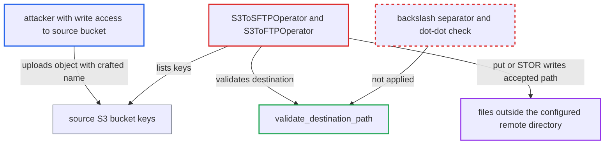

# S3-to-SFTP/FTP destination check bypassed by backslash dot-dot segments in S3 key names

| Field | Value |
|---|---|
| ID | `find_01SDkq16AJwmRpcZuqJJydKh` |
| Severity | **Medium** |
| Status | open |
| CWE | CWE-29 — Path traversal |
| Created | 2026-10-27T21:39:09.902445Z |
| Claude Security | https://claude.ai/security/findings/find_01SDkq16AJwmRpcZuqJJydKh |

## Description

Someone who can create objects in the source S3 bucket can make the S3-to-SFTP/FTP transfer write a file outside the configured remote directory, with content they choose. This works only when the destination server runs on a host that treats the backslash as a path separator, such as Windows. The check `validate_destination_path` uses only `/`-based rules, so backslash dot-dot names pass.

1. **attacker** uploads an S3 object with a backslash dot-dot name. The name is something like `incoming/..\\..\\Users\\svc\\.ssh\\authorized_keys`, and the content is chosen by the attacker.
2. **the operator `S3ToSFTPOperator` or `S3ToFTPOperator`** lists the bucket keys and appends each key suffix to the remote base path. This happens in multi-file mode, when `s3_filenames` is a string (`"*"` or a file-name prefix). The destination becomes `sftp_path` or `ftp_path` plus the suffix from `S3Hook.list_keys`. ([`providers/amazon/src/airflow/providers/amazon/aws/transfers/s3_to_sftp.py:148-190`](https://github.com/cx-benchmark/airflow/blob/a462d683469bb9f55646b0515ef84c41e16650fb/providers/amazon/src/airflow/providers/amazon/aws/transfers/s3_to_sftp.py#L148-L190))
3. **the function `validate_destination_path`** accepts the crafted destination. It normalises with `posixpath.normpath` and tests only `/`-based rules. `/C:/upload/..\\..\\x` has no `/`-delimited `..` component, stays unchanged and still starts with `/C:/upload/`. ([`providers/amazon/src/airflow/providers/amazon/aws/utils/__init__.py:119-141`](https://github.com/cx-benchmark/airflow/blob/a462d683469bb9f55646b0515ef84c41e16650fb/providers/amazon/src/airflow/providers/amazon/aws/utils/__init__.py#L119-L141))
4. **the method `_download_from_s3`** downloads the object and passes the accepted path unchanged to `sftp_client.put`. `paramiko` sends the path as it is, apart from prefixing the working directory to relative paths. ([`providers/amazon/src/airflow/providers/amazon/aws/transfers/s3_to_sftp.py:123-138`](https://github.com/cx-benchmark/airflow/blob/a462d683469bb9f55646b0515ef84c41e16650fb/providers/amazon/src/airflow/providers/amazon/aws/transfers/s3_to_sftp.py#L123-L138))
5. **the method `FTPHook.store_file`** sends the same path in a `STOR` command on the FTP route. The full path goes into `STOR {remote_full_path}` without change. ([`providers/ftp/src/airflow/providers/ftp/hooks/ftp.py:222-252`](https://github.com/cx-benchmark/airflow/blob/a462d683469bb9f55646b0515ef84c41e16650fb/providers/ftp/src/airflow/providers/ftp/hooks/ftp.py#L222-L252))
6. **the destination server** resolves the backslash `..` segments and writes the file outside the base directory. This happens only on a host that treats the backslash as a separator, such as Windows OpenSSH `sftp-server` or a Windows FTP daemon. On POSIX servers the backslash is an ordinary character and nothing escapes.

## Assessment

The attacker needs only the ability to create objects in the source S3 bucket under the DAG's `s3_key` prefix. No Airflow account is needed. The attack works on the next run of a transfer in multi-file mode, where `s3_filenames` is `"*"` or a file-name prefix. A name like `report\\..\\..\\x` also passes the prefix filter, because `posixpath.basename` does not split on the backslash. It succeeds only where the destination server's host treats the backslash as a separator, such as Windows-hosted SFTP or FTP. The single-key and list-of-names modes take names from the DAG author and are out of scope.

Impact: On the Airflow side, the operator's guarantee that uploads stay under `sftp_path` or `ftp_path` is broken, so the transfer writes where the DAG author did not direct it. The report finds no disclosure, change or loss of worker or metadata-database data.

Subsequent-system impact: On the SFTP/FTP server, the attacker can write or overwrite a file with chosen content at any path the connection's account may write, outside the intended directory. Targets include the account's `authorized_keys`, and scripts or configuration that other processes use. The account's filesystem permissions and any FTP user-root confinement limit this. The code creates no way to read data back.

## Recommendation

`validate_destination_path` applies POSIX-only separator rules to a destination the attacker influences, while the remote host may treat the backslash as a separator. Backslash dot-dot segments therefore get past the only containment check before `sftp_client.put` or `STOR`.

Fix criteria: No key suffix from `list_keys` can make the remote path resolve outside the configured base on any host. The validator either rejects suffixes containing a backslash or drive/UNC syntax, or splits on both `/` and the backslash and rejects any `..` component before the containment test. Tests run `S3ToSFTPOperator` and `S3ToFTPOperator` in `s3_filenames="*"` and prefix modes with keys such as `..\\..\\x`, `sub\\..\\..\\x`, `a/..\\..\\x` and `report\\..\\x`. Each one raises before any download or upload.

## Evidence

**https://github.com/cx-benchmark/airflow**

- [`providers/amazon/src/airflow/providers/amazon/aws/utils/__init__.py:119-141`](https://github.com/cx-benchmark/airflow/blob/a462d683469bb9f55646b0515ef84c41e16650fb/providers/amazon/src/airflow/providers/amazon/aws/utils/__init__.py#L119-L141)
- [`providers/amazon/src/airflow/providers/amazon/aws/transfers/s3_to_sftp.py:148-190`](https://github.com/cx-benchmark/airflow/blob/a462d683469bb9f55646b0515ef84c41e16650fb/providers/amazon/src/airflow/providers/amazon/aws/transfers/s3_to_sftp.py#L148-L190)
- [`providers/amazon/src/airflow/providers/amazon/aws/transfers/s3_to_sftp.py:123-138`](https://github.com/cx-benchmark/airflow/blob/a462d683469bb9f55646b0515ef84c41e16650fb/providers/amazon/src/airflow/providers/amazon/aws/transfers/s3_to_sftp.py#L123-L138)
- [`providers/amazon/src/airflow/providers/amazon/aws/transfers/s3_to_ftp.py:101-159`](https://github.com/cx-benchmark/airflow/blob/a462d683469bb9f55646b0515ef84c41e16650fb/providers/amazon/src/airflow/providers/amazon/aws/transfers/s3_to_ftp.py#L101-L159)
- [`providers/ftp/src/airflow/providers/ftp/hooks/ftp.py:222-252`](https://github.com/cx-benchmark/airflow/blob/a462d683469bb9f55646b0515ef84c41e16650fb/providers/ftp/src/airflow/providers/ftp/hooks/ftp.py#L222-L252)

