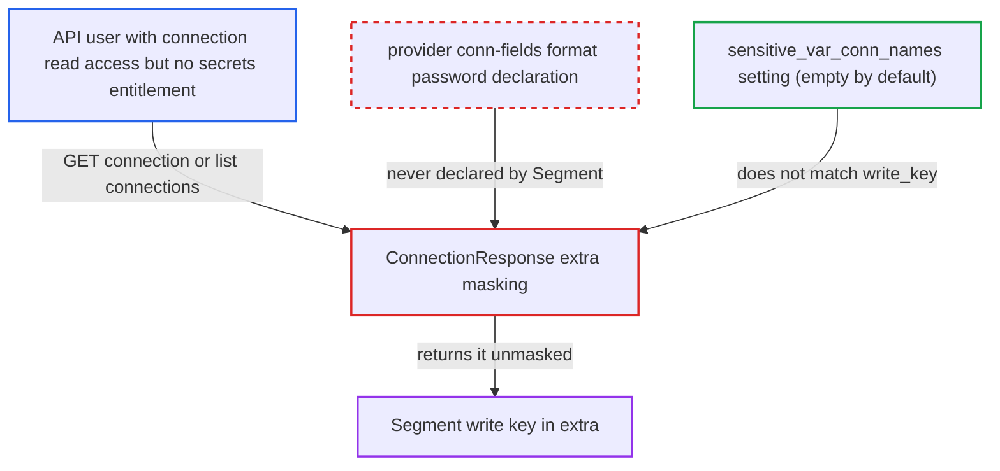

# Segment provider's write key stored in undeclared extra key is returned unmasked by connections API

| Field | Value |
|---|---|
| ID | `find_01EbodE6j2To3BLSaKZ3rMPs` |
| Severity | **Medium** |
| Status | open |
| CWE | CWE-212 — Sensitive data exposure |
| Created | 2026-10-27T21:45:21.963215Z |
| Claude Security | https://claude.ai/security/findings/find_01EbodE6j2To3BLSaKZ3rMPs |

## Description

A user whose role can read connections but is not entitled to see secrets can read a Segment write key in clear through the API. Admin and Op are documented as having credential access, so the gain is for custom FAB roles or Keycloak or AWS auth-manager policies. The Segment provider stores the key under the extra key `write_key` and never declares it sensitive, so API masking skips it.

1. **Airflow user** stores the Segment write key in the connection extra. The hook's docstring tells users to store it as `{"write_key": "YOUR_SECURITY_TOKEN"}`, so a connection set up as documented holds the secret there. ([`providers/segment/src/airflow/providers/segment/hooks/segment.py:39-49`](https://github.com/cx-benchmark/airflow/blob/a462d683469bb9f55646b0515ef84c41e16650fb/providers/segment/src/airflow/providers/segment/hooks/segment.py#L39-L49))
2. **the Segment provider** declares no sensitive extra fields. The `segment` connection type has no `conn-fields`, so `write_key` is never marked `format: password`. ([`providers/segment/provider.yaml:79-82`](https://github.com/cx-benchmark/airflow/blob/a462d683469bb9f55646b0515ef84c41e16650fb/providers/segment/provider.yaml#L79-L82))
3. **attacker with connection read access** calls `GET /api/v2/connections/{connection_id}` or `GET /api/v2/connections`. The routes return the stored connection through `ConnectionResponse` to any caller who is authorized for connection `GET`. ([`airflow-core/src/airflow/api_fastapi/core_api/routes/public/connections.py:200-258`](https://github.com/cx-benchmark/airflow/blob/a462d683469bb9f55646b0515ef84c41e16650fb/airflow-core/src/airflow/api_fastapi/core_api/routes/public/connections.py#L200-L258))
4. **`ConnectionResponse`** checks the extra keys for masking and finds no match. `redact_extra` hides only keys containing a word from `DEFAULT_SENSITIVE_FIELDS` or `[core] sensitive_var_conn_names` (empty by default), and `write_key` contains none. `redact_provider_sensitive_extra` hides only keys a provider declares with `format: password`, and Segment declares none. ([`airflow-core/src/airflow/api_fastapi/core_api/datamodels/connections.py:98-120`](https://github.com/cx-benchmark/airflow/blob/a462d683469bb9f55646b0515ef84c41e16650fb/airflow-core/src/airflow/api_fastapi/core_api/datamodels/connections.py#L98-L120))
5. **the API** returns the write key in clear. The response, and the UI connection editor that uses it, carry the key unmasked. ([`airflow-core/src/airflow/api_fastapi/core_api/routes/public/connections.py:200-258`](https://github.com/cx-benchmark/airflow/blob/a462d683469bb9f55646b0515ef84c41e16650fb/airflow-core/src/airflow/api_fastapi/core_api/routes/public/connections.py#L200-L258))

## Assessment

The attacker is an authenticated API user whose role grants connection `GET` but who is not entitled to see secrets. In practice this is a custom FAB role or a Keycloak or AWS auth-manager policy, since Admin and Op already have credential access. Any Segment connection stored in the metastore as documented is exposed. No victim action is needed. An operator can reduce the risk by adding `write_key` to `[core] sensitive_var_conn_names`, but nothing in the Segment provider tells them to.

Impact: The attacker reads the Segment write key, a credential the role is documented as unable to view. Only Segment write keys stored in the metastore are exposed, and other connections' secrets stay masked.

Subsequent-system impact: The write key lets its holder send track, identify and similar events into the organisation's Segment source, so forged analytics data could be injected downstream. The key gives no read access to Segment data.

## Recommendation

The Segment provider keeps its credential in the extra key `write_key`, whose name is not sensitive, and never declares it sensitive. API-level connection masking therefore returns the key in clear to principals that must not read credentials.

Fix criteria: A Segment write key stored as the provider documents comes back masked from `GET /api/v2/connections/{id}`, from the list endpoint and in the UI editor. Sending the masked value back through PATCH keeps the stored key. Existing connections that store `{"write_key": ...}` are also covered. One way is to declare the field as a `conn-field` with `format: password`. Another is to store the key in the connection `password`.

## Evidence

**https://github.com/cx-benchmark/airflow**

- [`providers/segment/provider.yaml:79-82`](https://github.com/cx-benchmark/airflow/blob/a462d683469bb9f55646b0515ef84c41e16650fb/providers/segment/provider.yaml#L79-L82)
- [`providers/segment/src/airflow/providers/segment/hooks/segment.py:39-49`](https://github.com/cx-benchmark/airflow/blob/a462d683469bb9f55646b0515ef84c41e16650fb/providers/segment/src/airflow/providers/segment/hooks/segment.py#L39-L49)
- [`providers/segment/src/airflow/providers/segment/hooks/segment.py:66-80`](https://github.com/cx-benchmark/airflow/blob/a462d683469bb9f55646b0515ef84c41e16650fb/providers/segment/src/airflow/providers/segment/hooks/segment.py#L66-L80)
- [`airflow-core/src/airflow/api_fastapi/core_api/datamodels/connections.py:98-120`](https://github.com/cx-benchmark/airflow/blob/a462d683469bb9f55646b0515ef84c41e16650fb/airflow-core/src/airflow/api_fastapi/core_api/datamodels/connections.py#L98-L120)
- [`airflow-core/src/airflow/api_fastapi/core_api/datamodels/connections.py:36-55`](https://github.com/cx-benchmark/airflow/blob/a462d683469bb9f55646b0515ef84c41e16650fb/airflow-core/src/airflow/api_fastapi/core_api/datamodels/connections.py#L36-L55)
- [`shared/secrets_masker/src/airflow_shared/secrets_masker/secrets_masker.py:51-76`](https://github.com/cx-benchmark/airflow/blob/a462d683469bb9f55646b0515ef84c41e16650fb/shared/secrets_masker/src/airflow_shared/secrets_masker/secrets_masker.py#L51-L76)
- [`shared/secrets_masker/src/airflow_shared/secrets_masker/secrets_masker.py:588-602`](https://github.com/cx-benchmark/airflow/blob/a462d683469bb9f55646b0515ef84c41e16650fb/shared/secrets_masker/src/airflow_shared/secrets_masker/secrets_masker.py#L588-L602)
- [`airflow-core/src/airflow/settings.py:772-781`](https://github.com/cx-benchmark/airflow/blob/a462d683469bb9f55646b0515ef84c41e16650fb/airflow-core/src/airflow/settings.py#L772-L781)
- [`airflow-core/src/airflow/api_fastapi/core_api/routes/public/connections.py:200-258`](https://github.com/cx-benchmark/airflow/blob/a462d683469bb9f55646b0515ef84c41e16650fb/airflow-core/src/airflow/api_fastapi/core_api/routes/public/connections.py#L200-L258)
- [`airflow-core/docs/security/security_model.rst:136-154`](https://github.com/cx-benchmark/airflow/blob/a462d683469bb9f55646b0515ef84c41e16650fb/airflow-core/docs/security/security_model.rst#L136-L154)

