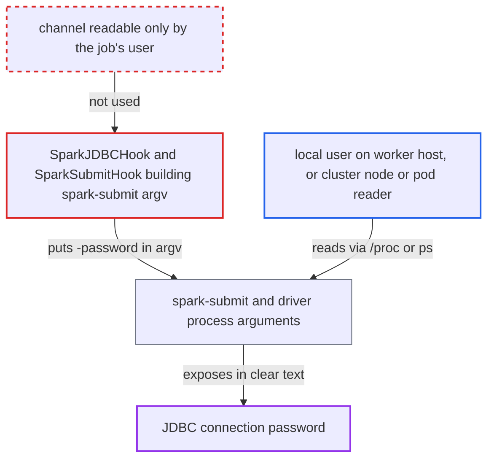

# Spark JDBC hook exposes the JDBC connection password in spark-submit process arguments

| Field | Value |
|---|---|
| ID | `find_01X7WxdKx3ztsZ3HYQ7a9duj` |
| Severity | **Medium** |
| Status | open |
| CWE | CWE-214 — Sensitive information in process arguments |
| Created | 2026-10-27T21:42:51.352376Z |
| Claude Security | https://claude.ai/security/findings/find_01X7WxdKx3ztsZ3HYQ7a9duj |

## Description

A local user on the machine that runs an Airflow Spark JDBC task can read the database password of that task's JDBC connection. In cluster mode, anyone who can list processes on the YARN NodeManager or read driver pods can read it too. The attacker needs no Airflow role, only a task running at the same time. The cause is that `SparkJDBCHook` passes the password to `spark_jdbc_script.py` as a command-line argument `-password`, and the argument stays in the clear in the `spark-submit` argv.

1. **the hook `SparkJDBCHook`** reads the connection password and adds it to the application arguments. `_build_jdbc_application_arguments` appends `-password <value>` next to `-url` and `-user`, taking the value from the connection named by `jdbc_conn_id`. ([`providers/apache/spark/src/airflow/providers/apache/spark/hooks/spark_jdbc.py:194-197`](https://github.com/cx-benchmark/airflow/blob/a462d683469bb9f55646b0515ef84c41e16650fb/providers/apache/spark/src/airflow/providers/apache/spark/hooks/spark_jdbc.py#L194-L197))
2. **the operator `SparkJDBCOperator`** calls `submit_jdbc_job` on every run. `submit_jdbc_job` stores the arguments as `self._application_args` and submits `spark_jdbc_script.py`, so every run with a password-protected connection takes this path with no special setting. ([`providers/apache/spark/src/airflow/providers/apache/spark/operators/spark_jdbc.py:139-143`](https://github.com/cx-benchmark/airflow/blob/a462d683469bb9f55646b0515ef84c41e16650fb/providers/apache/spark/src/airflow/providers/apache/spark/operators/spark_jdbc.py#L139-L143))
3. **the hook `SparkSubmitHook`** appends the arguments to the `spark-submit` command line. `_build_spark_submit_command` keeps the clear-text value in the argv, and `_mask_cmd` hides it only in the logged copy. ([`providers/apache/spark/src/airflow/providers/apache/spark/hooks/spark_submit.py:720-737`](https://github.com/cx-benchmark/airflow/blob/a462d683469bb9f55646b0515ef84c41e16650fb/providers/apache/spark/src/airflow/providers/apache/spark/hooks/spark_submit.py#L720-L737))
4. **`subprocess.Popen`** starts `spark-submit` with the password in its process arguments. The operating system exposes these arguments through `/proc/<pid>/cmdline` and `ps`, which other local users can read unless `/proc` is mounted with `hidepid`. ([`providers/apache/spark/src/airflow/providers/apache/spark/hooks/spark_submit.py:846-853`](https://github.com/cx-benchmark/airflow/blob/a462d683469bb9f55646b0515ef84c41e16650fb/providers/apache/spark/src/airflow/providers/apache/spark/hooks/spark_submit.py#L846-L853))
5. **the driver script `spark_jdbc_script.py`** reads `-password` back from `sys.argv`. `argparse` reads the value from the argv, so the driver process also carries the password in its arguments. ([`providers/apache/spark/src/airflow/providers/apache/spark/hooks/spark_jdbc_script.py:136-141`](https://github.com/cx-benchmark/airflow/blob/a462d683469bb9f55646b0515ef84c41e16650fb/providers/apache/spark/src/airflow/providers/apache/spark/hooks/spark_jdbc_script.py#L136-L141))
6. **a local attacker on the worker host** reads the arguments of the running process. While the job runs, `/proc/*/cmdline` or `ps -ef` shows `-url`, `-user` and `-password <value>`.

## Assessment

The attacker has an unprivileged local account on the host that runs the Airflow worker. In cluster mode, the attacker can instead list processes on the YARN NodeManager or read driver pods in the Spark namespace. The attacker waits for a `SparkJDBCOperator` task to run with a connection that has a password, then reads `/proc/*/cmdline` or runs `ps -ef`. This also works from the host of a containerised worker, because the host PID namespace sees container processes. The password stays readable for the life of the `spark-submit` JVM, and in client mode the Python driver process carries it too. No Airflow role and no victim action are needed, and `/proc` must not be mounted with `hidepid`. In cluster mode the report assumes, about Spark, that the application arguments end up in the YARN ApplicationMaster launch command or the Kubernetes driver pod's container args. Passing the value through the hook's `env_vars` is no safer, because for YARN and Kubernetes those are also emitted as `--conf` argv entries.

Impact: The attacker obtains the clear-text password of the JDBC Airflow connection used by the task. This is limited to connections used by `SparkJDBCOperator` tasks on that host, not the whole secret store. Nothing in Airflow is modified or degraded.

Subsequent-system impact: The URL, user and password together are a complete credential for the target database. The attacker can log in as the connection's account and read or modify what it can reach. The `spark_to_jdbc` overwrite and truncate modes suggest the account may drop and recreate tables, so data loss is possible within that account's grants.

## Recommendation

`SparkJDBCHook` sends the JDBC connection password to `spark_jdbc_script.py` as a command-line argument. That puts it in the world-readable argv of the `spark-submit` and driver processes, and in cluster launch contexts.

Fix criteria: The password does not appear in the argv of `spark-submit`, the driver or any child process, either as an application argument or as a `--conf` value. In cluster mode it does not appear in clear text in the YARN launch command or the Kubernetes driver pod spec. Run `SparkJDBCOperator` against a password-protected connection and check that `/proc/<pid>/cmdline` of every spawned process, and the driver pod spec in Kubernetes mode, contains no password value. The job must still authenticate.

## Evidence

**https://github.com/cx-benchmark/airflow**

- [`providers/apache/spark/src/airflow/providers/apache/spark/hooks/spark_jdbc.py:194-197`](https://github.com/cx-benchmark/airflow/blob/a462d683469bb9f55646b0515ef84c41e16650fb/providers/apache/spark/src/airflow/providers/apache/spark/hooks/spark_jdbc.py#L194-L197)
- [`providers/apache/spark/src/airflow/providers/apache/spark/hooks/spark_jdbc.py:230-233`](https://github.com/cx-benchmark/airflow/blob/a462d683469bb9f55646b0515ef84c41e16650fb/providers/apache/spark/src/airflow/providers/apache/spark/hooks/spark_jdbc.py#L230-L233)
- [`providers/apache/spark/src/airflow/providers/apache/spark/hooks/spark_submit.py:720-737`](https://github.com/cx-benchmark/airflow/blob/a462d683469bb9f55646b0515ef84c41e16650fb/providers/apache/spark/src/airflow/providers/apache/spark/hooks/spark_submit.py#L720-L737)
- [`providers/apache/spark/src/airflow/providers/apache/spark/hooks/spark_submit.py:846-853`](https://github.com/cx-benchmark/airflow/blob/a462d683469bb9f55646b0515ef84c41e16650fb/providers/apache/spark/src/airflow/providers/apache/spark/hooks/spark_submit.py#L846-L853)
- [`providers/apache/spark/src/airflow/providers/apache/spark/operators/spark_jdbc.py:139-143`](https://github.com/cx-benchmark/airflow/blob/a462d683469bb9f55646b0515ef84c41e16650fb/providers/apache/spark/src/airflow/providers/apache/spark/operators/spark_jdbc.py#L139-L143)
- [`providers/apache/spark/src/airflow/providers/apache/spark/hooks/spark_jdbc_script.py:136-141`](https://github.com/cx-benchmark/airflow/blob/a462d683469bb9f55646b0515ef84c41e16650fb/providers/apache/spark/src/airflow/providers/apache/spark/hooks/spark_jdbc_script.py#L136-L141)

