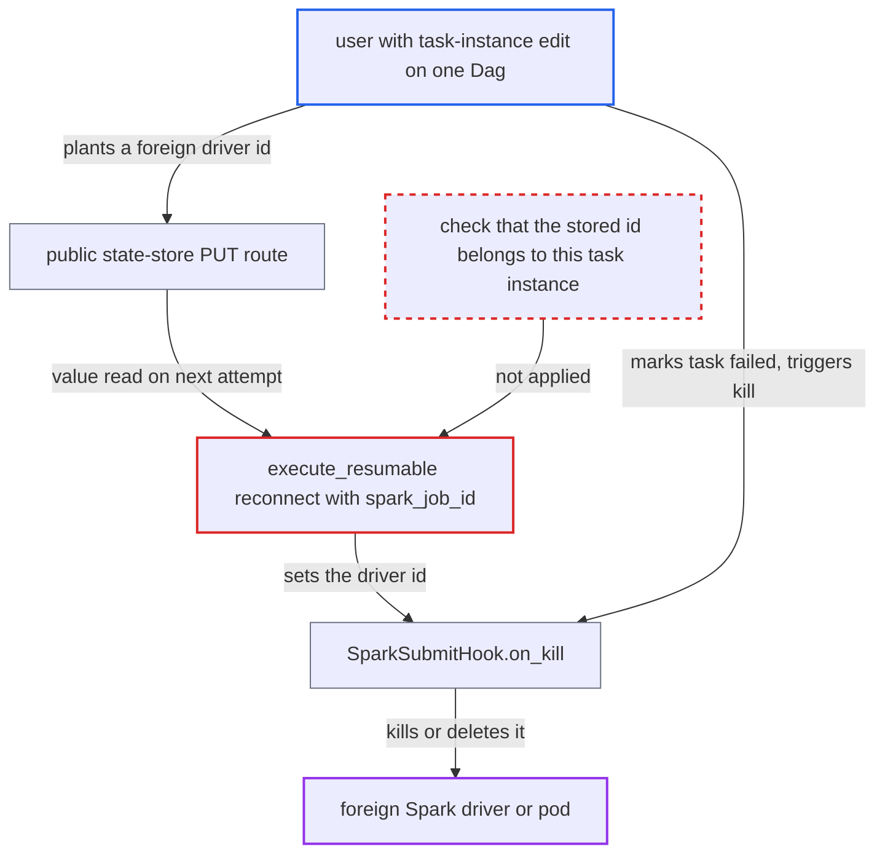

# SparkSubmitOperator kills any Spark driver id planted in its task state store

| Field | Value |
|---|---|
| ID | `find_01RcXbLFucmQumqjxt1ez4SC` |
| Severity | **Medium** |
| Status | open |
| CWE | CWE-639 — Insecure direct object reference |
| Created | 2026-10-27T21:46:00.121131Z |
| Claude Security | https://claude.ai/security/findings/find_01RcXbLFucmQumqjxt1ez4SC |

## Description

A user with task-instance edit rights on one Dag can make the Airflow worker kill a Spark driver they have no rights over. That driver may belong to another Dag or to a job outside Airflow on the same cluster. The attack works when that Dag runs `SparkSubmitOperator` against a standalone cluster in cluster mode, or in K8s mode with `track_driver_via_k8s_api=True`. The operator trusts the `spark_job_id` value in the task state store, and the public API lets an editor write that value.

1. **attacker with task-instance edit on one Dag** writes a foreign running driver id into the state store key `spark_job_id`. The public PUT route needs only task-instance edit permission on that Dag. It reserves no key and does not record who wrote the value. ([`airflow-core/src/airflow/api_fastapi/core_api/routes/public/task_state_store.py:269-289`](https://github.com/cx-benchmark/airflow/blob/a462d683469bb9f55646b0515ef84c41e16650fb/airflow-core/src/airflow/api_fastapi/core_api/routes/public/task_state_store.py#L269-L289))
2. **attacker** clears the task instance with `keep_task_state=true`. This keeps the planted value, so the next attempt reads it. Planting before the task starts also works. ([`airflow-core/src/airflow/api_fastapi/core_api/routes/public/task_instances.py:1318-1322`](https://github.com/cx-benchmark/airflow/blob/a462d683469bb9f55646b0515ef84c41e16650fb/airflow-core/src/airflow/api_fastapi/core_api/routes/public/task_instances.py#L1318-L1322))
3. **the method `execute_resumable`** reads the planted id and treats it as the driver this task submitted. When the backend reports the id as active, it calls `poll_until_complete`, which sets `hook._driver_id` to the planted id. Nothing checks who wrote the value or whether this task submitted that driver. ([`task-sdk/src/airflow/sdk/bases/resumablejobmixin.py:143-192`](https://github.com/cx-benchmark/airflow/blob/a462d683469bb9f55646b0515ef84c41e16650fb/task-sdk/src/airflow/sdk/bases/resumablejobmixin.py#L143-L192))
4. **attacker** marks the running task instance as failed. The task's heartbeat then gets a 409 response, and the supervisor sends SIGTERM to the task process. ([`task-sdk/src/airflow/sdk/execution_time/supervisor.py:2058-2073`](https://github.com/cx-benchmark/airflow/blob/a462d683469bb9f55646b0515ef84c41e16650fb/task-sdk/src/airflow/sdk/execution_time/supervisor.py#L2058-L2073))
5. **the task runner SIGTERM handler** calls `on_kill` on the operator. The call reaches `SparkSubmitHook.on_kill`. ([`task-sdk/src/airflow/sdk/execution_time/task_runner.py:1638-1645`](https://github.com/cx-benchmark/airflow/blob/a462d683469bb9f55646b0515ef84c41e16650fb/task-sdk/src/airflow/sdk/execution_time/task_runner.py#L1638-L1645))
6. **the hook method `on_kill`** runs the kill command against the planted id from the worker. `_build_spark_driver_kill_command` builds either a `curl -X POST` to `/v1/submissions/kill/<id>` or a `spark-submit --kill <id>` command, so the foreign driver is terminated. ([`providers/apache/spark/src/airflow/providers/apache/spark/hooks/spark_submit.py:1362-1393`](https://github.com/cx-benchmark/airflow/blob/a462d683469bb9f55646b0515ef84c41e16650fb/providers/apache/spark/src/airflow/providers/apache/spark/hooks/spark_submit.py#L1362-L1393))

## Assessment

The attacker is a Core API user with task-instance edit on one Dag that runs `SparkSubmitOperator` against a standalone cluster. That means a FAB `User`, not a Dag author. The Dag must use a `spark://` master with `deploy_mode=cluster`, and `durable` defaults to `True`. The attacker uses only the public API. They need a driver id to target. Standalone ids look like `driver-<yyyyMMddHHmmss>-<seq>` and are sequential. The attacker can see their own Dag's ids through the state-store GET, so neighbouring ids can be guessed. The same weakness exists in K8s mode when `track_driver_via_k8s_api=True` is set, which is opt-in. There the planted `namespace:pod` is probed in any namespace the worker can read. The pod name is then polled in the connection namespace and deleted by `_delete_driver_pod` on kill, or once it succeeds. In YARN mode the planted id is only used to probe status.

Impact: The attacker can kill any running standalone Spark driver whose id they know or guess, and can repeat this. In K8s mode they can delete any Pending or Running pod in the Spark namespace with the worker's kube credentials. If the victim is another Airflow Dag, its `SparkSubmitOperator` task fails, which a retry can recover from. The status of any probed driver or pod is written to the task log, which the attacker can read. Nothing is modified beyond termination.

Subsequent-system impact: Through the worker, the attacker reaches the Spark cluster, which they cannot reach directly. Jobs outside Airflow on that cluster can be terminated. In K8s mode, pods can be deleted with the worker's kube credentials.

## Recommendation

(1) The standalone and K8s backends (`_StandaloneSparkSubmitBackend`, `_KubernetesSparkSubmitBackend`) treat the stored value as the driver or pod this task submitted. They pass it to the kill and delete paths in `SparkSubmitHook.on_kill` and `_delete_driver_pod`. A value written by an API user therefore selects which cluster workload the worker terminates.

Fix criteria: On reconnect, a stored driver id or pod is verified as belonging to this task instance before it is polled, killed or deleted. One way is an identity the operator stamps on the submission (app name or driver labels carrying dag_id/run_id/task_id/map_index) and checks on reconnect. In K8s mode the namespace must equal the connection namespace. Otherwise the operator submits fresh. Test: plant a foreign running driver id or pod, clear the task with `keep_task_state=true`, and mark the task instance failed. The foreign driver keeps running.

(2) The public task-state-store PUT/PATCH routes let task-instance editors write values that cannot be told apart from the task's own checkpoints. `ResumableJobMixin` then consumes them as reconnect targets the task wrote itself.

Fix criteria: Reconnect targets consumed by `ResumableJobMixin` are only values written by an attempt of this task instance through the Execution API. Public-API writes of them are refused unless the caller holds a privilege that may already direct task execution. Test: a FAB `User` PUT of `spark_job_id` no longer changes which driver a retry reconnects to.

## Evidence

**https://github.com/cx-benchmark/airflow**

- [`providers/apache/spark/src/airflow/providers/apache/spark/operators/spark_submit.py:181-222`](https://github.com/cx-benchmark/airflow/blob/a462d683469bb9f55646b0515ef84c41e16650fb/providers/apache/spark/src/airflow/providers/apache/spark/operators/spark_submit.py#L181-L222)
- [`providers/apache/spark/src/airflow/providers/apache/spark/hooks/spark_submit.py:1414-1430`](https://github.com/cx-benchmark/airflow/blob/a462d683469bb9f55646b0515ef84c41e16650fb/providers/apache/spark/src/airflow/providers/apache/spark/hooks/spark_submit.py#L1414-L1430)
- [`providers/apache/spark/src/airflow/providers/apache/spark/hooks/spark_submit.py:1362-1393`](https://github.com/cx-benchmark/airflow/blob/a462d683469bb9f55646b0515ef84c41e16650fb/providers/apache/spark/src/airflow/providers/apache/spark/hooks/spark_submit.py#L1362-L1393)
- [`task-sdk/src/airflow/sdk/bases/resumablejobmixin.py:143-192`](https://github.com/cx-benchmark/airflow/blob/a462d683469bb9f55646b0515ef84c41e16650fb/task-sdk/src/airflow/sdk/bases/resumablejobmixin.py#L143-L192)
- [`providers/apache/spark/src/airflow/providers/apache/spark/operators/spark_submit.py:442-468`](https://github.com/cx-benchmark/airflow/blob/a462d683469bb9f55646b0515ef84c41e16650fb/providers/apache/spark/src/airflow/providers/apache/spark/operators/spark_submit.py#L442-L468)
- [`providers/apache/spark/src/airflow/providers/apache/spark/operators/spark_submit.py:88-125`](https://github.com/cx-benchmark/airflow/blob/a462d683469bb9f55646b0515ef84c41e16650fb/providers/apache/spark/src/airflow/providers/apache/spark/operators/spark_submit.py#L88-L125)
- [`providers/apache/spark/src/airflow/providers/apache/spark/hooks/spark_submit.py:1395-1412`](https://github.com/cx-benchmark/airflow/blob/a462d683469bb9f55646b0515ef84c41e16650fb/providers/apache/spark/src/airflow/providers/apache/spark/hooks/spark_submit.py#L1395-L1412)
- [`airflow-core/src/airflow/api_fastapi/core_api/routes/public/task_state_store.py:269-289`](https://github.com/cx-benchmark/airflow/blob/a462d683469bb9f55646b0515ef84c41e16650fb/airflow-core/src/airflow/api_fastapi/core_api/routes/public/task_state_store.py#L269-L289)
- [`airflow-core/src/airflow/api_fastapi/core_api/routes/public/task_instances.py:1318-1322`](https://github.com/cx-benchmark/airflow/blob/a462d683469bb9f55646b0515ef84c41e16650fb/airflow-core/src/airflow/api_fastapi/core_api/routes/public/task_instances.py#L1318-L1322)
- [`providers/fab/src/airflow/providers/fab/auth_manager/security_manager/override.py:305-316`](https://github.com/cx-benchmark/airflow/blob/a462d683469bb9f55646b0515ef84c41e16650fb/providers/fab/src/airflow/providers/fab/auth_manager/security_manager/override.py#L305-L316)
- [`task-sdk/src/airflow/sdk/execution_time/supervisor.py:2058-2073`](https://github.com/cx-benchmark/airflow/blob/a462d683469bb9f55646b0515ef84c41e16650fb/task-sdk/src/airflow/sdk/execution_time/supervisor.py#L2058-L2073)
- [`task-sdk/src/airflow/sdk/execution_time/task_runner.py:1638-1645`](https://github.com/cx-benchmark/airflow/blob/a462d683469bb9f55646b0515ef84c41e16650fb/task-sdk/src/airflow/sdk/execution_time/task_runner.py#L1638-L1645)

