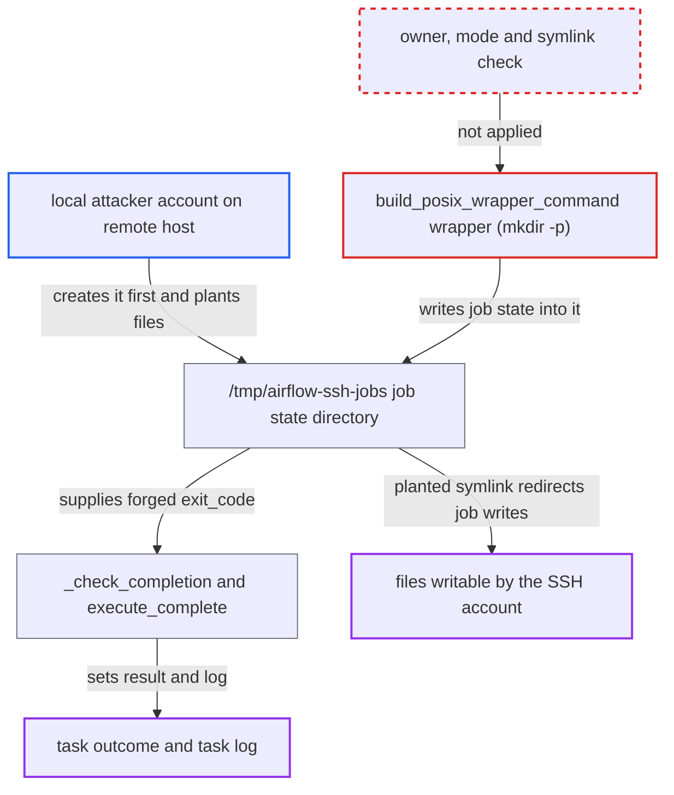

# SSHRemoteJobOperator trusts job state files in a shared, predictable /tmp directory on the remote host

| Field | Value |
|---|---|
| ID | `find_011Wvim6krGvvB21AJSAopAe` |
| Severity | **Medium** |
| Status | open |
| CWE | CWE-379 — Insecure Temporary File |
| Created | 2026-10-27T21:38:19.356244Z |
| Claude Security | https://claude.ai/security/findings/find_011Wvim6krGvvB21AJSAopAe |

## Description

A local user on the remote host can forge the result of any `SSHRemoteJobOperator` task that targets it. They can also make that host's SSH account overwrite files it can write. No Airflow privileges are needed, only an account on the same host. The cause is that the POSIX wrapper keeps job state under `/tmp/airflow-ssh-jobs` and creates it with a bare `mkdir -p`, with no ownership, mode or symlink check.

1. **local attacker** creates `/tmp/airflow-ssh-jobs` first with mode `0777`. This works before the SSH account first uses the host, or after a reboot clears `/tmp`. The attacker then owns the parent of every job directory and can list it. ([`providers/ssh/src/airflow/providers/ssh/utils/remote_job.py:30`](https://github.com/cx-benchmark/airflow/blob/a462d683469bb9f55646b0515ef84c41e16650fb/providers/ssh/src/airflow/providers/ssh/utils/remote_job.py#L30))
2. **the wrapper from `build_posix_wrapper_command`** creates the job directory with `mkdir -p "$job_dir"` under the attacker's directory. `mkdir -p` succeeds silently, and nothing checks the owner, the mode or whether the path is a symlink. ([`providers/ssh/src/airflow/providers/ssh/utils/remote_job.py:209-230`](https://github.com/cx-benchmark/airflow/blob/a462d683469bb9f55646b0515ef84c41e16650fb/providers/ssh/src/airflow/providers/ssh/utils/remote_job.py#L209-L230))
3. **local attacker** renames the new `af_*` directory and creates their own in its place. The attacker sees the directory name when listing the parent, so the random suffix from `generate_job_id` does not need to be guessed. The substitute holds either an `exit_code` file containing `0` or an `exit_code.tmp` symlink. ([`providers/ssh/src/airflow/providers/ssh/utils/remote_job.py:209-230`](https://github.com/cx-benchmark/airflow/blob/a462d683469bb9f55646b0515ef84c41e16650fb/providers/ssh/src/airflow/providers/ssh/utils/remote_job.py#L209-L230))
4. **the trigger `_check_completion`** reads the `exit_code` file with `test -s` and `cat` and accepts any digit string as the exit code. It follows whatever file or symlink target sits at the fixed path. The log chunk from `stdout.log` is read the same way. ([`providers/ssh/src/airflow/providers/ssh/triggers/ssh_remote_job.py:168-183`](https://github.com/cx-benchmark/airflow/blob/a462d683469bb9f55646b0515ef84c41e16650fb/providers/ssh/src/airflow/providers/ssh/triggers/ssh_remote_job.py#L168-L183))
5. **the operator method `execute_complete`** turns the forged exit code into task success, skip or failure and writes the remote log chunk into the task log. This outcome decides downstream scheduling. ([`providers/ssh/src/airflow/providers/ssh/operators/ssh_remote_job.py:404-450`](https://github.com/cx-benchmark/airflow/blob/a462d683469bb9f55646b0515ef84c41e16650fb/providers/ssh/src/airflow/providers/ssh/operators/ssh_remote_job.py#L404-L450))
6. **the job wrapper** writes the exit code through the planted `exit_code.tmp` symlink when the job finishes. This truncates the target file and writes the exit-code digits into it as the SSH account. The window lasts as long as the job runs, so no tight race is needed. ([`providers/ssh/src/airflow/providers/ssh/utils/remote_job.py:209-230`](https://github.com/cx-benchmark/airflow/blob/a462d683469bb9f55646b0515ef84c41e16650fb/providers/ssh/src/airflow/providers/ssh/utils/remote_job.py#L209-L230))

## Assessment

The attacker is an unprivileged local account on a multi-user remote host that a DAG targets with `SSHRemoteJobOperator`. They hold no Airflow privileges. This applies when `remote_base_dir` is left at its default of `None`, which gives `/tmp/airflow-ssh-jobs` on POSIX hosts. No victim action is needed beyond the scheduled run. Other routes: a planted `stdout.log` or `pid` symlink gives the same file-write primitive, but with a short race. A forged `pid` file steers `kill -TERM` at cancellation. An attacker who makes the base directory non-writable makes every job on that host fail to submit. Even without owning the parent, `stdout.log` is created with the SSH account's umask, typically world-readable, so other local users can read job output. The Windows default (`$env:TEMP`) is per-user and not affected.

Impact: The attacker chooses the recorded outcome (success, skip or failure) of every `SSHRemoteJobOperator` task on that host, and so what runs downstream. They can inject text into those task logs and make every such task fail at submission. Nothing on the Airflow side is disclosed, and the effect is limited to tasks that use this operator against that host.

Subsequent-system impact: On the remote host, a planted `exit_code.tmp` symlink makes the SSH account truncate any file it can write and write the exit-code digits into it. Examples are its `~/.ssh/authorized_keys`, which cuts Airflow off from the host, and its data files. The written content is only digits or job output, not attacker-chosen text. A forged `pid` only redirects SIGTERM to processes within the account's reach.

## Recommendation

The POSIX wrapper keeps job state under the fixed, predictable `/tmp/airflow-ssh-jobs` in world-writable `/tmp`. It creates the directory with a bare `mkdir -p` and never checks ownership, mode or symlinks. Another local user can own the parent directory and substitute the files that the wrapper writes and that the trigger and `on_kill` trust.

Fix criteria: Job state lives in a directory that no other local user can create, rename or write. For example, the default sits under the SSH account's home or runtime directory, or the directory is created with `mktemp -d` or mode `0700`. Alternatively, the wrapper refuses to run unless `base_dir` and the job directory are real directories owned by the current user and not group- or other-writable. To verify, pre-create `/tmp/airflow-ssh-jobs` as another user with mode `0777`. Submission must then fail or use a different private directory. A planted `exit_code` must not change the task outcome.

## Evidence

**https://github.com/cx-benchmark/airflow**

- [`providers/ssh/src/airflow/providers/ssh/utils/remote_job.py:209-230`](https://github.com/cx-benchmark/airflow/blob/a462d683469bb9f55646b0515ef84c41e16650fb/providers/ssh/src/airflow/providers/ssh/utils/remote_job.py#L209-L230)
- [`providers/ssh/src/airflow/providers/ssh/utils/remote_job.py:30`](https://github.com/cx-benchmark/airflow/blob/a462d683469bb9f55646b0515ef84c41e16650fb/providers/ssh/src/airflow/providers/ssh/utils/remote_job.py#L30)
- [`providers/ssh/src/airflow/providers/ssh/operators/ssh_remote_job.py:314-318`](https://github.com/cx-benchmark/airflow/blob/a462d683469bb9f55646b0515ef84c41e16650fb/providers/ssh/src/airflow/providers/ssh/operators/ssh_remote_job.py#L314-L318)
- [`providers/ssh/src/airflow/providers/ssh/utils/remote_job.py:386-394`](https://github.com/cx-benchmark/airflow/blob/a462d683469bb9f55646b0515ef84c41e16650fb/providers/ssh/src/airflow/providers/ssh/utils/remote_job.py#L386-L394)
- [`providers/ssh/src/airflow/providers/ssh/triggers/ssh_remote_job.py:168-183`](https://github.com/cx-benchmark/airflow/blob/a462d683469bb9f55646b0515ef84c41e16650fb/providers/ssh/src/airflow/providers/ssh/triggers/ssh_remote_job.py#L168-L183)
- [`providers/ssh/src/airflow/providers/ssh/operators/ssh_remote_job.py:404-450`](https://github.com/cx-benchmark/airflow/blob/a462d683469bb9f55646b0515ef84c41e16650fb/providers/ssh/src/airflow/providers/ssh/operators/ssh_remote_job.py#L404-L450)
- [`providers/ssh/src/airflow/providers/ssh/utils/remote_job.py:415-441`](https://github.com/cx-benchmark/airflow/blob/a462d683469bb9f55646b0515ef84c41e16650fb/providers/ssh/src/airflow/providers/ssh/utils/remote_job.py#L415-L441)

