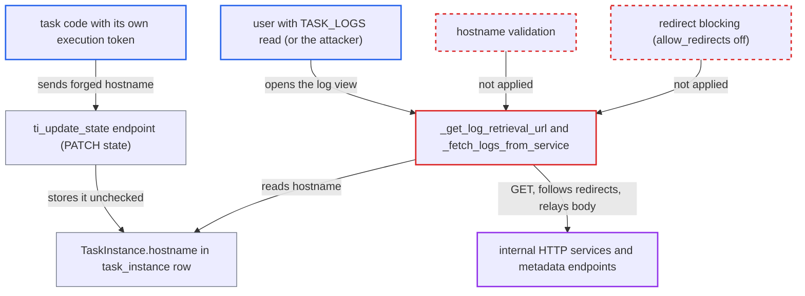

# SSRF from API server log fetch via task-written TaskInstance.hostname

| Field | Value |
|---|---|
| ID | `find_01MhVYwkU4a3ZePY6nUvYZX7` |
| Severity | **Medium** |
| Status | open |
| CWE | CWE-918 — Server-Side Request Forgery |
| Created | 2026-10-27T21:16:25.423142Z |
| Claude Security | https://claude.ai/security/findings/find_01MhVYwkU4a3ZePY6nUvYZX7 |

## Description

Code running inside a task can make the Airflow API server send HTTP GET requests to hosts of the task's choosing, including internal addresses. The response body is shown in the task's log view. The attacker needs only the task's own Execution API token. The cause is `_get_log_retrieval_url`, which puts the stored `ti.hostname` into a URL unchecked, and `requests.get` then follows redirects.

1. **task code** reads its own execution token from the memory of the forked supervisor. By default the task is a bare fork of the supervisor made inside `supervise_task(token=...)`, so the frames holding the token stay readable. ([`task-sdk/src/airflow/sdk/execution_time/supervisor.py:966-996`](https://github.com/cx-benchmark/airflow/blob/a462d683469bb9f55646b0515ef84c41e16650fb/task-sdk/src/airflow/sdk/execution_time/supervisor.py#L966-L996))
2. **task code** sends `PATCH /execution/task-instances/{id}/state` with `state=failed` and a crafted `hostname`. `TITerminalStatePayload.hostname` accepts any string, for example `10.0.0.5:9200/x/` or a host the attacker controls, and the call needs only the `ti:self` token and a RUNNING prior state. ([`airflow-core/src/airflow/api_fastapi/execution_api/datamodels/taskinstance.py:112-124`](https://github.com/cx-benchmark/airflow/blob/a462d683469bb9f55646b0515ef84c41e16650fb/airflow-core/src/airflow/api_fastapi/execution_api/datamodels/taskinstance.py#L112-L124))
3. **the handler `ti_update_state`** writes the supplied `hostname` into `TaskInstance.hostname`. Outside the `server_terminated` branch the value goes into the `UPDATE` through `model_dump`, and nothing compares or checks it. ([`airflow-core/src/airflow/api_fastapi/execution_api/routes/task_instances.py:675-681`](https://github.com/cx-benchmark/airflow/blob/a462d683469bb9f55646b0515ef84c41e16650fb/airflow-core/src/airflow/api_fastapi/execution_api/routes/task_instances.py#L675-L681))
4. **the attacker or any user with TASK_LOGS read** opens the log of that attempt through the public logs endpoint. With the default `remote_logging = False` and no local copy of the log on the API server, `_read` falls through to `_read_from_logs_server`. ([`airflow-core/src/airflow/utils/log/file_task_handler.py:627-641`](https://github.com/cx-benchmark/airflow/blob/a462d683469bb9f55646b0515ef84c41e16650fb/airflow-core/src/airflow/utils/log/file_task_handler.py#L627-L641))
5. **the method `_get_log_retrieval_url`** builds the URL from the stored hostname. It uses `urljoin(f"http://{hostname}:{port}/log/", log_relative_path)`, so the attacker's host, port and path prefix are used and the rendered log file name is always appended. ([`airflow-core/src/airflow/utils/log/file_task_handler.py:712-724`](https://github.com/cx-benchmark/airflow/blob/a462d683469bb9f55646b0515ef84c41e16650fb/airflow-core/src/airflow/utils/log/file_task_handler.py#L712-L724))
6. **the method `_fetch_logs_from_service`** calls `requests.get(url, stream=True)` from the API server. Redirects are followed, so a host the attacker controls, such as their own worker on the log port, can answer with a 302 to any http(s) URL. ([`airflow-core/src/airflow/utils/log/file_task_handler.py:166-192`](https://github.com/cx-benchmark/airflow/blob/a462d683469bb9f55646b0515ef84c41e16650fb/airflow-core/src/airflow/utils/log/file_task_handler.py#L166-L192))
7. **the method `_read_from_logs_server`** streams the response body into the log returned to the caller. This happens for any 2xx response with a `Content-Length` above 0, so the body of the forged request reaches the log viewer. ([`airflow-core/src/airflow/utils/log/file_task_handler.py:890-945`](https://github.com/cx-benchmark/airflow/blob/a462d683469bb9f55646b0515ef84c41e16650fb/airflow-core/src/airflow/utils/log/file_task_handler.py#L890-L945))

## Assessment

The attacker is code running in a task, such as a compromised or malicious task. It uses its own execution token to rewrite the task instance's `hostname` after the task starts. The fetch runs when someone opens that attempt's log. That can be the attacker or any user with TASK_LOGS read. For a finished task instance the fetch happens whenever the API server has no local or remote copy of the log, which is the default (`remote_logging = False`). A second way to write the hostname is `ti_run`, which writes it on QUEUED to RUNNING. A changed hostname on a RUNNING task instance is refused with 409, so this route needs a token held while the task instance is QUEUED, for example after a deferral or reschedule resume. A hostname that is only a host on the log port is also enough. The attacker's own worker can then redirect the request anywhere.

Impact: The attacker gets a GET request sent from the API server's own network position, including to loopback-only endpoints, and sees any 2xx response that has a `Content-Length`. No API-server data is changed. Each fetch is bounded by `log_fetch_timeout_sec`. The log JWT attached to the request covers only the attacker's own log file, and `requests` strips it on cross-host redirects, so it gives nothing useful.

Subsequent-system impact: Requests can reach any host and port, or through a redirect any http(s) URL, that the control plane can reach. The security model expects workers not to reach that network. Internal unauthenticated HTTP services and header-less metadata endpoints such as IMDSv1 can be read in full. GET-triggered actions on internal endpoints also become possible. The method and headers are fixed, so POST-only endpoints and endpoints needing custom headers stay out of reach.

## Recommendation

(1) `_get_log_retrieval_url` uses `TaskInstance.hostname`, which the untrusted worker side can write, as the authority of a URL the API server fetches. Characters such as `:`, `/` and `@` let the worker choose the port and path.

Fix criteria: The served-log URL is built only when the stored hostname is a syntactically valid bare hostname or IP literal, and is refused otherwise. The port always comes from configuration, and the path is `/log/` plus the rendered filename. A task instance whose `hostname` is `127.0.0.1:1234/x/` causes no request to port 1234.

(2) `_fetch_logs_from_service` lets `requests.get` follow redirects. Any host the API server is told to contact can send it to an arbitrary URL, and the body is relayed into the log view even when the hostname itself is valid.

Fix criteria: Log fetches do not follow redirects, and a 3xx from the log server is reported as an error without a second request. A log server that answers `302 Location: http://127.0.0.1:9/` produces no connection to that location.

(3) The Execution API saves a caller-supplied `hostname` from `TITerminalStatePayload` on any terminal-state update (`routes/task_instances.py:675-681`). It also accepts any string for `TIEnterRunningPayload.hostname`. A task can therefore rewrite the host that trusted components later contact.

Fix criteria: A terminal-state update does not change the stored `TaskInstance.hostname`, and the field is only compared, as on the `server_terminated` path. Hostnames accepted on `ti_run` are validated as bare host or IP literals of bounded length. `PATCH /state` with `state=failed` and a different `hostname` either leaves the stored value unchanged or is rejected.

## Evidence

**https://github.com/cx-benchmark/airflow**

- [`airflow-core/src/airflow/utils/log/file_task_handler.py:712-724`](https://github.com/cx-benchmark/airflow/blob/a462d683469bb9f55646b0515ef84c41e16650fb/airflow-core/src/airflow/utils/log/file_task_handler.py#L712-L724)
- [`airflow-core/src/airflow/utils/log/file_task_handler.py:166-192`](https://github.com/cx-benchmark/airflow/blob/a462d683469bb9f55646b0515ef84c41e16650fb/airflow-core/src/airflow/utils/log/file_task_handler.py#L166-L192)
- [`airflow-core/src/airflow/utils/log/file_task_handler.py:890-945`](https://github.com/cx-benchmark/airflow/blob/a462d683469bb9f55646b0515ef84c41e16650fb/airflow-core/src/airflow/utils/log/file_task_handler.py#L890-L945)
- [`airflow-core/src/airflow/utils/log/file_task_handler.py:627-641`](https://github.com/cx-benchmark/airflow/blob/a462d683469bb9f55646b0515ef84c41e16650fb/airflow-core/src/airflow/utils/log/file_task_handler.py#L627-L641)
- [`airflow-core/src/airflow/api_fastapi/execution_api/routes/task_instances.py:675-681`](https://github.com/cx-benchmark/airflow/blob/a462d683469bb9f55646b0515ef84c41e16650fb/airflow-core/src/airflow/api_fastapi/execution_api/routes/task_instances.py#L675-L681)
- [`airflow-core/src/airflow/api_fastapi/execution_api/datamodels/taskinstance.py:112-124`](https://github.com/cx-benchmark/airflow/blob/a462d683469bb9f55646b0515ef84c41e16650fb/airflow-core/src/airflow/api_fastapi/execution_api/datamodels/taskinstance.py#L112-L124)
- [`task-sdk/src/airflow/sdk/execution_time/supervisor.py:966-996`](https://github.com/cx-benchmark/airflow/blob/a462d683469bb9f55646b0515ef84c41e16650fb/task-sdk/src/airflow/sdk/execution_time/supervisor.py#L966-L996)
- [`airflow-core/src/airflow/api_fastapi/execution_api/routes/task_instances.py:241-300`](https://github.com/cx-benchmark/airflow/blob/a462d683469bb9f55646b0515ef84c41e16650fb/airflow-core/src/airflow/api_fastapi/execution_api/routes/task_instances.py#L241-L300)
- [`airflow-core/src/airflow/api_fastapi/core_api/routes/public/log.py:159-172`](https://github.com/cx-benchmark/airflow/blob/a462d683469bb9f55646b0515ef84c41e16650fb/airflow-core/src/airflow/api_fastapi/core_api/routes/public/log.py#L159-L172)

