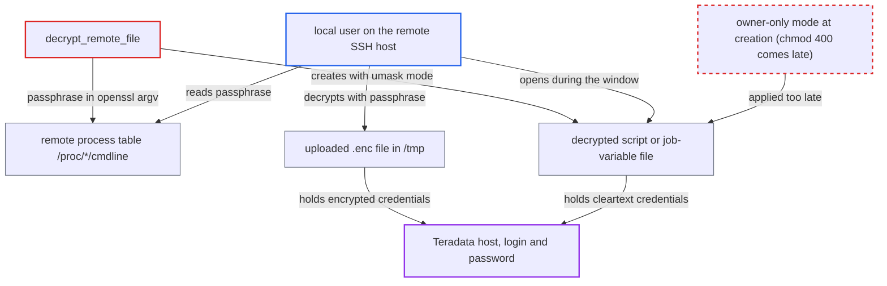

# TPT remote execution exposes Teradata credentials to other local users on the SSH host

| Field | Value |
|---|---|
| ID | `find_01NjHj6xidEe3Vzrp8FpB4XR` |
| Severity | **Medium** |
| Status | open |
| CWE | CWE-214 — Sensitive information exposure |
| Created | 2026-10-27T21:39:04.882220Z |
| Claude Security | https://claude.ai/security/findings/find_01NjHj6xidEe3Vzrp8FpB4XR |

## Description

A local user on the remote SSH host can steal the Teradata host, login and password that a TPT job uses. They can then act on the Teradata database as that account. The attack needs only an unprivileged account on the shared host while `DdlOperator` or `TdLoadOperator` runs with `ssh_conn_id`. `decrypt_remote_file` puts the passphrase on the openssl command line and leaves the decrypted file readable by others until a later chmod.

1. **the operator `DdlOperator` or `TdLoadOperator`** builds a script or job-variable file holding the Teradata credentials in cleartext. The tbuild script has `UserPassword = '{password}'`, and the tdload job-variable file has the `*UserPassword` variables, next to the connection's host and login. ([`providers/teradata/src/airflow/providers/teradata/utils/tpt_util.py:426-446`](https://github.com/cx-benchmark/airflow/blob/a462d683469bb9f55646b0515ef84c41e16650fb/providers/teradata/src/airflow/providers/teradata/utils/tpt_util.py#L426-L446))
2. **the hook `TptHook`** encrypts the file locally and uploads the `.enc` copy with `sftp.put`. No file mode is set, so the copy gets the remote umask-derived mode, and it lands in `remote_working_dir`, which defaults to the shared `/tmp`. ([`providers/teradata/src/airflow/providers/teradata/hooks/tpt.py:139-168`](https://github.com/cx-benchmark/airflow/blob/a462d683469bb9f55646b0515ef84c41e16650fb/providers/teradata/src/airflow/providers/teradata/hooks/tpt.py#L139-L168))
3. **the function `decrypt_remote_file`** runs openssl on the remote host with the passphrase in the command line. The argument is `-pass pass:'<pw>'`, so any local user can read it from `/proc/<pid>/cmdline` unless `hidepid` is set. ([`providers/teradata/src/airflow/providers/teradata/utils/tpt_util.py:623-630`](https://github.com/cx-benchmark/airflow/blob/a462d683469bb9f55646b0515ef84c41e16650fb/providers/teradata/src/airflow/providers/teradata/utils/tpt_util.py#L623-L630))
4. **remote openssl** writes the decrypted plaintext file with a umask-derived mode. The `chmod 400` runs only after two more SSH round trips, so the file is readable by others in the meantime. ([`providers/teradata/src/airflow/providers/teradata/hooks/tpt.py:139-168`](https://github.com/cx-benchmark/airflow/blob/a462d683469bb9f55646b0515ef84c41e16650fb/providers/teradata/src/airflow/providers/teradata/hooks/tpt.py#L139-L168))
5. **local attacker on the remote host** opens the plaintext file as it appears, or reads the passphrase and decrypts the `.enc` copy. An open file descriptor stays valid after the later chmod, and the `.enc` copy stays in the directory until cleanup after `tbuild` or `tdload` finishes. ([`providers/teradata/src/airflow/providers/teradata/hooks/tpt.py:317-343`](https://github.com/cx-benchmark/airflow/blob/a462d683469bb9f55646b0515ef84c41e16650fb/providers/teradata/src/airflow/providers/teradata/hooks/tpt.py#L317-L343))
6. **the attacker** uses the cleartext Teradata host, login and password. The same exposure exists for the tdload job-variable file, which holds `SourceUserPassword` and `TargetUserPassword`. ([`providers/teradata/src/airflow/providers/teradata/utils/tpt_util.py:426-446`](https://github.com/cx-benchmark/airflow/blob/a462d683469bb9f55646b0515ef84c41e16650fb/providers/teradata/src/airflow/providers/teradata/utils/tpt_util.py#L426-L446))

## Assessment

The attacker has an unprivileged local account on a remote Teradata tools host that a `DdlOperator` or `TdLoadOperator` task reaches over SSH. The host must be shared and the task must use `ssh_conn_id`. No Airflow role or victim action is needed. During a scheduled run the attacker watches `/tmp` (with inotify or polling) and `/proc/*/cmdline`. One route is to open `/tmp/tbuild_script_<uuid>.sql` or `tdload_job_var_<uuid>.txt` right after openssl creates it, and to keep the file descriptor past the later `chmod 400`. The other route is to capture the `-pass pass:'<pw>'` argument and decrypt the `.enc` copy. Remote cleanup does not run if an exception is raised before it, so the `.enc` copy can be left behind. The report assumes that OpenSSL `enc` opens `-out` with mode 0666 minus the umask. It also assumes that OpenSSH `sftp-server` creates the file the same way when paramiko sends no permission attributes.

Impact: The attacker obtains the cleartext host, login and password of the Airflow Teradata connections the task uses, plus the DDL or load statements. Only those connections are exposed, not the whole secret store. No Airflow data or service is modified or degraded.

Subsequent-system impact: With the stolen credentials the attacker can log in to the Teradata database as the connection's account. That account runs DAG-supplied DDL (CREATE, ALTER, DROP) or loads data. The attacker can therefore read, modify or drop whatever objects that account can reach.

## Recommendation

(1) `decrypt_remote_file` passes the decryption passphrase as a command-line argument of the remote openssl process. Any local user of the remote host can read it from the process table and use it to decrypt the uploaded `.enc` file.

Fix criteria: The passphrase and the Teradata credentials appear in the argv of no remote process, for example because they are passed on stdin as the BTEQ path does. To verify, run a TPT job over SSH while a second unprivileged user monitors `/proc/*/cmdline` on the remote host. That user must not see the passphrase.

(2) The decrypted credential-bearing script and the uploaded `.enc` file are created with umask-derived permissions in a shared directory (default `/tmp`). Permissions are tightened only afterwards, or never for the `.enc` file, so other users can open the plaintext before the chmod.

Fix criteria: Neither the plaintext script or job-variable file nor its encrypted copy is ever readable by another user. They are either created owner-only from the start or placed in a private directory, or the plaintext is kept off disk. Remote cleanup also runs on failure paths. To verify, have a second user watch the working directory with inotify during a run. That user must not be able to open either file.

## Evidence

**https://github.com/cx-benchmark/airflow**

- [`providers/teradata/src/airflow/providers/teradata/utils/tpt_util.py:623-630`](https://github.com/cx-benchmark/airflow/blob/a462d683469bb9f55646b0515ef84c41e16650fb/providers/teradata/src/airflow/providers/teradata/utils/tpt_util.py#L623-L630)
- [`providers/teradata/src/airflow/providers/teradata/hooks/tpt.py:139-168`](https://github.com/cx-benchmark/airflow/blob/a462d683469bb9f55646b0515ef84c41e16650fb/providers/teradata/src/airflow/providers/teradata/hooks/tpt.py#L139-L168)
- [`providers/teradata/src/airflow/providers/teradata/hooks/tpt.py:317-343`](https://github.com/cx-benchmark/airflow/blob/a462d683469bb9f55646b0515ef84c41e16650fb/providers/teradata/src/airflow/providers/teradata/hooks/tpt.py#L317-L343)
- [`providers/teradata/src/airflow/providers/teradata/utils/tpt_util.py:426-446`](https://github.com/cx-benchmark/airflow/blob/a462d683469bb9f55646b0515ef84c41e16650fb/providers/teradata/src/airflow/providers/teradata/utils/tpt_util.py#L426-L446)
- [`providers/teradata/src/airflow/providers/teradata/operators/tpt.py:159-166`](https://github.com/cx-benchmark/airflow/blob/a462d683469bb9f55646b0515ef84c41e16650fb/providers/teradata/src/airflow/providers/teradata/operators/tpt.py#L159-L166)
- [`providers/teradata/src/airflow/providers/teradata/utils/encryption_utils.py:51-65`](https://github.com/cx-benchmark/airflow/blob/a462d683469bb9f55646b0515ef84c41e16650fb/providers/teradata/src/airflow/providers/teradata/utils/encryption_utils.py#L51-L65)

