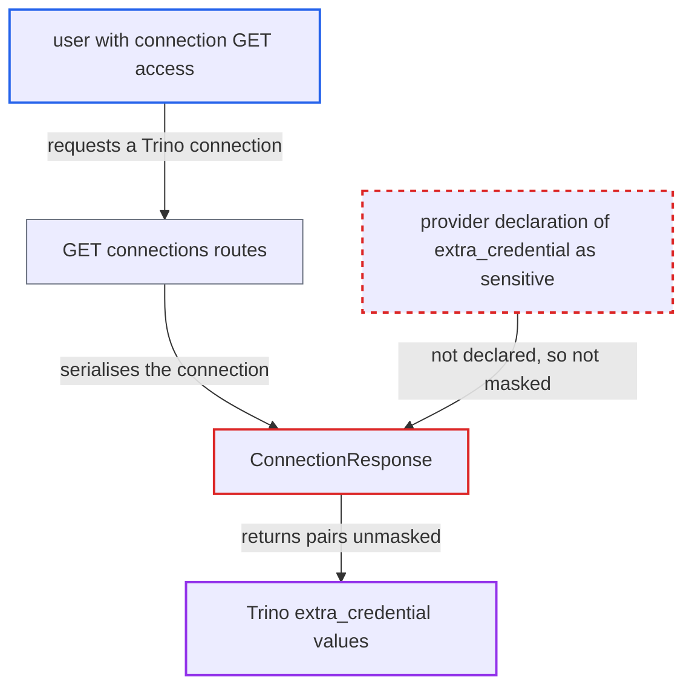

# Trino `extra_credential` connector credentials not declared sensitive, returned in clear by connections API

| Field | Value |
|---|---|
| ID | `find_01NWocLN5sjHPSo4jbehrqCp` |
| Severity | **Medium** |
| Status | open |
| CWE | CWE-212 — Sensitive information exposure |
| Created | 2026-10-27T22:04:46.141771Z |
| Claude Security | https://claude.ai/security/findings/find_01NWocLN5sjHPSo4jbehrqCp |

## Description

A user who can read connections through the API or UI, but is meant to have write-only access to stored credentials, can read the Trino connector passwords in clear text. This needs a Trino connection that keeps connector secrets in `extra_credential`. The Trino provider never declares `extra_credential` as sensitive, and the name-based masker does not recognise it, so `ConnectionResponse` returns the pairs unmasked.

1. **Deployment owner** stores connector secrets in a Trino connection. The connection extra `extra_credential` holds name/value pairs such as `a.password`, which `TrinoHook.get_conn` passes to `trino.dbapi.connect`. ([`providers/trino/src/airflow/providers/trino/hooks/trino.py:224`](https://github.com/cx-benchmark/airflow/blob/a462d683469bb9f55646b0515ef84c41e16650fb/providers/trino/src/airflow/providers/trino/hooks/trino.py#L224))
2. **Trino provider** leaves `extra_credential` undeclared as sensitive. The `trino` connection type in `provider.yaml` declares only `ui-field-behaviour` and no `conn-fields`, so the key is never marked `format: password`. ([`providers/trino/provider.yaml:125-152`](https://github.com/cx-benchmark/airflow/blob/a462d683469bb9f55646b0515ef84c41e16650fb/providers/trino/provider.yaml#L125-L152))
3. **API masking in `ConnectionResponse`** checks only provider-declared password keys and the default sensitive names. `_sensitive_extra_keys()` collects only keys that some provider declares with `format: password`, and no provider declares `extra_credential`. ([`airflow-core/src/airflow/api_fastapi/core_api/datamodels/connections.py:36-55`](https://github.com/cx-benchmark/airflow/blob/a462d683469bb9f55646b0515ef84c41e16650fb/airflow-core/src/airflow/api_fastapi/core_api/datamodels/connections.py#L36-L55))
4. **the secrets masker** fails to match the key by name. `DEFAULT_SENSITIVE_FIELDS` has no entry that is a substring of `extra_credential`, because `credential` is not on the list, and `[core] sensitive_var_conn_names` ships empty. ([`shared/secrets_masker/src/airflow_shared/secrets_masker/secrets_masker.py:51-76`](https://github.com/cx-benchmark/airflow/blob/a462d683469bb9f55646b0515ef84c41e16650fb/shared/secrets_masker/src/airflow_shared/secrets_masker/secrets_masker.py#L51-L76))
5. **the secrets masker** skips the names inside the list of pairs. `SecretsMasker._redact` walks list items with `name=None`, so a pair named `a.password` is not masked, and `add_mask` registers no pattern for the values. ([`shared/secrets_masker/src/airflow_shared/secrets_masker/secrets_masker.py:392-408`](https://github.com/cx-benchmark/airflow/blob/a462d683469bb9f55646b0515ef84c41e16650fb/shared/secrets_masker/src/airflow_shared/secrets_masker/secrets_masker.py#L392-L408))
6. **connection-reading user** calls `GET /api/v2/connections/{id}` or the list endpoint. These routes require only `requires_access_connection(method="GET")` and serialise the result through `ConnectionResponse`. ([`airflow-core/src/airflow/api_fastapi/core_api/routes/public/connections.py:200-258`](https://github.com/cx-benchmark/airflow/blob/a462d683469bb9f55646b0515ef84c41e16650fb/airflow-core/src/airflow/api_fastapi/core_api/routes/public/connections.py#L200-L258))
7. **the API server** returns every `extra_credential` pair in clear. The UI connection editor is built on the same responses and shows the same values. ([`airflow-core/src/airflow/api_fastapi/core_api/datamodels/connections.py:98-128`](https://github.com/cx-benchmark/airflow/blob/a462d683469bb9f55646b0515ef84c41e16650fb/airflow-core/src/airflow/api_fastapi/core_api/datamodels/connections.py#L98-L128))

## Assessment

The attacker is an authenticated API or UI user who can read connections but is meant to have write-only access to stored credentials. An example is a custom FAB, Keycloak or AWS connection-configuration role. Admin and Op are already allowed to access credentials. In SimpleAuthManager only OP and above can read connections. The deployment must hold a Trino connection that passes connector secrets in `extra_credential`. No setting change and no victim action is needed, because `[core] sensitive_var_conn_names` ships empty. The attacker calls `GET /api/v2/connections/{id}` or the list endpoint, or opens the UI editor built on them.

Impact: The role reads connector credentials that it may only write. The exposure is limited to the `extra_credential` values of Trino connections that the user can read. Nothing in Airflow is modified and no service is degraded.

Subsequent-system impact: The pairs are credentials that Trino connectors use against the data systems behind Trino, such as database user/password pairs. A holder can present them through any Trino session. The holder can also use them directly against the backing systems where those are reachable, and read that data with the credential's rights. What else they allow depends on the deployment.

## Recommendation

The Trino connection type keeps connector credentials in the extra key `extra_credential` but never declares it sensitive. Neither the key name nor the names inside its list of pairs are recognised by the name-based masker, so the connections API returns the credentials in clear.

Fix criteria: `GET /api/v2/connections/{id}`, the list endpoint and the UI return a non-empty `extra_credential` masked as `***`, in both the plain and `extra__trino__` forms. A PATCH that sends the mask back keeps the stored pairs, and `TrinoHook` still uses them. To verify, store `{"extra_credential": [["pg.password", "zz9secret"]]}` and check that no response contains `zz9secret`.

## Evidence

**https://github.com/cx-benchmark/airflow**

- [`providers/trino/provider.yaml:125-152`](https://github.com/cx-benchmark/airflow/blob/a462d683469bb9f55646b0515ef84c41e16650fb/providers/trino/provider.yaml#L125-L152)
- [`providers/trino/src/airflow/providers/trino/hooks/trino.py:224`](https://github.com/cx-benchmark/airflow/blob/a462d683469bb9f55646b0515ef84c41e16650fb/providers/trino/src/airflow/providers/trino/hooks/trino.py#L224)
- [`providers/trino/docs/connections.rst:60`](https://github.com/cx-benchmark/airflow/blob/a462d683469bb9f55646b0515ef84c41e16650fb/providers/trino/docs/connections.rst#L60)
- [`providers/trino/tests/unit/trino/hooks/test_trino.py:266-270`](https://github.com/cx-benchmark/airflow/blob/a462d683469bb9f55646b0515ef84c41e16650fb/providers/trino/tests/unit/trino/hooks/test_trino.py#L266-L270)
- [`shared/secrets_masker/src/airflow_shared/secrets_masker/secrets_masker.py:51-76`](https://github.com/cx-benchmark/airflow/blob/a462d683469bb9f55646b0515ef84c41e16650fb/shared/secrets_masker/src/airflow_shared/secrets_masker/secrets_masker.py#L51-L76)
- [`shared/secrets_masker/src/airflow_shared/secrets_masker/secrets_masker.py:392-408`](https://github.com/cx-benchmark/airflow/blob/a462d683469bb9f55646b0515ef84c41e16650fb/shared/secrets_masker/src/airflow_shared/secrets_masker/secrets_masker.py#L392-L408)
- [`shared/secrets_masker/src/airflow_shared/secrets_masker/secrets_masker.py:604-645`](https://github.com/cx-benchmark/airflow/blob/a462d683469bb9f55646b0515ef84c41e16650fb/shared/secrets_masker/src/airflow_shared/secrets_masker/secrets_masker.py#L604-L645)
- [`airflow-core/src/airflow/api_fastapi/core_api/datamodels/connections.py:36-55`](https://github.com/cx-benchmark/airflow/blob/a462d683469bb9f55646b0515ef84c41e16650fb/airflow-core/src/airflow/api_fastapi/core_api/datamodels/connections.py#L36-L55)
- [`airflow-core/src/airflow/api_fastapi/core_api/datamodels/connections.py:98-128`](https://github.com/cx-benchmark/airflow/blob/a462d683469bb9f55646b0515ef84c41e16650fb/airflow-core/src/airflow/api_fastapi/core_api/datamodels/connections.py#L98-L128)
- [`airflow-core/src/airflow/api_fastapi/core_api/routes/public/connections.py:200-258`](https://github.com/cx-benchmark/airflow/blob/a462d683469bb9f55646b0515ef84c41e16650fb/airflow-core/src/airflow/api_fastapi/core_api/routes/public/connections.py#L200-L258)

