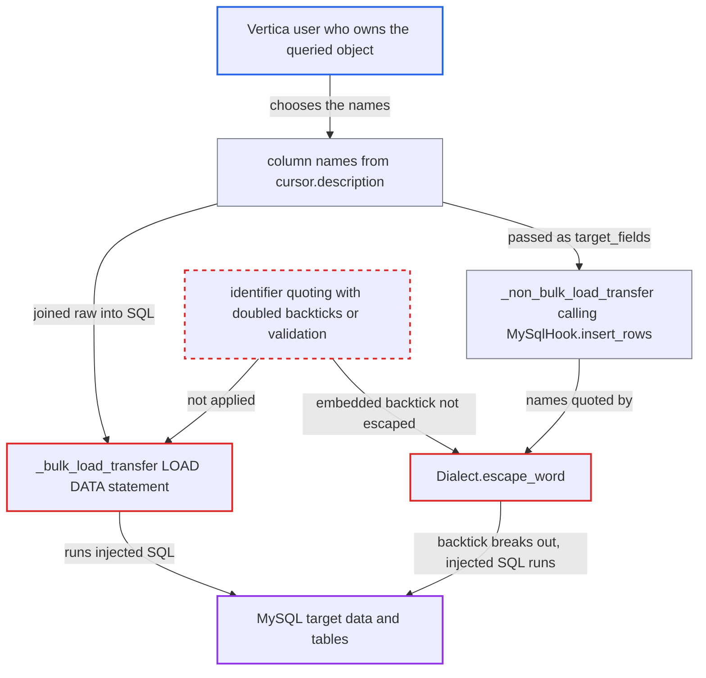

# VerticaToMySqlOperator splices Vertica-supplied column names into MySQL LOAD DATA and INSERT SQL

| Field | Value |
|---|---|
| ID | `find_01FB3xhJiDeRwwRGTZwMewTZ` |
| Severity | **Medium** |
| Status | open |
| CWE | CWE-89 — SQL injection |
| Created | 2026-10-27T21:42:24.648385Z |
| Claude Security | https://claude.ai/security/findings/find_01FB3xhJiDeRwwRGTZwMewTZ |

## Description

A Vertica user who controls the column names of a table or view can run their own SQL on the MySQL target. The statements run with the Airflow MySQL connection's privileges. The attack needs a DAG that uses `VerticaToMySqlOperator` on a query whose output names the attacker defines, such as `SELECT *` from their view. The operator puts those names into MySQL SQL without safe quoting, in both `_bulk_load_transfer` and the default insert path.

1. **Vertica user** creates or renames a table or view so a column name holds SQL text. Vertica quoted identifiers can hold arbitrary characters up to 128 bytes, and a query such as `SELECT *` returns these names unchanged. ([`providers/mysql/src/airflow/providers/mysql/transfers/vertica_to_mysql.py:141`](https://github.com/cx-benchmark/airflow/blob/a462d683469bb9f55646b0515ef84c41e16650fb/providers/mysql/src/airflow/providers/mysql/transfers/vertica_to_mysql.py#L141))
2. **the operator `VerticaToMySqlOperator`** reads the column names from `cursor.description` on the next run. `selected_columns` is built from `d.name`, the label the Vertica server returns, so the attacker's string is used as is. ([`providers/mysql/src/airflow/providers/mysql/transfers/vertica_to_mysql.py:141`](https://github.com/cx-benchmark/airflow/blob/a462d683469bb9f55646b0515ef84c41e16650fb/providers/mysql/src/airflow/providers/mysql/transfers/vertica_to_mysql.py#L141))
3. **the bulk path `_bulk_load_transfer`** joins the names raw into the `LOAD DATA LOCAL INFILE` statement. The f-string is run with `cursor2.execute` and no parameters, and the column list is never quoted, escaped or validated. ([`providers/mysql/src/airflow/providers/mysql/transfers/vertica_to_mysql.py:156-160`](https://github.com/cx-benchmark/airflow/blob/a462d683469bb9f55646b0515ef84c41e16650fb/providers/mysql/src/airflow/providers/mysql/transfers/vertica_to_mysql.py#L156-L160))
4. **the default path `_non_bulk_load_transfer`** passes the names as `target_fields` to `MySqlHook.insert_rows`. This is the path used by default. ([`providers/mysql/src/airflow/providers/mysql/transfers/vertica_to_mysql.py:120-131`](https://github.com/cx-benchmark/airflow/blob/a462d683469bb9f55646b0515ef84c41e16650fb/providers/mysql/src/airflow/providers/mysql/transfers/vertica_to_mysql.py#L120-L131))
5. **`Dialect.escape_word`** wraps the name in backticks without doubling a backtick inside it. A name containing a backtick therefore closes the identifier early and the rest becomes SQL in the generated `INSERT INTO ... VALUES (...)`. ([`providers/common/sql/src/airflow/providers/common/sql/dialects/dialect.py:73-87`](https://github.com/cx-benchmark/airflow/blob/a462d683469bb9f55646b0515ef84c41e16650fb/providers/common/sql/src/airflow/providers/common/sql/dialects/dialect.py#L73-L87))
6. **`MySqlHook`** sends the forged statement to MySQL over mysqlclient. The hook sets no client flags and mysqlclient turns on `CLIENT_MULTI_STATEMENTS`, so extra statements can be stacked after the first. ([`providers/mysql/src/airflow/providers/mysql/hooks/mysql.py:212-226`](https://github.com/cx-benchmark/airflow/blob/a462d683469bb9f55646b0515ef84c41e16650fb/providers/mysql/src/airflow/providers/mysql/hooks/mysql.py#L212-L226))
7. **MySQL target** executes the injected SQL under the Airflow MySQL connection's credential. The attacker can append `INSERT ... SELECT` from other tables, `ON DUPLICATE KEY UPDATE`, a `LOAD DATA ... SET col = (subquery)` clause, or whole extra statements. ([`providers/fab/tests/unit/fab/auth_manager/models/test_db.py:349-350`](https://github.com/cx-benchmark/airflow/blob/a462d683469bb9f55646b0515ef84c41e16650fb/providers/fab/tests/unit/fab/auth_manager/models/test_db.py#L349-L350))

## Assessment

The attacker is a Vertica user who can create or rename an object that a deployed `VerticaToMySqlOperator` reads. The query must take its output names from that object, for example `SELECT * FROM their_view`. No Airflow or MySQL access is needed. On the next scheduled run the operator reads the forged name and runs the SQL, with no user interaction. Both routes work: the default path through `insert_rows`, and the bulk path through `LOAD DATA`. The report assumes vertica-python (>=1.3.0) returns the column label verbatim and mysqlclient (>=2.2.5) enables multi-statements by default. `self.mysql_table` is set by the DAG author and is not part of this finding.

Impact: Arbitrary SQL runs on the MySQL target with the Airflow MySQL connection's credential. The attacker can change or delete any data and drop any table that credential can reach. They can also copy other tables' contents into tables the transfer fills. The report found no channel that returns query results to the attacker, so disclosure is limited, and the damage is bounded by the credential's grants.

## Recommendation

(1) `VerticaToMySqlOperator` puts column names from the Vertica result description, and the table name, into the `LOAD DATA` statement without validation or identifier quoting. Source-side metadata therefore becomes MySQL SQL.

Fix criteria: Every identifier in the generated `LOAD DATA` is checked against a strict identifier pattern or quoted as a MySQL identifier with embedded backticks doubled. A transfer from a Vertica query whose column alias contains backticks, `)`, `;` or `SET` is either rejected or loads into a column literally named by that alias. No extra clause or statement runs in either case.

(2) `Dialect.escape_word` in common.sql wraps names in the dialect's quote characters without escaping those characters inside the name. The `INSERT` that `insert_rows` builds from `target_fields` can therefore be broken out of.

Fix criteria: Quoting a column name for the generated `INSERT` escapes embedded quote characters, or rejects names that contain them, so any string passed as a target field is treated as one identifier. An `insert_rows` call whose target field contains a backtick does not change the statement's structure.

## Evidence

**https://github.com/cx-benchmark/airflow**

- [`providers/mysql/src/airflow/providers/mysql/transfers/vertica_to_mysql.py:156-160`](https://github.com/cx-benchmark/airflow/blob/a462d683469bb9f55646b0515ef84c41e16650fb/providers/mysql/src/airflow/providers/mysql/transfers/vertica_to_mysql.py#L156-L160)
- [`providers/mysql/src/airflow/providers/mysql/transfers/vertica_to_mysql.py:141`](https://github.com/cx-benchmark/airflow/blob/a462d683469bb9f55646b0515ef84c41e16650fb/providers/mysql/src/airflow/providers/mysql/transfers/vertica_to_mysql.py#L141)
- [`providers/mysql/src/airflow/providers/mysql/transfers/vertica_to_mysql.py:120-131`](https://github.com/cx-benchmark/airflow/blob/a462d683469bb9f55646b0515ef84c41e16650fb/providers/mysql/src/airflow/providers/mysql/transfers/vertica_to_mysql.py#L120-L131)
- [`providers/common/sql/src/airflow/providers/common/sql/dialects/dialect.py:73-87`](https://github.com/cx-benchmark/airflow/blob/a462d683469bb9f55646b0515ef84c41e16650fb/providers/common/sql/src/airflow/providers/common/sql/dialects/dialect.py#L73-L87)
- [`providers/mysql/src/airflow/providers/mysql/hooks/mysql.py:84`](https://github.com/cx-benchmark/airflow/blob/a462d683469bb9f55646b0515ef84c41e16650fb/providers/mysql/src/airflow/providers/mysql/hooks/mysql.py#L84)
- [`providers/mysql/src/airflow/providers/mysql/hooks/mysql.py:212-226`](https://github.com/cx-benchmark/airflow/blob/a462d683469bb9f55646b0515ef84c41e16650fb/providers/mysql/src/airflow/providers/mysql/hooks/mysql.py#L212-L226)
- [`providers/fab/tests/unit/fab/auth_manager/models/test_db.py:349-350`](https://github.com/cx-benchmark/airflow/blob/a462d683469bb9f55646b0515ef84c41e16650fb/providers/fab/tests/unit/fab/auth_manager/models/test_db.py#L349-L350)

