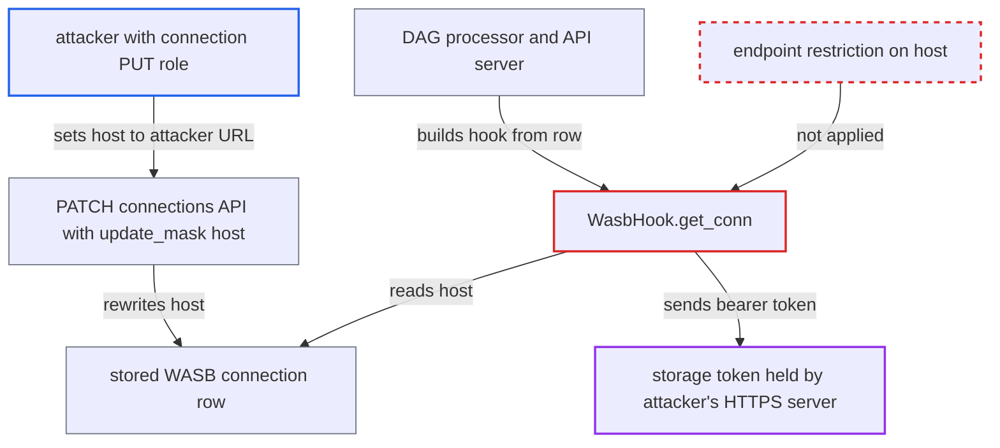

# WASB hook sends control-plane managed-identity storage token to a connection-chosen account URL

| Field | Value |
|---|---|
| ID | `find_01Npx8NvnXDF9thycTFk1Y6k` |
| Severity | **Medium** |
| Status | open |
| CWE | CWE-923 — Improper endpoint restriction |
| Created | 2026-10-27T22:09:12.707390Z |
| Claude Security | https://claude.ai/security/findings/find_01Npx8NvnXDF9thycTFk1Y6k |

## Description

A user who can edit connections can steal the Azure Storage access token of the DAG processor's or API server's own identity. Those are credentials the role has no rights over. It works when a WASB connection has no credential fields, the usual managed-identity setup, and the edited connection is used by `WasbDagBundle` or by `[logging] remote_log_conn_id`. `WasbHook.get_conn` takes the storage URL from the connection's `host` and never checks it.

1. **attacker with connection PUT** changes the connection's `host` to an attacker-controlled HTTPS URL. The PATCH uses `update_mask=host`, and the route does not check the new destination. ([`airflow-core/src/airflow/api_fastapi/core_api/routes/public/connections.py:298-328`](https://github.com/cx-benchmark/airflow/blob/a462d683469bb9f55646b0515ef84c41e16650fb/airflow-core/src/airflow/api_fastapi/core_api/routes/public/connections.py#L298-L328))
2. **DAG processor or API server** builds a `WasbHook` from the edited connection. The hook is cached, so this happens only on the next restart, scale-out or worker refresh, or on the first log read of a fresh API-server process. The DAG processor does it through `WasbDagBundle` and the API server through the remote-log read. ([`providers/microsoft/azure/src/airflow/providers/microsoft/azure/bundles/wasb.py:67-94`](https://github.com/cx-benchmark/airflow/blob/a462d683469bb9f55646b0515ef84c41e16650fb/providers/microsoft/azure/src/airflow/providers/microsoft/azure/bundles/wasb.py#L67-L94))
3. **`parse_blob_account_url`** turns the attacker's `host` into the account URL. It accepts any dotted host and only prepends `https://`. It does not limit the host to Azure Storage endpoint suffixes. ([`providers/microsoft/azure/src/airflow/providers/microsoft/azure/utils.py:194-224`](https://github.com/cx-benchmark/airflow/blob/a462d683469bb9f55646b0515ef84c41e16650fb/providers/microsoft/azure/src/airflow/providers/microsoft/azure/utils.py#L194-L224))
4. **`WasbHook.get_conn`** falls back to `DefaultAzureCredential` and builds `BlobServiceClient` for that URL. This happens because the connection carries none of `connection_string`, `tenant_id`, `shared_access_key`, `sas_token`, `password` or `account_key`. Leftover `extra` keys are passed to the client as kwargs. ([`providers/microsoft/azure/src/airflow/providers/microsoft/azure/hooks/wasb.py:212-231`](https://github.com/cx-benchmark/airflow/blob/a462d683469bb9f55646b0515ef84c41e16650fb/providers/microsoft/azure/src/airflow/providers/microsoft/azure/hooks/wasb.py#L212-L231))
5. **Azure SDK bearer-token policy** sends the storage access token in the `Authorization` header of the first request to the attacker's host. This rests on an assumption about azure-core 1.41.0 and azure-storage-blob 12.31.0, which the scanner did not have installed. The policy requires HTTPS but has no host allow-list.
6. **attacker** replays the token against Azure Storage. The token is a valid Entra ID token for the control-plane identity, so Azure Storage accepts it.

## Assessment

The attacker holds the connection-configuration role (for example FAB Op), which allows connection PUT. They change `host` on a WASB connection used by `WasbDagBundle` or named in `[logging] remote_log_conn_id`, and they set no credential fields. The WASB bundle or remote logging must be in use, on hosts whose Azure identity differs from the workers' identity. The edit takes effect only when a control-plane process next builds the hook. That is after a DAG processor restart, a scale-out or worker refresh, or the first log read of a fresh API-server process. Either of the two paths works. Setting `connection_verify: false` in `extra` also works, but a valid certificate on the attacker's host is enough.

Impact: The attacker gets a replayable Azure Storage token for the DAG processor's or API server's identity. They can read every blob that identity can read. At minimum that is the DAG bundle container and the task-log container, which holds every DAG's logs, and reading it bypasses Airflow RBAC. Per the docs the identity can also write to the log container, so logs could be altered or deleted. The docs do not give it write access to DAG code, so changing DAG code is not established.

## Recommendation

(1) `WasbHook.get_conn` uses the process's ambient identity (`DefaultAzureCredential`) against an account URL taken from the connection's `host`. Nothing restricts the destination, and transport kwargs such as `connection_verify` come from the connection.

Fix criteria: When the hook falls back to `DefaultAzureCredential`, the account URL is limited to the Azure Storage endpoint suffixes of the configured cloud or to an allow-list set by the Deployment Manager. Transport kwargs such as `connection_verify` no longer come from the connection. A connection with `host=https://example.org/` and no credentials fails before any request is sent. This holds in both the DAG processor bundle path and the API-server remote-log read path.

(2) The WASB DAG bundle and the remote-log reader build hooks from the connection table that the API can edit. A connection-configuration user's edit therefore reaches the DAG processor and API server processes and their identities.

Fix criteria: Connections referenced by bundle configuration and by `[logging] remote_log_conn_id` come from Deployment-Manager-only sources, or the connections API cannot edit them. Editing such a connection through the REST API does not change the account URL or the credential the DAG processor or API server uses.

## Evidence

**https://github.com/cx-benchmark/airflow**

- [`providers/microsoft/azure/src/airflow/providers/microsoft/azure/hooks/wasb.py:212-231`](https://github.com/cx-benchmark/airflow/blob/a462d683469bb9f55646b0515ef84c41e16650fb/providers/microsoft/azure/src/airflow/providers/microsoft/azure/hooks/wasb.py#L212-L231)
- [`providers/microsoft/azure/src/airflow/providers/microsoft/azure/hooks/wasb.py:170-181`](https://github.com/cx-benchmark/airflow/blob/a462d683469bb9f55646b0515ef84c41e16650fb/providers/microsoft/azure/src/airflow/providers/microsoft/azure/hooks/wasb.py#L170-L181)
- [`providers/microsoft/azure/src/airflow/providers/microsoft/azure/utils.py:194-224`](https://github.com/cx-benchmark/airflow/blob/a462d683469bb9f55646b0515ef84c41e16650fb/providers/microsoft/azure/src/airflow/providers/microsoft/azure/utils.py#L194-L224)
- [`airflow-core/src/airflow/api_fastapi/core_api/routes/public/connections.py:298-328`](https://github.com/cx-benchmark/airflow/blob/a462d683469bb9f55646b0515ef84c41e16650fb/airflow-core/src/airflow/api_fastapi/core_api/routes/public/connections.py#L298-L328)
- [`providers/microsoft/azure/src/airflow/providers/microsoft/azure/bundles/wasb.py:67-94`](https://github.com/cx-benchmark/airflow/blob/a462d683469bb9f55646b0515ef84c41e16650fb/providers/microsoft/azure/src/airflow/providers/microsoft/azure/bundles/wasb.py#L67-L94)
- [`airflow-core/src/airflow/dag_processing/manager.py:384-422`](https://github.com/cx-benchmark/airflow/blob/a462d683469bb9f55646b0515ef84c41e16650fb/airflow-core/src/airflow/dag_processing/manager.py#L384-L422)
- [`providers/microsoft/azure/src/airflow/providers/microsoft/azure/log/wasb_task_handler.py:110-166`](https://github.com/cx-benchmark/airflow/blob/a462d683469bb9f55646b0515ef84c41e16650fb/providers/microsoft/azure/src/airflow/providers/microsoft/azure/log/wasb_task_handler.py#L110-L166)
- [`airflow-core/src/airflow/config_templates/airflow_local_settings.py:234-256`](https://github.com/cx-benchmark/airflow/blob/a462d683469bb9f55646b0515ef84c41e16650fb/airflow-core/src/airflow/config_templates/airflow_local_settings.py#L234-L256)
- [`airflow-core/src/airflow/utils/log/file_task_handler.py:957-988`](https://github.com/cx-benchmark/airflow/blob/a462d683469bb9f55646b0515ef84c41e16650fb/airflow-core/src/airflow/utils/log/file_task_handler.py#L957-L988)
- [`airflow-core/src/airflow/api_fastapi/main.py:23-25`](https://github.com/cx-benchmark/airflow/blob/a462d683469bb9f55646b0515ef84c41e16650fb/airflow-core/src/airflow/api_fastapi/main.py#L23-L25)
- [`providers/microsoft/azure/src/airflow/providers/microsoft/azure/hooks/wasb.py:158-163`](https://github.com/cx-benchmark/airflow/blob/a462d683469bb9f55646b0515ef84c41e16650fb/providers/microsoft/azure/src/airflow/providers/microsoft/azure/hooks/wasb.py#L158-L163)
- [`task-sdk/src/airflow/sdk/execution_time/supervisor.py:1584-1640`](https://github.com/cx-benchmark/airflow/blob/a462d683469bb9f55646b0515ef84c41e16650fb/task-sdk/src/airflow/sdk/execution_time/supervisor.py#L1584-L1640)
- [`providers/microsoft/azure/docs/bundles/index.rst:53-61`](https://github.com/cx-benchmark/airflow/blob/a462d683469bb9f55646b0515ef84c41e16650fb/providers/microsoft/azure/docs/bundles/index.rst#L53-L61)
- [`airflow-core/docs/security/security_model.rst:1064-1074`](https://github.com/cx-benchmark/airflow/blob/a462d683469bb9f55646b0515ef84c41e16650fb/airflow-core/docs/security/security_model.rst#L1064-L1074)

