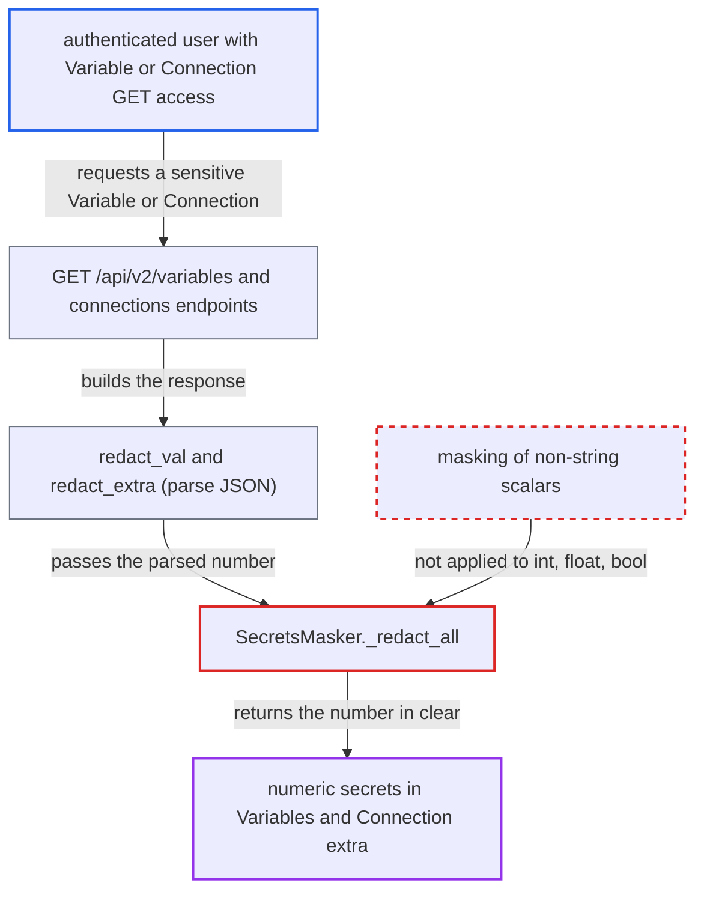

# API masking skips numeric values of sensitive Variables and Connection extra keys

| Field | Value |
|---|---|
| ID | `find_01Nm4dqvvGa2QmKqfpJfEWFV` |
| Severity | **Low** |
| Status | open |
| CWE | CWE-212 — Sensitive data exposure |
| Created | 2026-10-27T21:21:25.472291Z |
| Claude Security | https://claude.ai/security/findings/find_01Nm4dqvvGa2QmKqfpJfEWFV |

## Description

An authenticated user who may read Variables or Connections, but is not meant to see secrets, can read some secrets in clear through the API. Only values stored as bare numbers are affected, such as PINs, numeric passwords and numeric API keys. The cause is `_redact_all` in `SecretsMasker`, which masks only `str` values and returns numbers unchanged.

1. **administrator** stores a sensitive-named Variable whose value is a bare number. For example, a key like `db_password`, `*_token` or `api_key` with the value `4821937465`. A Variable is always stored and decrypted as a string. ([`airflow-core/src/airflow/models/variable.py:94-121`](https://github.com/cx-benchmark/airflow/blob/a462d683469bb9f55646b0515ef84c41e16650fb/airflow-core/src/airflow/models/variable.py#L94-L121))
2. **attacker** requests the Variable through the API. The attacker calls `GET /api/v2/variables/{key}` or the list endpoint. Access is gated only by `requires_access_variable("GET")`, and no other redaction is applied. ([`airflow-core/src/airflow/api_fastapi/core_api/routes/public/variables.py:75-93`](https://github.com/cx-benchmark/airflow/blob/a462d683469bb9f55646b0515ef84c41e16650fb/airflow-core/src/airflow/api_fastapi/core_api/routes/public/variables.py#L75-L93))
3. **`VariableResponse.redact_val`** parses the stored string with `json.loads` and then calls `redact`. The numeric string becomes an `int` or `float` before key-based masking runs. ([`airflow-core/src/airflow/api_fastapi/core_api/datamodels/variables.py:42-54`](https://github.com/cx-benchmark/airflow/blob/a462d683469bb9f55646b0515ef84c41e16650fb/airflow-core/src/airflow/api_fastapi/core_api/datamodels/variables.py#L42-L54))
4. **`SecretsMasker._redact`** sends the value to `_redact_all` because the key name is sensitive. The string replacer is never reached for such values. ([`shared/secrets_masker/src/airflow_shared/secrets_masker/secrets_masker.py:362-373`](https://github.com/cx-benchmark/airflow/blob/a462d683469bb9f55646b0515ef84c41e16650fb/shared/secrets_masker/src/airflow_shared/secrets_masker/secrets_masker.py#L362-L373))
5. **`_redact_all`** returns the number unchanged. Only `str` leaves are replaced. Other scalars such as `int`, `float` and `bool` reach `return item` at line 360. ([`shared/secrets_masker/src/airflow_shared/secrets_masker/secrets_masker.py:336-360`](https://github.com/cx-benchmark/airflow/blob/a462d683469bb9f55646b0515ef84c41e16650fb/shared/secrets_masker/src/airflow_shared/secrets_masker/secrets_masker.py#L336-L360))
6. **API server** serialises the number back into the response in clear. The attacker reads the secret. `ConnectionResponse.redact_extra` has the same gap for numeric values under sensitive extra keys. ([`airflow-core/src/airflow/api_fastapi/core_api/datamodels/connections.py:98-120`](https://github.com/cx-benchmark/airflow/blob/a462d683469bb9f55646b0515ef84c41e16650fb/airflow-core/src/airflow/api_fastapi/core_api/datamodels/connections.py#L98-L120))

## Assessment

The attacker is an authenticated user whose role can GET Variables or Connections but is not entitled to see secrets, such as the documented 'Connection configuration users'. The default auth managers grant these permissions to Op and above. Masking is on by default, so the default deployment is affected. The attack works only when a sensitive value is stored as a bare JSON number, which the attacker does not control. Another way in is a JSON Variable such as `{"password": 12345678}`. A Connection `extra` key such as `password`, `api_key` or `secret` is also exposed, unless an installed provider declares that exact key `format: password`.

Impact: The attacker reads the plaintext of sensitive Variables or extra keys whose values are purely numeric. String secrets, connection passwords and values with leading zeros stay masked. What leaks depends on what operators store, so the loss is limited. Nothing is modified.

## Recommendation

(1) `SecretsMasker._redact_all` treats only `str` as a redactable leaf, so non-string scalars under a sensitive key come out unchanged (`secrets_masker.py:360`).

Fix criteria: Once a key is judged sensitive, every non-null scalar leaf beneath it, numbers and booleans included, comes out as the replacement marker. `redact(4821937465, "api_key")` and `redact({"password": 12345678})` return `***` values. The merge path still restores the original values when `***` is sent back unchanged. The test at `test_secrets_masker.py:1232-1248` that asserts the number pass-through is updated.

(2) `VariableResponse.redact_val` turns a string-stored Variable into a typed JSON value before key-based masking, so a sensitive Variable's value can escape masking based on its content (`variables.py:47-49`).

Fix criteria: For a Variable whose key is sensitive, the response value is masked whatever the stored string parses to. `GET /api/v2/variables/<sensitive_key>` and the list endpoint return `***` for stored values like `4821937465`, `1.5e3` and `{"password": 123456}`. The Connection `extra` response masks numeric values under sensitive keys in the same way.

## Evidence

**https://github.com/cx-benchmark/airflow**

- [`shared/secrets_masker/src/airflow_shared/secrets_masker/secrets_masker.py:336-360`](https://github.com/cx-benchmark/airflow/blob/a462d683469bb9f55646b0515ef84c41e16650fb/shared/secrets_masker/src/airflow_shared/secrets_masker/secrets_masker.py#L336-L360)
- [`shared/secrets_masker/src/airflow_shared/secrets_masker/secrets_masker.py:362-373`](https://github.com/cx-benchmark/airflow/blob/a462d683469bb9f55646b0515ef84c41e16650fb/shared/secrets_masker/src/airflow_shared/secrets_masker/secrets_masker.py#L362-L373)
- [`airflow-core/src/airflow/api_fastapi/core_api/datamodels/variables.py:42-54`](https://github.com/cx-benchmark/airflow/blob/a462d683469bb9f55646b0515ef84c41e16650fb/airflow-core/src/airflow/api_fastapi/core_api/datamodels/variables.py#L42-L54)
- [`airflow-core/src/airflow/models/variable.py:94-121`](https://github.com/cx-benchmark/airflow/blob/a462d683469bb9f55646b0515ef84c41e16650fb/airflow-core/src/airflow/models/variable.py#L94-L121)
- [`airflow-core/src/airflow/api_fastapi/core_api/routes/public/variables.py:75-93`](https://github.com/cx-benchmark/airflow/blob/a462d683469bb9f55646b0515ef84c41e16650fb/airflow-core/src/airflow/api_fastapi/core_api/routes/public/variables.py#L75-L93)
- [`airflow-core/src/airflow/api_fastapi/core_api/datamodels/connections.py:98-120`](https://github.com/cx-benchmark/airflow/blob/a462d683469bb9f55646b0515ef84c41e16650fb/airflow-core/src/airflow/api_fastapi/core_api/datamodels/connections.py#L98-L120)
- [`airflow-core/src/airflow/settings.py:762-791`](https://github.com/cx-benchmark/airflow/blob/a462d683469bb9f55646b0515ef84c41e16650fb/airflow-core/src/airflow/settings.py#L762-L791)

