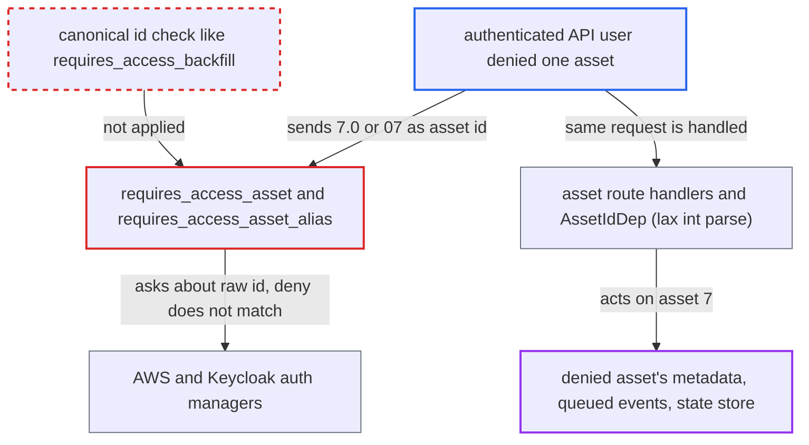

# Asset authorization checks the raw path id while handlers act on the lax-parsed integer

| Field | Value |
|---|---|
| ID | `find_01GLzEGFRCYLsLyrBZzQuqJ5` |
| Severity | **Low** |
| Status | open |
| CWE | CWE-863 — Incorrect authorization |
| Created | 2026-10-27T21:20:50.348752Z |
| Claude Security | https://claude.ai/security/findings/find_01GLzEGFRCYLsLyrBZzQuqJ5 |

## Description

An authenticated API user who is denied one specific asset can still read it, change its state store and delete its queued events. This works only where an AWS (AVP `forbid`) or Keycloak per-asset deny policy is in use. The cause is that `requires_access_asset` and `requires_access_asset_alias` authorize the raw path string, such as `7.0`, while the handler acts on the integer `7`.

1. **attacker** sends a request with a variant spelling of the denied asset's id. Examples are `GET /api/v2/assets/7.0`, `/assets/07`, `/assets/+7`, or `PUT /api/v2/assets/7.0/state-store/k`.
2. **the dependency `requires_access_asset`** builds the authorization subject from the raw `request.path_params` string. `_build_asset_details` puts that string into `AssetDetails.id`. It resolves name and uri only when the string passes `isdigit()`, so `7.0` gets no name or uri and `07` keeps the raw id. ([`airflow-core/src/airflow/api_fastapi/core_api/security.py:1224-1268`](https://github.com/cx-benchmark/airflow/blob/a462d683469bb9f55646b0515ef84c41e16650fb/airflow-core/src/airflow/api_fastapi/core_api/security.py#L1224-L1268))
3. **the dependency `requires_access_asset_alias`** does the same for alias routes. It passes the raw `asset_alias_id` string as `AssetAliasDetails(id=...)` on `GET /assets/aliases/{asset_alias_id}`. ([`airflow-core/src/airflow/api_fastapi/core_api/security.py:1287-1301`](https://github.com/cx-benchmark/airflow/blob/a462d683469bb9f55646b0515ef84c41e16650fb/airflow-core/src/airflow/api_fastapi/core_api/security.py#L1287-L1301))
4. **the auth manager** decides on the literal id string. `AwsAuthManager` sends it as the AVP entity id and `KeycloakAuthManager` sends it as the `resource_id` claim. A deny on asset `7` does not match `7.0`, so the group-wide permit allows the request. ([`providers/amazon/src/airflow/providers/amazon/aws/auth_manager/aws_auth_manager.py:181-195`](https://github.com/cx-benchmark/airflow/blob/a462d683469bb9f55646b0515ef84c41e16650fb/providers/amazon/src/airflow/providers/amazon/aws/auth_manager/aws_auth_manager.py#L181-L195))
5. **the route handler or `AssetIdDep`** parses the path id as an `int` with pydantic's lax mode and acts on asset 7. Lax parsing maps `7.0`, `7.00`, ` 7` and `+7` to `7`. The handler then reads, writes or deletes data for the denied asset. ([`airflow-core/src/airflow/api_fastapi/core_api/routes/public/assets.py:573-616`](https://github.com/cx-benchmark/airflow/blob/a462d683469bb9f55646b0515ef84c41e16650fb/airflow-core/src/airflow/api_fastapi/core_api/routes/public/assets.py#L573-L616))
6. **the state-store routes** let the caller read, overwrite or clear the denied asset's state store. `set_asset_state_store` and `clear_asset_state_store` use the same divergent id. ([`airflow-core/src/airflow/api_fastapi/core_api/routes/public/asset_state_store.py:47-226`](https://github.com/cx-benchmark/airflow/blob/a462d683469bb9f55646b0515ef84c41e16650fb/airflow-core/src/airflow/api_fastapi/core_api/routes/public/asset_state_store.py#L47-L226))

## Assessment

The attacker is an authenticated API user whose group is granted asset access, but who is denied one specific asset by a per-resource policy. That is an AWS AVP `forbid` or a Keycloak policy on the resource id. Without such a deny policy there is nothing to bypass. The attacker sends a variant spelling of the id on an asset route, an asset state-store route or an asset alias route. FAB and Simple auth managers ignore `details` and are unaffected.

Impact: The attacker can read the denied asset's metadata, queued events and state-store values. They can also overwrite or clear its state-store keys and delete its queued events. Materialization still needs RUN permission on the producing Dag. The impact stays within that asset's records.

## Recommendation

The asset and asset-alias authorization dependencies take the resource id from the unparsed path string. The handlers take it from pydantic's lax integer parsing, so one asset can have two identities.

Fix criteria: The id passed to `is_authorized_asset` and `is_authorized_asset_alias` is the same canonical integer the handler acts on, written canonically (for example `"7"`), with name and uri resolved from it. Spellings the handler rejects fail closed. Tests show that `/assets/7.0`, `/assets/07`, `/assets/+7`, `/assets/%207`, `/assets/7.0/state-store/k` and `/assets/aliases/7.0` either present `AssetDetails(id="7", name=..., uri=...)` or `AssetAliasDetails(id="7")`, or are rejected, for every route that uses these dependencies.

## Evidence

**https://github.com/cx-benchmark/airflow**

- [`airflow-core/src/airflow/api_fastapi/core_api/security.py:1224-1268`](https://github.com/cx-benchmark/airflow/blob/a462d683469bb9f55646b0515ef84c41e16650fb/airflow-core/src/airflow/api_fastapi/core_api/security.py#L1224-L1268)
- [`airflow-core/src/airflow/api_fastapi/core_api/security.py:1287-1301`](https://github.com/cx-benchmark/airflow/blob/a462d683469bb9f55646b0515ef84c41e16650fb/airflow-core/src/airflow/api_fastapi/core_api/security.py#L1287-L1301)
- [`airflow-core/src/airflow/api_fastapi/core_api/routes/public/assets.py:573-616`](https://github.com/cx-benchmark/airflow/blob/a462d683469bb9f55646b0515ef84c41e16650fb/airflow-core/src/airflow/api_fastapi/core_api/routes/public/assets.py#L573-L616)
- [`airflow-core/src/airflow/api_fastapi/core_api/routes/public/asset_state_store.py:47-226`](https://github.com/cx-benchmark/airflow/blob/a462d683469bb9f55646b0515ef84c41e16650fb/airflow-core/src/airflow/api_fastapi/core_api/routes/public/asset_state_store.py#L47-L226)
- [`providers/amazon/src/airflow/providers/amazon/aws/auth_manager/aws_auth_manager.py:181-195`](https://github.com/cx-benchmark/airflow/blob/a462d683469bb9f55646b0515ef84c41e16650fb/providers/amazon/src/airflow/providers/amazon/aws/auth_manager/aws_auth_manager.py#L181-L195)
- [`providers/keycloak/src/airflow/providers/keycloak/auth_manager/keycloak_auth_manager.py:338-359`](https://github.com/cx-benchmark/airflow/blob/a462d683469bb9f55646b0515ef84c41e16650fb/providers/keycloak/src/airflow/providers/keycloak/auth_manager/keycloak_auth_manager.py#L338-L359)
- [`providers/amazon/docs/auth-manager/manage/index.rst:298-312`](https://github.com/cx-benchmark/airflow/blob/a462d683469bb9f55646b0515ef84c41e16650fb/providers/amazon/docs/auth-manager/manage/index.rst#L298-L312)
- [`airflow-core/src/airflow/api_fastapi/core_api/security.py:556-606`](https://github.com/cx-benchmark/airflow/blob/a462d683469bb9f55646b0515ef84c41e16650fb/airflow-core/src/airflow/api_fastapi/core_api/security.py#L556-L606)

