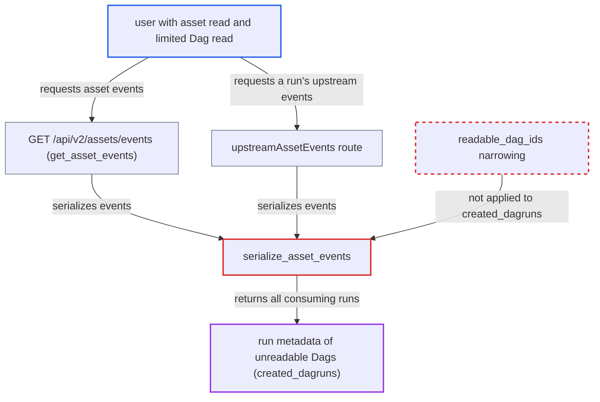

# Asset events expose DAG run metadata of DAGs the caller may not read

| Field | Value |
|---|---|
| ID | `find_01Y39uC6PN3vDwhJVmTPWaEH` |
| Severity | **Low** |
| Status | open |
| CWE | CWE-863 — Missing authorization |
| Created | 2026-10-27T21:07:40.376511Z |
| Claude Security | https://claude.ai/security/findings/find_01Y39uC6PN3vDwhJVmTPWaEH |

## Description

A logged-in user who can read assets but only some Dags can see run metadata of Dags they may not read. This covers each run's Dag id, run id, state, dates, data interval and partition key. It needs a Dag outside the user's readable set that is scheduled on a visible asset and has consumed its events. The cause is `serialize_asset_events`, which returns the whole `created_dagruns` list without narrowing it to the caller's readable Dags.

1. **the scheduler** links each asset-triggered run to the events it consumed. This happens for every scheduled Dag, so runs of Dags the caller cannot read end up in `created_dagruns` of events the caller can see. ([`airflow-core/src/airflow/jobs/scheduler_job_runner.py:3060-3075`](https://github.com/cx-benchmark/airflow/blob/a462d683469bb9f55646b0515ef84c41e16650fb/airflow-core/src/airflow/jobs/scheduler_job_runner.py#L3060-L3075))
2. **attacker** calls `GET /api/v2/assets/events`, optionally with `?asset_id=N`. The attacker has asset read and per-Dag read on only some Dags. ([`airflow-core/src/airflow/api_fastapi/core_api/routes/public/assets.py:293-386`](https://github.com/cx-benchmark/airflow/blob/a462d683469bb9f55646b0515ef84c41e16650fb/airflow-core/src/airflow/api_fastapi/core_api/routes/public/assets.py#L293-L386))
3. **`PermittedAssetEventFilter`** lets the events through. Events with `source_dag_id IS NULL` (created through the API or by a watcher) pass for any asset reader, and so do events from a readable producer Dag. ([`airflow-core/src/airflow/api_fastapi/core_api/security.py:341-355`](https://github.com/cx-benchmark/airflow/blob/a462d683469bb9f55646b0515ef84c41e16650fb/airflow-core/src/airflow/api_fastapi/core_api/security.py#L341-L355))
4. **`serialize_asset_events`** validates the whole ORM event into `AssetEventResponse`. It walks `created_dagruns` only to set `triggering`, and never narrows the list to the caller's readable Dags. ([`airflow-core/src/airflow/api_fastapi/core_api/services/public/assets.py:31-45`](https://github.com/cx-benchmark/airflow/blob/a462d683469bb9f55646b0515ef84c41e16650fb/airflow-core/src/airflow/api_fastapi/core_api/services/public/assets.py#L31-L45))
5. **`DagRunAssetReference`** writes each consuming run's metadata into the response. It includes `dag_id`, `run_id`, `state`, `logical_date`, `start_date`, `end_date`, the data interval, `partition_key` and `triggering`. ([`airflow-core/src/airflow/api_fastapi/core_api/datamodels/assets.py:181-216`](https://github.com/cx-benchmark/airflow/blob/a462d683469bb9f55646b0515ef84c41e16650fb/airflow-core/src/airflow/api_fastapi/core_api/datamodels/assets.py#L181-L216))

## Assessment

The attacker is an authenticated user with asset read (FAB `can_read` on Assets, where `get_authorized_assets` returns every asset) and a role limited to some Dags. The attacker calls `GET /api/v2/assets/events`, optionally with `?asset_id=N`. A second way in is `GET /dags/{dag_id}/dagRuns/{dag_run_id}/upstreamAssetEvents`. It checks read on that one Dag's run only, but it also lists runs of other Dags that consumed the same events. The attack needs a Dag outside the attacker's readable set to be scheduled on a visible asset and to have consumed its events. That is deployment state the attacker does not control. No victim action is needed.

Impact: The attacker learns metadata of runs of Dags they may not read: Dag ids, run ids, run states, logical, start and end dates, data intervals and partition keys. This breaks per-Dag read isolation. It reveals no credentials, code, XCom or logs, and gives no write access.

## Recommendation

`serialize_asset_events` emits the whole `AssetEvent.created_dagruns` relationship. Run metadata of Dags outside the caller's readable set crosses the per-Dag authorization boundary that the other asset routes enforce with `readable_dag_ids`.

Fix criteria: Every `created_dagruns` entry returned by `GET /assets/events` or `GET /dags/{dag_id}/dagRuns/{dag_run_id}/upstreamAssetEvents` belongs to a Dag in the caller's readable set, the set `ReadableDagsFilterDep` yields. The `triggering` flag stays correct. To verify, take a user who may read assets and Dag A but not Dag B, and an API-created event consumed by both. On both routes the response must list A's run and omit B's.

## Evidence

**https://github.com/cx-benchmark/airflow**

- [`airflow-core/src/airflow/api_fastapi/core_api/services/public/assets.py:31-45`](https://github.com/cx-benchmark/airflow/blob/a462d683469bb9f55646b0515ef84c41e16650fb/airflow-core/src/airflow/api_fastapi/core_api/services/public/assets.py#L31-L45)
- [`airflow-core/src/airflow/api_fastapi/core_api/routes/public/assets.py:293-386`](https://github.com/cx-benchmark/airflow/blob/a462d683469bb9f55646b0515ef84c41e16650fb/airflow-core/src/airflow/api_fastapi/core_api/routes/public/assets.py#L293-L386)
- [`airflow-core/src/airflow/api_fastapi/core_api/security.py:341-355`](https://github.com/cx-benchmark/airflow/blob/a462d683469bb9f55646b0515ef84c41e16650fb/airflow-core/src/airflow/api_fastapi/core_api/security.py#L341-L355)
- [`airflow-core/src/airflow/api_fastapi/core_api/datamodels/assets.py:181-216`](https://github.com/cx-benchmark/airflow/blob/a462d683469bb9f55646b0515ef84c41e16650fb/airflow-core/src/airflow/api_fastapi/core_api/datamodels/assets.py#L181-L216)
- [`airflow-core/src/airflow/api_fastapi/core_api/routes/public/dag_run.py:286-318`](https://github.com/cx-benchmark/airflow/blob/a462d683469bb9f55646b0515ef84c41e16650fb/airflow-core/src/airflow/api_fastapi/core_api/routes/public/dag_run.py#L286-L318)
- [`airflow-core/src/airflow/jobs/scheduler_job_runner.py:3060-3075`](https://github.com/cx-benchmark/airflow/blob/a462d683469bb9f55646b0515ef84c41e16650fb/airflow-core/src/airflow/jobs/scheduler_job_runner.py#L3060-L3075)

