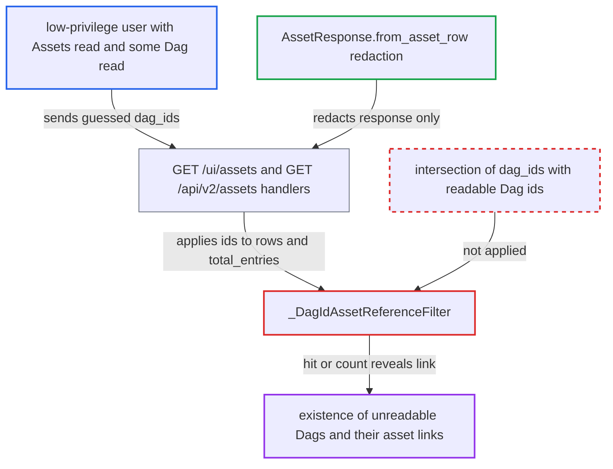

# Asset list dag_ids filter reveals unreadable Dags' existence and asset links

| Field | Value |
|---|---|
| ID | `find_01RTHJGauaLeQ6WrgRkb2hKK` |
| Severity | **Low** |
| Status | open |
| CWE | CWE-203 — Information exposure |
| Created | 2026-10-27T21:14:05.905113Z |
| Claude Security | https://claude.ai/security/findings/find_01RTHJGauaLeQ6WrgRkb2hKK |

## Description

A logged-in user who can read only some Dags can find out whether other Dags exist, and which assets those Dags are scheduled on, produce or consume. The attacker needs a role with broad asset read and per-Dag read, as under FAB, Keycloak or AWS, and must guess exact Dag ids. The `dag_ids` filter `_DagIdAssetReferenceFilter` matches hidden Dags' references without limiting the ids to the caller's readable Dags.

1. **Attacker** sends a request with guessed Dag ids in `dag_ids`. The request is `GET /ui/assets?dag_ids=a,b,c,...&limit=1` or the same parameter on `GET /api/v2/assets`, and the list can hold many guesses. ([`airflow-core/src/airflow/api_fastapi/core_api/routes/ui/assets.py:87-155`](https://github.com/cx-benchmark/airflow/blob/a462d683469bb9f55646b0515ef84c41e16650fb/airflow-core/src/airflow/api_fastapi/core_api/routes/ui/assets.py#L87-L155))
2. **the handler `get_assets`** passes the supplied ids to the row filter and the `total_entries` count. The ids are not intersected with the caller's readable Dag ids, and `readable_dags_filter` is used only later. ([`airflow-core/src/airflow/api_fastapi/core_api/routes/public/assets.py:149-239`](https://github.com/cx-benchmark/airflow/blob/a462d683469bb9f55646b0515ef84c41e16650fb/airflow-core/src/airflow/api_fastapi/core_api/routes/public/assets.py#L149-L239))
3. **the filter `_DagIdAssetReferenceFilter`** keeps every asset that has a reference row naming any supplied Dag id. It checks `DagScheduleAssetReference`, `TaskOutletAssetReference` and `TaskInletAssetReference` rows, whatever the caller's Dag permissions. ([`airflow-core/src/airflow/api_fastapi/common/parameters/asset.py:63-86`](https://github.com/cx-benchmark/airflow/blob/a462d683469bb9f55646b0515ef84c41e16650fb/airflow-core/src/airflow/api_fastapi/common/parameters/asset.py#L63-L86))
4. **`AssetResponse.from_asset_row`** removes unreadable Dags' references from each returned asset. The redaction acts on the response only. Which assets come back, and how many, has already been decided by the hidden references. ([`airflow-core/src/airflow/api_fastapi/core_api/datamodels/assets.py:114-149`](https://github.com/cx-benchmark/airflow/blob/a462d683469bb9f55646b0515ef84c41e16650fb/airflow-core/src/airflow/api_fastapi/core_api/datamodels/assets.py#L114-L149))
5. **Attacker** reads the returned rows or `total_entries` to confirm a hit. A non-empty result or a non-zero `total_entries` shows that a Dag with a guessed id exists and is linked to the visible assets. Bisecting the guesses narrows down each hidden Dag and its assets.

## Assessment

The attacker is an authenticated low-privilege user. Their role grants Assets read and read on only some Dags, as with FAB `DAG:<id>` roles (shipped by the Helm chart), Keycloak or AWS. They call either `GET /ui/assets` or `GET /api/v2/assets` with `dag_ids`. No victim is involved. It works only where per-Dag scoped roles exist and a hidden Dag references assets. Dag ids must be guessed exactly. The `SimpleAuthManager` grants all Dags or none and is not affected.

Impact: The attacker learns whether guessed Dag ids outside their permissions exist, and which assets each one is scheduled on, produces or consumes. Dag code, runs, logs, credentials and write access are not exposed. The asset rows were already readable to the caller.

## Recommendation

`_DagIdAssetReferenceFilter` applies caller-supplied Dag ids to the asset reference tables. The `get_assets` handlers on both routers never intersect them with the caller's readable Dag ids. A query predicate therefore reveals Dag-to-asset links that the response removes on purpose.

Fix criteria: On both `GET /ui/assets` and `GET /api/v2/assets`, the `dag_ids` predicate matches only reference rows of Dags in the caller's readable set. To verify, take a FAB user with Assets read and `DAG:A` read only, where Dag B produces asset X. Then `dag_ids=B` must return the same rows and `total_entries` as a nonexistent Dag id. And `dag_ids=A` must still return A's assets.

## Evidence

**https://github.com/cx-benchmark/airflow**

- [`airflow-core/src/airflow/api_fastapi/common/parameters/asset.py:63-86`](https://github.com/cx-benchmark/airflow/blob/a462d683469bb9f55646b0515ef84c41e16650fb/airflow-core/src/airflow/api_fastapi/common/parameters/asset.py#L63-L86)
- [`airflow-core/src/airflow/api_fastapi/core_api/routes/ui/assets.py:87-155`](https://github.com/cx-benchmark/airflow/blob/a462d683469bb9f55646b0515ef84c41e16650fb/airflow-core/src/airflow/api_fastapi/core_api/routes/ui/assets.py#L87-L155)
- [`airflow-core/src/airflow/api_fastapi/core_api/routes/public/assets.py:149-239`](https://github.com/cx-benchmark/airflow/blob/a462d683469bb9f55646b0515ef84c41e16650fb/airflow-core/src/airflow/api_fastapi/core_api/routes/public/assets.py#L149-L239)
- [`airflow-core/src/airflow/api_fastapi/core_api/datamodels/assets.py:114-149`](https://github.com/cx-benchmark/airflow/blob/a462d683469bb9f55646b0515ef84c41e16650fb/airflow-core/src/airflow/api_fastapi/core_api/datamodels/assets.py#L114-L149)
- [`airflow-core/src/airflow/api_fastapi/core_api/services/ui/dependencies.py:450-471`](https://github.com/cx-benchmark/airflow/blob/a462d683469bb9f55646b0515ef84c41e16650fb/airflow-core/src/airflow/api_fastapi/core_api/services/ui/dependencies.py#L450-L471)
- [`providers/fab/src/airflow/providers/fab/auth_manager/fab_auth_manager.py:589-660`](https://github.com/cx-benchmark/airflow/blob/a462d683469bb9f55646b0515ef84c41e16650fb/providers/fab/src/airflow/providers/fab/auth_manager/fab_auth_manager.py#L589-L660)

