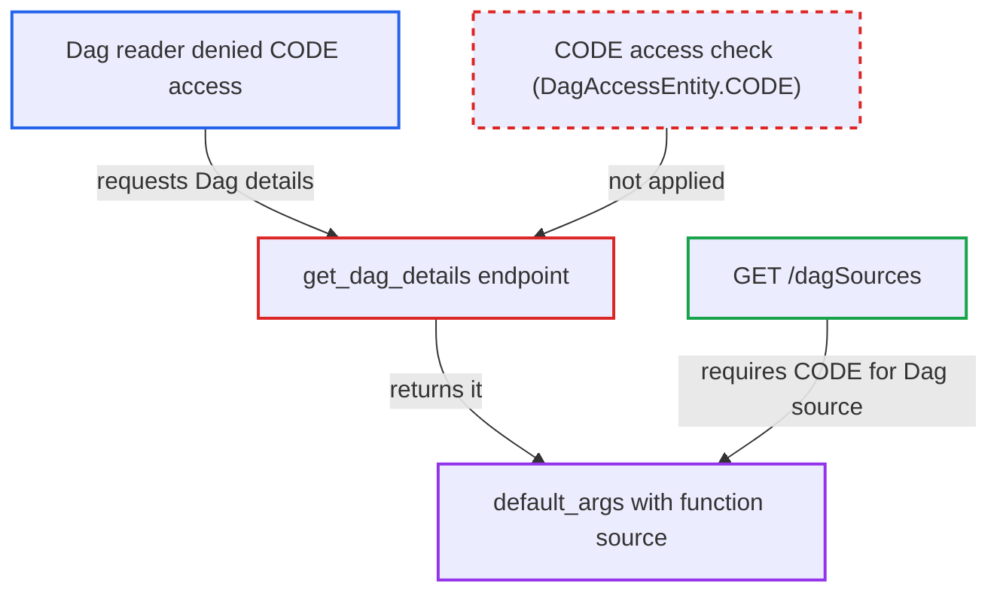

# Dag details endpoint discloses callable source from default_args to readers denied CODE access

| Field | Value |
|---|---|
| ID | `find_01YNoro8iuGfwWZrPECzKdJ6` |
| Severity | **Low** |
| Status | open |
| CWE | CWE-212 — Information exposure |
| Created | 2026-10-27T21:24:24.649988Z |
| Claude Security | https://claude.ai/security/findings/find_01YNoro8iuGfwWZrPECzKdJ6 |

## Description

A logged-in user who can read a Dag but is denied code access can still read the source of some functions in that Dag. This only applies where an operator has removed CODE (`DAG Code`) access from a role, because every shipped default role grants it, and where a Dag author put a non-callback callable in `default_args`. `BaseSerialization.serialize` stores the callable's full source, and `get_dag_details` returns it with only a Dag GET check.

1. **Dag author** puts a callable in `default_args`. Examples are `pre_execute`/`post_execute` hooks, `python_callable`, a sensor's `response_check`, or callables nested in a dict such as `op_kwargs`.
2. **`BaseSerialization.serialize`** turns the callable into its full source text. It stores `str(get_python_source(var))`, and `get_python_source` uses `inspect.getsource`. ([`airflow-core/src/airflow/serialization/serialized_objects.py:609-610`](https://github.com/cx-benchmark/airflow/blob/a462d683469bb9f55646b0515ef84c41e16650fb/airflow-core/src/airflow/serialization/serialized_objects.py#L609-L610))
3. **`serialize_dag`** keeps the source text in the stored serialized Dag. It replaces only the `_HAS_FLAG_FIELDS` keys (`on_*_callback`, `retry_policy`) with `has_*` flags, so every other callable in `default_args` stays as source. ([`airflow-core/src/airflow/serialization/serialized_objects.py:1803-1816`](https://github.com/cx-benchmark/airflow/blob/a462d683469bb9f55646b0515ef84c41e16650fb/airflow-core/src/airflow/serialization/serialized_objects.py#L1803-L1816))
4. **attacker with Dag read but no CODE access** calls `GET /api/v2/dags/{dag_id}/details` or opens the Dag Details tab. The route `get_dag_details` is guarded only by `requires_access_dag(method="GET")`, and it copies `default_args` from the deserialized Dag onto the response. ([`airflow-core/src/airflow/api_fastapi/core_api/routes/public/dags.py:237-262`](https://github.com/cx-benchmark/airflow/blob/a462d683469bb9f55646b0515ef84c41e16650fb/airflow-core/src/airflow/api_fastapi/core_api/routes/public/dags.py#L237-L262))
5. **`DAGDetailsResponse`** returns `default_args` with the function source strings. Its validator rewrites only `pod_override`, so the source text reaches the caller unchanged. ([`airflow-core/src/airflow/api_fastapi/core_api/datamodels/dags.py:224-277`](https://github.com/cx-benchmark/airflow/blob/a462d683469bb9f55646b0515ef84c41e16650fb/airflow-core/src/airflow/api_fastapi/core_api/datamodels/dags.py#L224-L277))

## Assessment

The attacker is an authenticated API or UI user whose role grants Dag read but not `DAG Code` (`DagAccessEntity.CODE`). Two conditions outside the attacker's control must hold. The operator must have restricted CODE for that role, since every shipped default role grants it. A Dag author must also have placed a non-callback callable in `default_args`. The attacker then calls `GET /api/v2/dags/{dag_id}/details` or opens the Dag Details tab.

Impact: The attacker reads the bodies of callables a Dag author put in `default_args`. These may reveal internal hostnames, paths, logic or literals hard-coded in those functions. The leak does not cover the whole Dag file. Nothing is modified and availability is unaffected.

## Recommendation

(1) `BaseSerialization.serialize` stores the full Python source of any callable in the serialized Dag. The `default_args` cleanup in `serialize_dag` removes only callback and retry-policy keys. Function bodies end up in data that Dag-read endpoints return without a CODE check.

Fix criteria: The serialized Dag holds no function source for callables in `default_args` or nested in it. At most it holds a qualified name or a presence flag, as template fields and mapped `python_callable` already do. To verify, serialize a Dag with `default_args={"pre_execute": fn}` and confirm that neither the stored blob nor `GET /dags/{id}/details` contains any line of `fn`'s body.

(2) `GET /dags/{dag_id}/details` returns serialized `default_args` to any Dag reader. The project gates Dag source and serialized-Dag values on `DagAccessEntity.CODE` elsewhere.

Fix criteria: A caller without CODE access to the Dag receives no Dag source text through the details response or the UI Details tab. Verify with a role that has Dag read but lacks `DAG Code`.

## Evidence

**https://github.com/cx-benchmark/airflow**

- [`airflow-core/src/airflow/serialization/serialized_objects.py:609-610`](https://github.com/cx-benchmark/airflow/blob/a462d683469bb9f55646b0515ef84c41e16650fb/airflow-core/src/airflow/serialization/serialized_objects.py#L609-L610)
- [`airflow-core/src/airflow/serialization/serialized_objects.py:1803-1816`](https://github.com/cx-benchmark/airflow/blob/a462d683469bb9f55646b0515ef84c41e16650fb/airflow-core/src/airflow/serialization/serialized_objects.py#L1803-L1816)
- [`airflow-core/src/airflow/api_fastapi/core_api/routes/public/dags.py:237-262`](https://github.com/cx-benchmark/airflow/blob/a462d683469bb9f55646b0515ef84c41e16650fb/airflow-core/src/airflow/api_fastapi/core_api/routes/public/dags.py#L237-L262)
- [`airflow-core/src/airflow/api_fastapi/core_api/datamodels/dags.py:224-277`](https://github.com/cx-benchmark/airflow/blob/a462d683469bb9f55646b0515ef84c41e16650fb/airflow-core/src/airflow/api_fastapi/core_api/datamodels/dags.py#L224-L277)
- [`airflow-core/src/airflow/api_fastapi/core_api/routes/public/dag_sources.py:56`](https://github.com/cx-benchmark/airflow/blob/a462d683469bb9f55646b0515ef84c41e16650fb/airflow-core/src/airflow/api_fastapi/core_api/routes/public/dag_sources.py#L56)
- [`airflow-core/docs/security/security_model.rst:253-277`](https://github.com/cx-benchmark/airflow/blob/a462d683469bb9f55646b0515ef84c41e16650fb/airflow-core/docs/security/security_model.rst#L253-L277)

