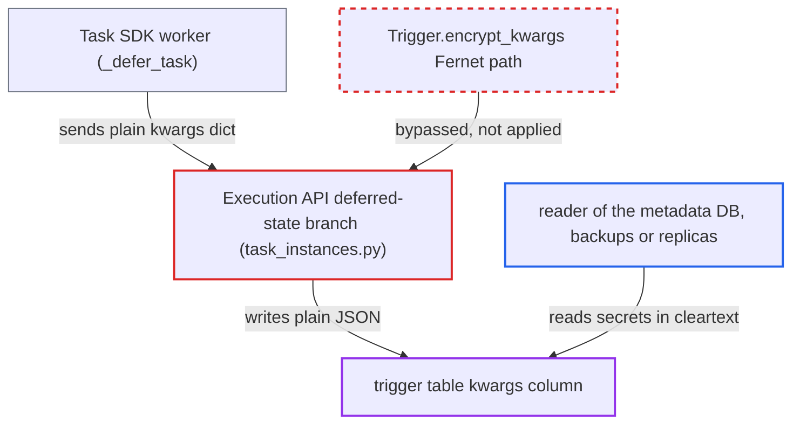

# Deferral via Execution API stores trigger kwargs in cleartext, bypassing Fernet encryption at rest

| Field | Value |
|---|---|
| ID | `find_01YKra2F9HDG6wvUnusw2Gam` |
| Severity | **Low** |
| Status | open |
| CWE | CWE-312 — Cleartext Storage of Sensitive Information |
| Created | 2026-10-27T21:21:02.176841Z |
| Claude Security | https://claude.ai/security/findings/find_01YKra2F9HDG6wvUnusw2Gam |

## Description

Anyone who can read the Airflow metadata database, its backups or replicas can read the arguments of deferred tasks' triggers in cleartext. Those arguments can include credentials such as auth headers, access tokens or DSNs. The Execution API deferral route `_create_ti_state_update_query_and_update_state` stores the kwargs as plain JSON and skips the model's Fernet encryption. Exposure lasts only while the trigger row exists.

1. **the Task SDK `_defer_task`** builds the trigger kwargs as a plain serde-encoded dict. The SDK never encrypts the kwargs, so the server receives a dict and not an encrypted string. ([`task-sdk/src/airflow/sdk/execution_time/task_runner.py:1561-1583`](https://github.com/cx-benchmark/airflow/blob/a462d683469bb9f55646b0515ef84c41e16650fb/task-sdk/src/airflow/sdk/execution_time/task_runner.py#L1561-L1583))
2. **the worker** reports the deferral with `PATCH /task-instances/{id}/state`. The `TIDeferredStatePayload` carries `trigger_kwargs` in the clear. This is the normal path for every Airflow 3 worker. ([`airflow-core/src/airflow/api_fastapi/execution_api/routes/task_instances.py:952-966`](https://github.com/cx-benchmark/airflow/blob/a462d683469bb9f55646b0515ef84c41e16650fb/airflow-core/src/airflow/api_fastapi/execution_api/routes/task_instances.py#L952-L966))
3. **the route `_create_ti_state_update_query_and_update_state`** runs `json.dumps` on the kwargs and assigns the result to `trigger_row.encrypted_kwargs`. The code assumes a dict does not need encryption, so the `Trigger.encrypt_kwargs` path is never used. ([`airflow-core/src/airflow/api_fastapi/execution_api/routes/task_instances.py:952-966`](https://github.com/cx-benchmark/airflow/blob/a462d683469bb9f55646b0515ef84c41e16650fb/airflow-core/src/airflow/api_fastapi/execution_api/routes/task_instances.py#L952-L966))
4. **the `Trigger` model** is bypassed, so the trigger row is stored unencrypted. `Trigger._decrypt_kwargs` treats any value starting with `{` as unencrypted and reads it without error, so nothing flags the cleartext row. ([`airflow-core/src/airflow/models/trigger.py:128-184`](https://github.com/cx-benchmark/airflow/blob/a462d683469bb9f55646b0515ef84c41e16650fb/airflow-core/src/airflow/models/trigger.py#L128-L184))
5. **a reader of the metadata database** selects the kwargs column from the trigger table while the trigger is pending. The reader needs no Fernet key, because the stored value is plain JSON.

## Assessment

No active attack on the API is needed. Every deferral a worker reports through the Execution API writes a cleartext row. The beneficiary is anyone who can read the metadata database, its backups, replicas or logs. That includes a DBA, a backup operator, or an attacker holding database credentials but not the Fernet key. This is the adversary Fernet at-rest encryption is meant to stop. They read the `trigger` table's kwargs while triggers are pending. The scheduler-side start-trigger path in `models/taskinstance.py` still encrypts, so only deferrals through the Execution API are affected.

Impact: The reader obtains whatever the operator passed to its trigger. For many providers that is only connection ids. For others it is live credentials such as auth headers, access tokens or DSNs. Values are exposed only while the trigger row exists, and only to someone who can read the database. Nothing can be modified and nothing becomes unavailable.

## Recommendation

The Execution API writes task-supplied trigger kwargs to `trigger.kwargs` as plaintext JSON instead of going through the model's Fernet encryption. It does this through a branch that wrongly assumes the client already encrypted string input. This breaks the at-rest confidentiality the `Trigger` model and the documentation promise.

Fix criteria: Any trigger row created from an Execution API deferral has its kwargs Fernet-encrypted at rest, exactly like rows created by `Trigger(kwargs=...)`. The 'client already encrypted it' string branch is either removed or checks that the value is a valid Fernet token before storing it. To verify, defer a task through the API and check that the stored `trigger.kwargs` column does not start with `{` and decrypts with `get_fernet()`. The triggerer must still read the kwargs through `Trigger.kwargs`.

## Evidence

**https://github.com/cx-benchmark/airflow**

- [`airflow-core/src/airflow/api_fastapi/execution_api/routes/task_instances.py:952-966`](https://github.com/cx-benchmark/airflow/blob/a462d683469bb9f55646b0515ef84c41e16650fb/airflow-core/src/airflow/api_fastapi/execution_api/routes/task_instances.py#L952-L966)
- [`airflow-core/src/airflow/models/trigger.py:128-184`](https://github.com/cx-benchmark/airflow/blob/a462d683469bb9f55646b0515ef84c41e16650fb/airflow-core/src/airflow/models/trigger.py#L128-L184)
- [`task-sdk/src/airflow/sdk/execution_time/task_runner.py:1561-1583`](https://github.com/cx-benchmark/airflow/blob/a462d683469bb9f55646b0515ef84c41e16650fb/task-sdk/src/airflow/sdk/execution_time/task_runner.py#L1561-L1583)
- [`airflow-core/src/airflow/api_fastapi/core_api/datamodels/trigger.py:49-52`](https://github.com/cx-benchmark/airflow/blob/a462d683469bb9f55646b0515ef84c41e16650fb/airflow-core/src/airflow/api_fastapi/core_api/datamodels/trigger.py#L49-L52)
- [`airflow-core/docs/authoring-and-scheduling/deferring.rst:180-183`](https://github.com/cx-benchmark/airflow/blob/a462d683469bb9f55646b0515ef84c41e16650fb/airflow-core/docs/authoring-and-scheduling/deferring.rst#L180-L183)

