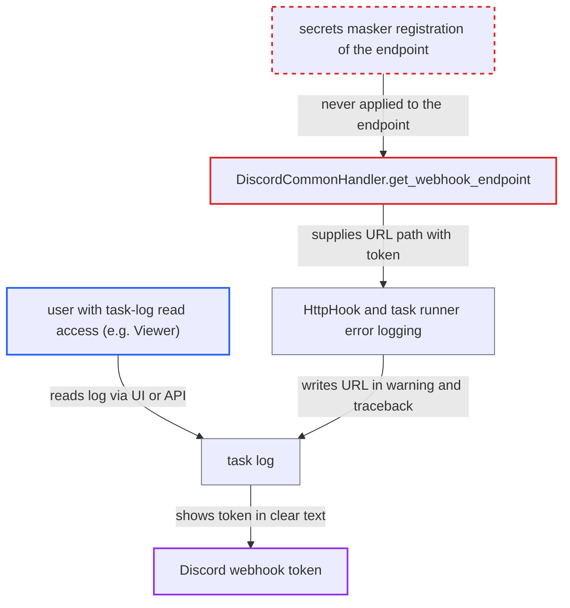

# Discord webhook token leaks into task logs through HTTP error and exception messages

| Field | Value |
|---|---|
| ID | `find_01RkuNUbDUAw8dM5oYDeaSuQ` |
| Severity | **Low** |
| Status | open |
| CWE | CWE-532 — Sensitive information in log file |
| Created | 2026-10-27T21:44:18.340874Z |
| Claude Security | https://claude.ai/security/findings/find_01RkuNUbDUAw8dM5oYDeaSuQ |

## Description

A logged-in user who can read task logs, such as a default Viewer, can read a Discord webhook token from the log of a failed run. With that token they can post to the Discord channel and edit or delete the webhook. The token is part of the request URL, and the secrets masker is never told about it. So the HTTP hook and the task runner write it into the task log when a request fails.

1. **the handler `DiscordCommonHandler.get_webhook_endpoint`** reads `webhooks/<id>/<token>` from the connection extra key `webhook_endpoint` and uses it as the request URL path. The value is not registered with the secrets masker, and it can also come from the operator argument. ([`providers/discord/src/airflow/providers/discord/hooks/discord_webhook.py:39-63`](https://github.com/cx-benchmark/airflow/blob/a462d683469bb9f55646b0515ef84c41e16650fb/providers/discord/src/airflow/providers/discord/hooks/discord_webhook.py#L39-L63))
2. **the secrets masker** does not recognise the endpoint as a secret. The connection code registers `conn.extra` only as one whole JSON string, and the key `webhook_endpoint` matches no entry of `DEFAULT_SENSITIVE_FIELDS`; `[core] sensitive_var_conn_names` is empty by default. ([`shared/secrets_masker/src/airflow_shared/secrets_masker/secrets_masker.py:604-641`](https://github.com/cx-benchmark/airflow/blob/a462d683469bb9f55646b0515ef84c41e16650fb/shared/secrets_masker/src/airflow_shared/secrets_masker/secrets_masker.py#L604-L641))
3. **the hook `HttpHook`** logs or raises an error whose text contains the full request URL. On a connection error `run_and_check` logs `str(ex)` at WARNING. On any 4xx or 5xx, `check_response` raises `AirflowException` inside `except HTTPError`, so the chained `HTTPError` text with the URL ends up in the traceback. ([`providers/http/src/airflow/providers/http/hooks/http.py:481-483`](https://github.com/cx-benchmark/airflow/blob/a462d683469bb9f55646b0515ef84c41e16650fb/providers/http/src/airflow/providers/http/hooks/http.py#L481-L483))
4. **the notifier `BaseNotifier.__call__`** logs the hook exception at ERROR when `DiscordNotifier` runs as a task callback. The exception text carries the token-bearing URL. ([`task-sdk/src/airflow/sdk/bases/notifier.py:137-141`](https://github.com/cx-benchmark/airflow/blob/a462d683469bb9f55646b0515ef84c41e16650fb/task-sdk/src/airflow/sdk/bases/notifier.py#L137-L141))
5. **the task runner** calls `log.exception` for the failing operator or callback. The exception chain is written into the task log, URL included, and the masker has no pattern that matches it. ([`task-sdk/src/airflow/sdk/execution_time/task_runner.py:2226-2230`](https://github.com/cx-benchmark/airflow/blob/a462d683469bb9f55646b0515ef84c41e16650fb/task-sdk/src/airflow/sdk/execution_time/task_runner.py#L2226-L2230))
6. **the attacker with task-log read access** opens the task log in the UI or calls `GET .../logs/{try_number}` and copies the token. The default Viewer role can read task logs but not connections, so it is not entitled to this credential. ([`providers/fab/src/airflow/providers/fab/auth_manager/security_manager/override.py:264-300`](https://github.com/cx-benchmark/airflow/blob/a462d683469bb9f55646b0515ef84c41e16650fb/providers/fab/src/airflow/providers/fab/auth_manager/security_manager/override.py#L264-L300))

## Assessment

The attacker is an authenticated user who can read task logs for a Dag that uses `DiscordWebhookOperator` or `DiscordNotifier` as a task callback. A default Viewer without connection access is enough. A run must fail with a network or TLS error, or Discord must answer with any 4xx or 5xx, for example a 429 rate limit. The attacker does not control that failure. It happens at default log levels. Lower-impact variants exist. The DEBUG URL line at `http.py:419` needs a non-default log level. The async WARNING at `http.py:676-686` fires in the triggerer for deadline-alert notifiers, where no task-log endpoint serves it.

Impact: The attacker obtains one stored connection credential, the Discord webhook token, which their role is not entitled to read. Airflow data and behaviour are not modified, and the service is unaffected.

Subsequent-system impact: Discord accepts the webhook token alone as authority. A holder can post arbitrary messages into the channel as the Airflow integration. They can also edit or delete its messages, and modify or delete the webhook, which disables the alerting channel.

## Recommendation

(1) The Discord hooks resolve a credential-bearing URL path from a connection extra key that the masker does not treat as sensitive, and never register it with the secrets masker. Any log line or exception message that contains the request URL exposes the token.

Fix criteria: Once the endpoint is resolved, from the connection or the operator argument, the token or full endpoint is masked in every task-log line and rendered exception. That covers the ConnectionError warning, the chained HTTPError traceback on 4xx/5xx, the notifier ERROR line and the task-runner failure logs. To verify, force a connection failure and a 429 or 404 for a Discord operator and for a notifier task callback with default settings. Then confirm the task log shows only the masked form.

(2) The generic HTTP hook logs and re-raises messages that contain the full request URL, which can hold credentials in its path or query.

Fix criteria: The HTTP hook's own warning and error output does not carry URL components that callers mark as secret. Verify that a hook whose endpoint holds a registered secret produces no clear-text secret in the WARNING or traceback output on a connection failure or on an HTTP error status.

## Evidence

**https://github.com/cx-benchmark/airflow**

- [`providers/discord/src/airflow/providers/discord/hooks/discord_webhook.py:39-63`](https://github.com/cx-benchmark/airflow/blob/a462d683469bb9f55646b0515ef84c41e16650fb/providers/discord/src/airflow/providers/discord/hooks/discord_webhook.py#L39-L63)
- [`providers/http/src/airflow/providers/http/hooks/http.py:481-483`](https://github.com/cx-benchmark/airflow/blob/a462d683469bb9f55646b0515ef84c41e16650fb/providers/http/src/airflow/providers/http/hooks/http.py#L481-L483)
- [`providers/http/src/airflow/providers/http/hooks/http.py:437-442`](https://github.com/cx-benchmark/airflow/blob/a462d683469bb9f55646b0515ef84c41e16650fb/providers/http/src/airflow/providers/http/hooks/http.py#L437-L442)
- [`task-sdk/src/airflow/sdk/bases/notifier.py:137-141`](https://github.com/cx-benchmark/airflow/blob/a462d683469bb9f55646b0515ef84c41e16650fb/task-sdk/src/airflow/sdk/bases/notifier.py#L137-L141)
- [`task-sdk/src/airflow/sdk/execution_time/task_runner.py:2226-2230`](https://github.com/cx-benchmark/airflow/blob/a462d683469bb9f55646b0515ef84c41e16650fb/task-sdk/src/airflow/sdk/execution_time/task_runner.py#L2226-L2230)
- [`task-sdk/src/airflow/sdk/execution_time/context.py:187-192`](https://github.com/cx-benchmark/airflow/blob/a462d683469bb9f55646b0515ef84c41e16650fb/task-sdk/src/airflow/sdk/execution_time/context.py#L187-L192)
- [`shared/secrets_masker/src/airflow_shared/secrets_masker/secrets_masker.py:604-641`](https://github.com/cx-benchmark/airflow/blob/a462d683469bb9f55646b0515ef84c41e16650fb/shared/secrets_masker/src/airflow_shared/secrets_masker/secrets_masker.py#L604-L641)
- [`providers/fab/src/airflow/providers/fab/auth_manager/security_manager/override.py:264-300`](https://github.com/cx-benchmark/airflow/blob/a462d683469bb9f55646b0515ef84c41e16650fb/providers/fab/src/airflow/providers/fab/auth_manager/security_manager/override.py#L264-L300)
- [`airflow-core/docs/security/security_model.rst:1320-1335`](https://github.com/cx-benchmark/airflow/blob/a462d683469bb9f55646b0515ef84c41e16650fb/airflow-core/docs/security/security_model.rst#L1320-L1335)

