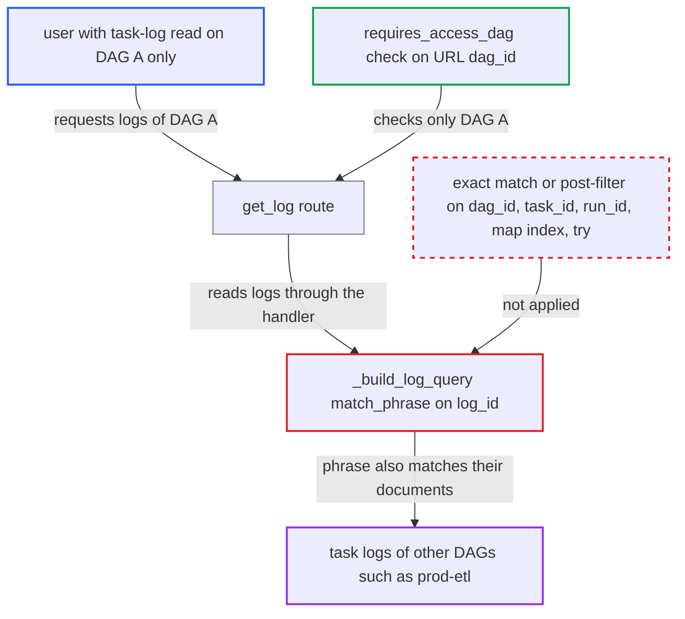

# Elasticsearch task-log reader selects documents by non-unique log_id phrase, leaking other DAGs' logs

| Field | Value |
|---|---|
| ID | `find_01TFiGbyRKC6KwC28ggwyCH7` |
| Severity | **Low** |
| Status | open |
| CWE | CWE-863 — Incorrect authorization |
| Created | 2026-10-27T21:38:05.672072Z |
| Claude Security | https://claude.ai/security/findings/find_01TFiGbyRKC6KwC28ggwyCH7 |

## Description

A user who may read task logs for one DAG can also read log lines from other DAGs whose names extend theirs, such as `prod-etl` when the user has `etl`. This needs the other DAG's documents to lack `ti_id`, which is true on Airflow cores before 3.4 and for older or minimal-schema documents on 3.4. The cause is that `_build_log_query` selects documents with an analyzed, unanchored `match_phrase` on a non-unique `log_id`.

1. **attacker** requests task logs for a DAG they are allowed to read. The attacker has task-log read access on DAG `A` only and calls `GET /dags/A/dagRuns/{run_id}/taskInstances/load/logs/1`; the route `get_log` checks access to the URL's `dag_id` only. ([`airflow-core/src/airflow/api_fastapi/core_api/routes/public/log.py:86-172`](https://github.com/cx-benchmark/airflow/blob/a462d683469bb9f55646b0515ef84c41e16650fb/airflow-core/src/airflow/api_fastapi/core_api/routes/public/log.py#L86-L172))
2. **the function `_render_log_id`** builds the log id from the task instance with plain hyphens. It fills the template `{dag_id}-{task_id}-{run_id}-{map_index}-{try_number}` without escaping, and `-` is legal in `dag_id` and `task_id`, so different task instances can give the same or a suffix-matching string. ([`providers/elasticsearch/src/airflow/providers/elasticsearch/log/es_task_handler.py:223-231`](https://github.com/cx-benchmark/airflow/blob/a462d683469bb9f55646b0515ef84c41e16650fb/providers/elasticsearch/src/airflow/providers/elasticsearch/log/es_task_handler.py#L223-L231))
3. **the function `_build_log_query`** selects documents with `match_phrase` on `log_id`. On an analyzed `text` field the phrase is split on `-`, lower-cased and not anchored to the whole value, so documents of DAG `prod-etl` task `load` match a query for DAG `etl` task `load` with the same run_id, map index and try. ([`providers/elasticsearch/src/airflow/providers/elasticsearch/log/es_task_handler.py:241-255`](https://github.com/cx-benchmark/airflow/blob/a462d683469bb9f55646b0515ef84c41e16650fb/providers/elasticsearch/src/airflow/providers/elasticsearch/log/es_task_handler.py#L241-L255))
4. **the function `_es_read`** searches all indexes and returns every hit. It puts the query in `must` and searches `index_patterns`, which defaults to `_all`, with no further filter. ([`providers/elasticsearch/src/airflow/providers/elasticsearch/log/es_task_handler.py:900-948`](https://github.com/cx-benchmark/airflow/blob/a462d683469bb9f55646b0515ef84c41e16650fb/providers/elasticsearch/src/airflow/providers/elasticsearch/log/es_task_handler.py#L900-L948))
5. **the function `_read`** turns every hit into the log response. It never compares the hit's `dag_id`, `task_id` or `run_id` with the requested task instance, so the other DAG's lines reach the attacker. ([`providers/elasticsearch/src/airflow/providers/elasticsearch/log/es_task_handler.py:434-541`](https://github.com/cx-benchmark/airflow/blob/a462d683469bb9f55646b0515ef84c41e16650fb/providers/elasticsearch/src/airflow/providers/elasticsearch/log/es_task_handler.py#L434-L541))

## Assessment

The attacker is an authenticated API or UI user with task-log read access on DAG `A` but not on DAG `V`. `V`'s dag_id and task_id tokens must end with `A`'s, for example `A=etl` and `V=prod-etl` with the same task `load`. The attacker cannot create this naming relation. A second form is two names that render identically, such as `etl`/`prod-load` and `etl-prod`/`load`. `V`'s documents must also lack `ti_id`. That holds for every document on cores 3.0-3.3, and on core 3.4 for legacy documents written before an upgrade or for documents from a shipper that follows the documented minimal schema. The run_id must match. DAGs on the same schedule already share scheduled run_ids. An attacker with trigger rights can also reuse a victim DAG's predictable scheduled run_id as a manual run_id. The report assumes Elasticsearch's default dynamic mapping for `log_id`, but the identical-string case holds under any mapping. The report notes that the OpenSearch handler has the same pattern.

Impact: The attacker reads task-log content of DAGs they are not authorized for. Logs can hold business data, paths, error output and unmasked values. The disclosure is partial, because only task tries whose rendered `log_id` collides with or contains the attacker's own are reachable. Nothing is modified and availability is unaffected.

## Recommendation

The reader treats an unescaped, hyphen-joined `log_id` as a unique key and selects it with an analyzed, unanchored `match_phrase`. Documents of other task instances in other DAGs therefore satisfy the query and go to a caller authorized for only one DAG.

Fix criteria: A log read for task try X returns only documents produced by X, with or without `ti_id`. This is done either by an exact (term/keyword) match on an identifier that is unambiguous for every legal `dag_id`, `task_id` and `run_id`, or by post-filtering hits on exact `dag_id`, `task_id`, `run_id`, map index and try. Test: index documents for `prod-etl`/`load`/R and `etl`/`load`/R, and also `etl-prod`/`load` and `etl`/`prod-load`. Reading either task instance must return no lines of the other. The test must pass on cores before and after 3.4.

## Evidence

**https://github.com/cx-benchmark/airflow**

- [`providers/elasticsearch/src/airflow/providers/elasticsearch/log/es_task_handler.py:241-255`](https://github.com/cx-benchmark/airflow/blob/a462d683469bb9f55646b0515ef84c41e16650fb/providers/elasticsearch/src/airflow/providers/elasticsearch/log/es_task_handler.py#L241-L255)
- [`providers/elasticsearch/src/airflow/providers/elasticsearch/log/es_task_handler.py:223-231`](https://github.com/cx-benchmark/airflow/blob/a462d683469bb9f55646b0515ef84c41e16650fb/providers/elasticsearch/src/airflow/providers/elasticsearch/log/es_task_handler.py#L223-L231)
- [`providers/elasticsearch/src/airflow/providers/elasticsearch/log/es_task_handler.py:900-948`](https://github.com/cx-benchmark/airflow/blob/a462d683469bb9f55646b0515ef84c41e16650fb/providers/elasticsearch/src/airflow/providers/elasticsearch/log/es_task_handler.py#L900-L948)
- [`providers/elasticsearch/src/airflow/providers/elasticsearch/log/es_task_handler.py:434-541`](https://github.com/cx-benchmark/airflow/blob/a462d683469bb9f55646b0515ef84c41e16650fb/providers/elasticsearch/src/airflow/providers/elasticsearch/log/es_task_handler.py#L434-L541)
- [`airflow-core/src/airflow/api_fastapi/core_api/routes/public/log.py:86-172`](https://github.com/cx-benchmark/airflow/blob/a462d683469bb9f55646b0515ef84c41e16650fb/airflow-core/src/airflow/api_fastapi/core_api/routes/public/log.py#L86-L172)
- [`task-sdk/src/airflow/sdk/execution_time/supervisor.py:3191-3193`](https://github.com/cx-benchmark/airflow/blob/a462d683469bb9f55646b0515ef84c41e16650fb/task-sdk/src/airflow/sdk/execution_time/supervisor.py#L3191-L3193)
- [`airflow-core/src/airflow/models/dagrun.py:520-533`](https://github.com/cx-benchmark/airflow/blob/a462d683469bb9f55646b0515ef84c41e16650fb/airflow-core/src/airflow/models/dagrun.py#L520-L533)

