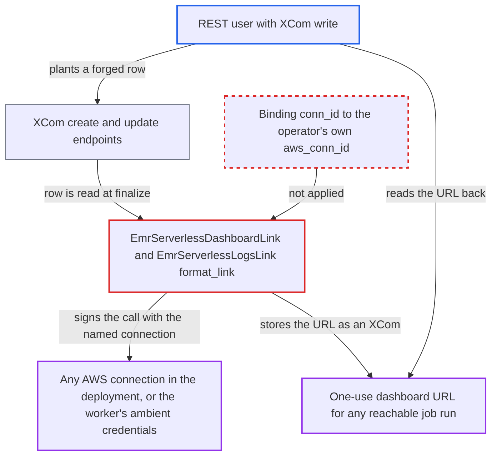

# EMR Serverless extra links mint dashboard URLs with an XCom-supplied AWS connection

| Field | Value |
|---|---|
| ID | `find_01GXeZPKziArMfUFaVjhwNK1` |
| Severity | **Low** |
| Status | open |
| CWE | CWE-639 — Authorization bypass |
| Created | 2026-10-27T21:44:26.008859Z |
| Claude Security | https://claude.ai/security/findings/find_01GXeZPKziArMfUFaVjhwNK1 |

## Description

A REST API user who can write XComs, but is not allowed to use AWS connections, can make an Airflow worker call AWS with any connection in the deployment. The worker then returns a one-use, unauthenticated dashboard URL for an EMR Serverless job run, which the user reads back. This needs a Dag with an `EmrServerlessStartJobOperator` task and known application and job run IDs. The cause is that `format_link` in `EmrServerlessDashboardLink` and `EmrServerlessLogsLink` takes `conn_id` from a writable XCom row.

1. **REST API user with XCom write** creates or overwrites the XCom `emr_serverless_dashboard` while an `EmrServerlessStartJobOperator` task runs or is deferred. The row holds `conn_id`, `application_id` and `job_run_id`, chosen by the attacker. The endpoint is gated only by XCom access and does not check the task instance's state. ([`airflow-core/src/airflow/api_fastapi/core_api/routes/public/xcom.py:323-425`](https://github.com/cx-benchmark/airflow/blob/a462d683469bb9f55646b0515ef84c41e16650fb/airflow-core/src/airflow/api_fastapi/core_api/routes/public/xcom.py#L323-L425))
2. **Airflow worker** keeps the planted row until the task finishes. A task instance's XComs are cleared only when a run starts, not when it resumes from deferral, so a row written during the run survives. ([`airflow-core/src/airflow/api_fastapi/execution_api/routes/task_instances.py:351-356`](https://github.com/cx-benchmark/airflow/blob/a462d683469bb9f55646b0515ef84c41e16650fb/airflow-core/src/airflow/api_fastapi/execution_api/routes/task_instances.py#L351-L356))
3. **the worker's `finalize` step** calls `get_link` for every class in `operator_extra_links`. `BaseAwsLink.get_link` reads the whole XCom row and passes it into `format_link`, so the attacker's values are trusted. ([`providers/amazon/src/airflow/providers/amazon/aws/links/base_aws.py:64-79`](https://github.com/cx-benchmark/airflow/blob/a462d683469bb9f55646b0515ef84c41e16650fb/providers/amazon/src/airflow/providers/amazon/aws/links/base_aws.py#L64-L79))
4. **`EmrServerlessDashboardLink.format_link`** passes the XCom's `conn_id` as `aws_conn_id`, with the XCom's `application_id` and `job_run_id`, to `get_serverless_dashboard_url`. Nothing ties these values to the operator's own `aws_conn_id` or job. ([`providers/amazon/src/airflow/providers/amazon/aws/links/emr.py:139-147`](https://github.com/cx-benchmark/airflow/blob/a462d683469bb9f55646b0515ef84c41e16650fb/providers/amazon/src/airflow/providers/amazon/aws/links/emr.py#L139-L147))
5. **`EmrServerlessHook`** loads the named connection and signs `GetDashboardForJobRun` with it. The Execution API serves any connection id to any task token. An unknown id only logs a warning and falls back to the worker's ambient boto3 credentials. ([`airflow-core/src/airflow/api_fastapi/execution_api/routes/connections.py:36-53`](https://github.com/cx-benchmark/airflow/blob/a462d683469bb9f55646b0515ef84c41e16650fb/airflow-core/src/airflow/api_fastapi/execution_api/routes/connections.py#L36-L53))
6. **the worker** stores the returned URL in the XCom `_link_EmrServerlessDashboardLink`, and the attacker reads it. The URL is one-use, needs no authentication and expires in about 1 hour, according to the provider docstring. ([`providers/amazon/src/airflow/providers/amazon/aws/links/emr.py:63-93`](https://github.com/cx-benchmark/airflow/blob/a462d683469bb9f55646b0515ef84c41e16650fb/providers/amazon/src/airflow/providers/amazon/aws/links/emr.py#L63-L93))

## Assessment

The attacker is an authenticated REST API user who can write XComs on a Dag that contains an `EmrServerlessStartJobOperator` task. An example is the Keycloak auth manager's default `User` role, which has every scope on the Dag resource but only GET on connections. They need a write during the window while the task runs or is deferred. They also need to know the target application and job run IDs. The setting `enable_application_ui_links` (default False) does not prevent this. It only decides whether `persist_links` writes the row itself, and the operator lists both links regardless. The attacker can create the row, or overwrite it if `persist_links` wrote it. Under FAB defaults only `Op` can write XComs, and the security model treats `Op` as admin-equivalent, so FAB default roles gain nothing. In multi-team mode the reachable connections are the attacker's own team's.

Impact: The attacker makes the worker use an AWS connection they are not authorized to use for one API call. They get a one-use URL to the Spark/Tez UI or Spark driver stdout of any job run that credential can reach. Success or failure also shows which connection ids exist and reach EMR Serverless. The connection secret is not returned, and only the attacker's own XCom rows change.

Subsequent-system impact: In AWS, the attacker can read job configuration, query plans and driver output of jobs outside their Dags or outside Airflow. The URL is valid for about 1 hour. Access is read-only and limited to what the dashboard shows.

## Recommendation

`EmrServerlessDashboardLink.format_link` and `EmrServerlessLogsLink.format_link` take the AWS connection and the job identifiers from an XCom row that REST users with XCom write can create or overwrite. The worker then signs an AWS call with credentials the writer may not use.

Fix criteria: The credentials used to resolve the dashboard URL come from the operator's own `aws_conn_id`, or the URL is resolved inside `execute` so that only the finished string is stored. Data read from XCom never chooses which connection or identity signs an AWS call. Test: plant a row with a foreign or unknown `conn_id` during a run. No AWS call is made with that identity, and no URL appears in the `_link_EmrServerless*` XComs.

## Evidence

**https://github.com/cx-benchmark/airflow**

- [`providers/amazon/src/airflow/providers/amazon/aws/links/emr.py:139-147`](https://github.com/cx-benchmark/airflow/blob/a462d683469bb9f55646b0515ef84c41e16650fb/providers/amazon/src/airflow/providers/amazon/aws/links/emr.py#L139-L147)
- [`providers/amazon/src/airflow/providers/amazon/aws/links/emr.py:122-130`](https://github.com/cx-benchmark/airflow/blob/a462d683469bb9f55646b0515ef84c41e16650fb/providers/amazon/src/airflow/providers/amazon/aws/links/emr.py#L122-L130)
- [`providers/amazon/src/airflow/providers/amazon/aws/links/emr.py:63-93`](https://github.com/cx-benchmark/airflow/blob/a462d683469bb9f55646b0515ef84c41e16650fb/providers/amazon/src/airflow/providers/amazon/aws/links/emr.py#L63-L93)
- [`providers/amazon/src/airflow/providers/amazon/aws/links/base_aws.py:64-79`](https://github.com/cx-benchmark/airflow/blob/a462d683469bb9f55646b0515ef84c41e16650fb/providers/amazon/src/airflow/providers/amazon/aws/links/base_aws.py#L64-L79)
- [`task-sdk/src/airflow/sdk/execution_time/task_runner.py:2483-2487`](https://github.com/cx-benchmark/airflow/blob/a462d683469bb9f55646b0515ef84c41e16650fb/task-sdk/src/airflow/sdk/execution_time/task_runner.py#L2483-L2487)
- [`airflow-core/src/airflow/api_fastapi/core_api/routes/public/xcom.py:323-425`](https://github.com/cx-benchmark/airflow/blob/a462d683469bb9f55646b0515ef84c41e16650fb/airflow-core/src/airflow/api_fastapi/core_api/routes/public/xcom.py#L323-L425)
- [`airflow-core/src/airflow/api_fastapi/core_api/routes/public/xcom.py:428-495`](https://github.com/cx-benchmark/airflow/blob/a462d683469bb9f55646b0515ef84c41e16650fb/airflow-core/src/airflow/api_fastapi/core_api/routes/public/xcom.py#L428-L495)
- [`airflow-core/src/airflow/api_fastapi/execution_api/routes/task_instances.py:351-356`](https://github.com/cx-benchmark/airflow/blob/a462d683469bb9f55646b0515ef84c41e16650fb/airflow-core/src/airflow/api_fastapi/execution_api/routes/task_instances.py#L351-L356)
- [`airflow-core/src/airflow/api_fastapi/execution_api/routes/connections.py:36-53`](https://github.com/cx-benchmark/airflow/blob/a462d683469bb9f55646b0515ef84c41e16650fb/airflow-core/src/airflow/api_fastapi/execution_api/routes/connections.py#L36-L53)
- [`providers/amazon/src/airflow/providers/amazon/aws/hooks/base_aws.py:637-659`](https://github.com/cx-benchmark/airflow/blob/a462d683469bb9f55646b0515ef84c41e16650fb/providers/amazon/src/airflow/providers/amazon/aws/hooks/base_aws.py#L637-L659)
- [`providers/amazon/src/airflow/providers/amazon/aws/operators/emr.py:1337-1342`](https://github.com/cx-benchmark/airflow/blob/a462d683469bb9f55646b0515ef84c41e16650fb/providers/amazon/src/airflow/providers/amazon/aws/operators/emr.py#L1337-L1342)
- [`providers/keycloak/src/airflow/providers/keycloak/auth_manager/cli/commands.py:266-300`](https://github.com/cx-benchmark/airflow/blob/a462d683469bb9f55646b0515ef84c41e16650fb/providers/keycloak/src/airflow/providers/keycloak/auth_manager/cli/commands.py#L266-L300)

