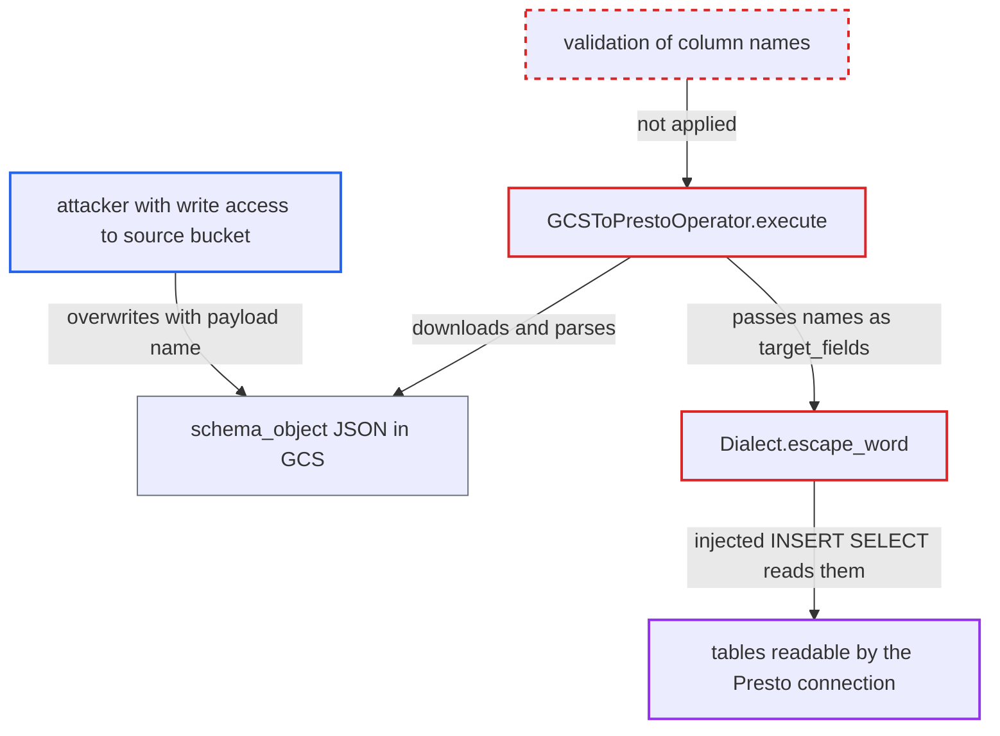

# GCSToPrestoOperator splices column names from a GCS schema object into INSERT SQL

| Field | Value |
|---|---|
| ID | `find_01N23QXWPkRiWXgDidcth4kT` |
| Severity | **Low** |
| Status | open |
| CWE | CWE-89 — SQL injection |
| Created | 2026-10-27T21:42:51.273357Z |
| Claude Security | https://claude.ai/security/findings/find_01N23QXWPkRiWXgDidcth4kT |

## Description

Someone who can only write to the source GCS bucket can make the Airflow Presto connection run a query of their choice. The statement is limited to one `INSERT INTO <presto_table> (...) <query>`, so it can copy readable tables into `presto_table`. It needs a DAG that uses `schema_object` and a CSV with at least one row. The cause is that `GCSToPrestoOperator` passes column names from the schema JSON unchecked, and `Dialect.escape_word` does not escape quotes inside them.

1. **attacker** overwrites the schema JSON in the source bucket. The first entry holds a name that contains a double quote, SQL text, matching `?` placeholders and a trailing `--`.
2. **the operator `GCSToPrestoOperator.execute`** downloads the schema object and parses it with `json.loads`. The resulting list is passed unchecked as `target_fields`, although it comes from the same external bucket as the CSV. ([`providers/presto/src/airflow/providers/presto/transfers/gcs_to_presto.py:114-120`](https://github.com/cx-benchmark/airflow/blob/a462d683469bb9f55646b0515ef84c41e16650fb/providers/presto/src/airflow/providers/presto/transfers/gcs_to_presto.py#L114-L120))
3. **the method `Dialect.escape_word`** wraps the malicious name in double quotes without escaping the quote inside it. The name contains a non-word character, so it gets wrapped in the default `escape_word_format`. The embedded `"` is not doubled or rejected, so it ends the quoted identifier early. ([`providers/common/sql/src/airflow/providers/common/sql/dialects/dialect.py:73-87`](https://github.com/cx-benchmark/airflow/blob/a462d683469bb9f55646b0515ef84c41e16650fb/providers/common/sql/src/airflow/providers/common/sql/dialects/dialect.py#L73-L87))
4. **the method `DbApiHook.insert_rows`** builds the INSERT text for each CSV row from the attacker's `target_fields`. `PrestoHook` has `supports_executemany = False`, so every row runs its own `cur.execute(sql, values)`. The text after the closing quote becomes SQL, and `--` comments out the operator's `VALUES (?, ?)`. ([`providers/common/sql/src/airflow/providers/common/sql/hooks/sql.py:1044-1050`](https://github.com/cx-benchmark/airflow/blob/a462d683469bb9f55646b0515ef84c41e16650fb/providers/common/sql/src/airflow/providers/common/sql/hooks/sql.py#L1044-L1050))
5. **Presto** runs the injected `INSERT INTO <presto_table> (...) SELECT ...` under the Airflow connection's identity. The CSV values are bound as parameters, but the names are not. The extra `?` placeholders keep the parameter count equal to the CSV width. ([`providers/presto/src/airflow/providers/presto/hooks/presto.py:281-308`](https://github.com/cx-benchmark/airflow/blob/a462d683469bb9f55646b0515ef84c41e16650fb/providers/presto/src/airflow/providers/presto/hooks/presto.py#L281-L308))

## Assessment

The attacker can write to the GCS bucket that a DAG reads with `GCSToPrestoOperator(schema_object=...)`. They need no Airflow privileges. They overwrite the schema JSON so its first entry holds the payload. On the next scheduled run the operator uses it. The DAG must use `schema_object`, and the CSV must have at least one row. The default `escape_word_format` of `"{}"` is enough, so no unusual connection setting is needed. The report assumes presto-python-client >=0.8.4 sends a parameterised `execute()` as a server-side `PREPARE ... FROM <sql>` / `EXECUTE ... USING`.

Impact: The attacker controls one `INSERT INTO <presto_table> ... <query>` statement run with the Airflow connection's Presto identity. They can copy rows from any table in any catalog that identity can read into `presto_table`, where everyone who reads that table can see them. They can also write rows derived from those tables. The target table is fixed by the DAG author, and Presto runs one statement per query, which limits the impact.

## Recommendation

(1) `GCSToPrestoOperator` takes column names from an object in an external storage bucket and passes them as `target_fields` without checking them. It does not trust the CSV values from the same bucket, but it trusts these names.

Fix criteria: Column names from `schema_object` are checked against a strict identifier pattern, or against the target table's real columns, before use. A schema JSON entry containing `"`, `)`, `--` or `SELECT` fails the task before any SQL is sent.

(2) `Dialect.escape_word` quotes identifiers by wrapping them in `escape_word_format` without escaping the quote character inside the name. A quoted identifier can therefore be ended early.

Fix criteria: Any identifier that `escape_word` emits is a single identifier token for the dialect, with embedded quote characters doubled or rejected. The generated INSERT for a name containing `"` refers to one column literally named by that string, or is refused.

## Evidence

**https://github.com/cx-benchmark/airflow**

- [`providers/presto/src/airflow/providers/presto/transfers/gcs_to_presto.py:114-120`](https://github.com/cx-benchmark/airflow/blob/a462d683469bb9f55646b0515ef84c41e16650fb/providers/presto/src/airflow/providers/presto/transfers/gcs_to_presto.py#L114-L120)
- [`providers/common/sql/src/airflow/providers/common/sql/dialects/dialect.py:73-87`](https://github.com/cx-benchmark/airflow/blob/a462d683469bb9f55646b0515ef84c41e16650fb/providers/common/sql/src/airflow/providers/common/sql/dialects/dialect.py#L73-L87)
- [`providers/common/sql/src/airflow/providers/common/sql/hooks/sql.py:1044-1050`](https://github.com/cx-benchmark/airflow/blob/a462d683469bb9f55646b0515ef84c41e16650fb/providers/common/sql/src/airflow/providers/common/sql/hooks/sql.py#L1044-L1050)
- [`providers/common/sql/src/airflow/providers/common/sql/hooks/sql.py:246-250`](https://github.com/cx-benchmark/airflow/blob/a462d683469bb9f55646b0515ef84c41e16650fb/providers/common/sql/src/airflow/providers/common/sql/hooks/sql.py#L246-L250)
- [`providers/presto/src/airflow/providers/presto/hooks/presto.py:281-308`](https://github.com/cx-benchmark/airflow/blob/a462d683469bb9f55646b0515ef84c41e16650fb/providers/presto/src/airflow/providers/presto/hooks/presto.py#L281-L308)

