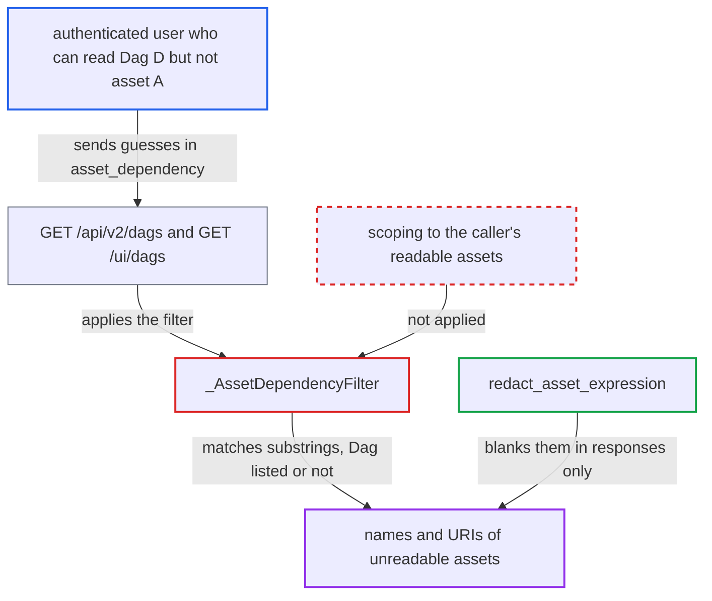

# GET /dags asset_dependency filter is an oracle for names/URIs of unreadable assets

| Field | Value |
|---|---|
| ID | `find_011NtMPk7PA1NQLy5bJAX6ui` |
| Severity | **Low** |
| Status | open |
| CWE | CWE-203 — Information exposure |
| Created | 2026-10-27T21:09:45.383240Z |
| Claude Security | https://claude.ai/security/findings/find_011NtMPk7PA1NQLy5bJAX6ui |

## Description

A logged-in user who can read a Dag but not one of the assets it is scheduled on can still learn that asset's name and URI. The attack works only under auth managers that authorize assets one by one, such as the shipped Keycloak and AWS managers. The cause is `_AssetDependencyFilter`, which matches the `asset_dependency` value against every asset instead of only the assets the caller may read.

1. **attacker** sends a list request with a guessed string in `asset_dependency`. The request is `GET /api/v2/dags?dag_id_pattern=D&asset_dependency=<guess>`, where D is a Dag the attacker can read. `GET /ui/dags` accepts the same parameter. ([`airflow-core/src/airflow/api_fastapi/core_api/routes/public/dags.py:97-205`](https://github.com/cx-benchmark/airflow/blob/a462d683469bb9f55646b0515ef84c41e16650fb/airflow-core/src/airflow/api_fastapi/core_api/routes/public/dags.py#L97-L205))
2. **the filter `_AssetDependencyFilter.to_orm`** keeps Dags that have a scheduling asset whose `name` or `uri` contains the guess. The match is a case-insensitive literal substring. The subquery is never limited to the caller's readable asset ids, so unreadable assets are matched too. ([`airflow-core/src/airflow/api_fastapi/common/parameters/asset.py:135-155`](https://github.com/cx-benchmark/airflow/blob/a462d683469bb9f55646b0515ef84c41e16650fb/airflow-core/src/airflow/api_fastapi/common/parameters/asset.py#L135-L155))
3. **the list handler** applies the unscoped filter next to `readable_dags_filter`. The route is guarded only by `requires_access_dag(method="GET")` and has no asset check. Whether D appears in `dags` and in `total_entries` therefore depends on the hidden asset's attributes. ([`airflow-core/src/airflow/api_fastapi/core_api/routes/public/dags.py:97-205`](https://github.com/cx-benchmark/airflow/blob/a462d683469bb9f55646b0515ef84c41e16650fb/airflow-core/src/airflow/api_fastapi/core_api/routes/public/dags.py#L97-L205))
4. **attacker** reads whether D is in the result and adds one character to the guess. If D is still listed, the guess matches a fragment of the hidden asset. Repeating this rebuilds the full name and URI, in lowercase.

## Assessment

The attacker is an authenticated low-privilege UI or API user. They need read access to a Dag D that is scheduled on an asset A they cannot read. The deployment must use an auth manager that authorizes assets individually, such as the shipped Keycloak or AWS managers. FAB and the Simple auth manager grant all assets or none, so they are not affected. No victim takes part and no defence has to be evaded. The attacker can use either `GET /api/v2/dags` or `GET /ui/dags`.

Impact: The attacker learns the names and URIs of assets they may not read, which can reveal storage paths, tables or endpoints. This is limited to assets that schedule a Dag they can read, and the text comes back in lowercase. No credentials, data contents, writes or outages result.

## Recommendation

`_AssetDependencyFilter` tests asset `name` and `uri` across every asset row and ignores the caller's asset authorization. A query predicate therefore reveals attributes that the response bodies redact.

Fix criteria: The `asset_dependency` predicate matches only assets in the caller's readable asset set, on both `GET /api/v2/dags` and `GET /ui/dags`. Test it as a Keycloak or AWS user who can read Dag D but not asset A, where D is scheduled on A. A fragment of A's name or URI must give the same result as a fragment that matches nothing. A fragment of a readable asset must still match.

## Evidence

**https://github.com/cx-benchmark/airflow**

- [`airflow-core/src/airflow/api_fastapi/common/parameters/asset.py:135-155`](https://github.com/cx-benchmark/airflow/blob/a462d683469bb9f55646b0515ef84c41e16650fb/airflow-core/src/airflow/api_fastapi/common/parameters/asset.py#L135-L155)
- [`airflow-core/src/airflow/api_fastapi/core_api/routes/public/dags.py:97-205`](https://github.com/cx-benchmark/airflow/blob/a462d683469bb9f55646b0515ef84c41e16650fb/airflow-core/src/airflow/api_fastapi/core_api/routes/public/dags.py#L97-L205)
- [`airflow-core/src/airflow/api_fastapi/core_api/routes/ui/dags.py:153-198`](https://github.com/cx-benchmark/airflow/blob/a462d683469bb9f55646b0515ef84c41e16650fb/airflow-core/src/airflow/api_fastapi/core_api/routes/ui/dags.py#L153-L198)
- [`airflow-core/src/airflow/api_fastapi/core_api/routes/public/dags.py:293-302`](https://github.com/cx-benchmark/airflow/blob/a462d683469bb9f55646b0515ef84c41e16650fb/airflow-core/src/airflow/api_fastapi/core_api/routes/public/dags.py#L293-L302)
- [`airflow-core/src/airflow/api_fastapi/core_api/routes/ui/dags.py:317-330`](https://github.com/cx-benchmark/airflow/blob/a462d683469bb9f55646b0515ef84c41e16650fb/airflow-core/src/airflow/api_fastapi/core_api/routes/ui/dags.py#L317-L330)
- [`airflow-core/src/airflow/api_fastapi/common/asset_expression.py:26-58`](https://github.com/cx-benchmark/airflow/blob/a462d683469bb9f55646b0515ef84c41e16650fb/airflow-core/src/airflow/api_fastapi/common/asset_expression.py#L26-L58)
- [`providers/keycloak/src/airflow/providers/keycloak/auth_manager/keycloak_auth_manager.py:338-344`](https://github.com/cx-benchmark/airflow/blob/a462d683469bb9f55646b0515ef84c41e16650fb/providers/keycloak/src/airflow/providers/keycloak/auth_manager/keycloak_auth_manager.py#L338-L344)

