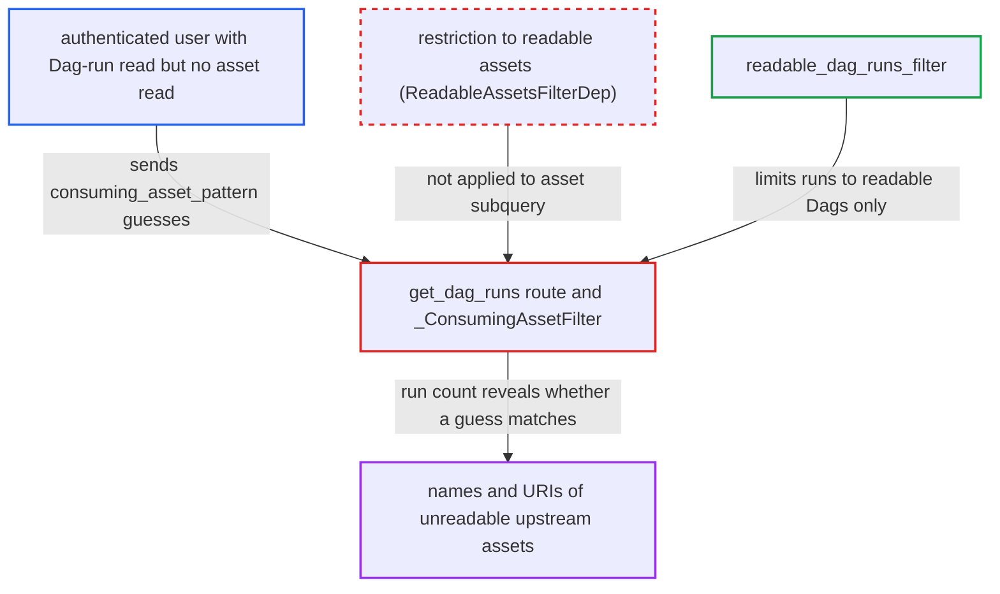

# GET dagRuns consuming_asset_pattern filter is an oracle for names/URIs of unreadable assets

| Field | Value |
|---|---|
| ID | `find_01AoxE2vkL2bXXiuSoiz3mib` |
| Severity | **Low** |
| Status | open |
| CWE | CWE-203 — Information exposure |
| Created | 2026-10-27T21:16:49.039584Z |
| Claude Security | https://claude.ai/security/findings/find_01AoxE2vkL2bXXiuSoiz3mib |

## Description

A logged-in user who can read a Dag's runs can discover the names and URIs of assets they are not allowed to read. This works only under an auth manager that authorizes assets one by one, which means the shipped Keycloak and AWS managers. The `consuming_asset_pattern` filter, `_ConsumingAssetFilter`, searches all assets and never limits the search to the assets the caller can read.

1. **attacker** sends a request to the dagRuns list with a guessed substring. The attacker has Dag-run read on an asset-triggered Dag D but no read on the upstream asset A, and sends `GET /api/v2/dags/D/dagRuns?consuming_asset_pattern=<guess>`. ([`airflow-core/src/airflow/api_fastapi/core_api/routes/public/dag_run.py:505-592`](https://github.com/cx-benchmark/airflow/blob/a462d683469bb9f55646b0515ef84c41e16650fb/airflow-core/src/airflow/api_fastapi/core_api/routes/public/dag_run.py#L505-L592))
2. **the route `get_dag_runs`** accepts the request after checking only Dag-run read. The route is guarded by `requires_access_dag` for `DagAccessEntity.RUN` and makes no asset-read check. ([`airflow-core/src/airflow/api_fastapi/core_api/routes/public/dag_run.py:505-592`](https://github.com/cx-benchmark/airflow/blob/a462d683469bb9f55646b0515ef84c41e16650fb/airflow-core/src/airflow/api_fastapi/core_api/routes/public/dag_run.py#L505-L592))
3. **the filter `_ConsumingAssetFilter`** matches the guess against the name and URI of every asset linked to a run's events. It does a case-insensitive substring match with LIKE metacharacters escaped. The asset subquery is not limited to the caller's readable asset ids. ([`airflow-core/src/airflow/api_fastapi/common/parameters/asset.py:173-199`](https://github.com/cx-benchmark/airflow/blob/a462d683469bb9f55646b0515ef84c41e16650fb/airflow-core/src/airflow/api_fastapi/common/parameters/asset.py#L173-L199))
4. **the route `get_dag_runs`** applies the unscoped asset filter alongside `readable_dag_runs_filter`. Only runs of readable Dags are returned. A run shows up in `dag_runs` and `total_entries` exactly when a consumed asset's name or URI contains the guess. ([`airflow-core/src/airflow/api_fastapi/core_api/routes/public/dag_run.py:678-700`](https://github.com/cx-benchmark/airflow/blob/a462d683469bb9f55646b0515ef84c41e16650fb/airflow-core/src/airflow/api_fastapi/core_api/routes/public/dag_run.py#L678-L700))
5. **attacker** extends the guess while `total_entries` stays non-zero. Repeating this one character at a time rebuilds the hidden asset's full name and URI.

## Assessment

The attacker is an authenticated low-privilege UI or API user. They need Dag-run read on an asset-triggered Dag D, and no read on an upstream asset A whose events triggered D. The deployment must use the Keycloak or AWS auth manager, which authorize each asset separately. FAB returns every asset id to every user, and the Simple manager decides asset read by role, so neither is exploitable this way. No victim takes part and nothing has to be bypassed. The route `GET /api/v2/dags/{dag_id}/dagRuns` also works with `dag_id=~`.

Impact: The attacker learns the names and URIs of assets they may not read, such as storage paths, tables or endpoints. Only assets whose events were consumed by runs of Dags the attacker can read are exposed, and the text is recovered case-insensitively. No event payloads, credentials, writes or outages result.

## Recommendation

`_ConsumingAssetFilter` tests asset `name` and `uri` across every asset row linked to a run and ignores the caller's asset authorization. A query predicate therefore reveals attributes that other responses redact.

Fix criteria: The `consuming_asset_pattern` predicate matches only assets in the caller's readable asset set. A test as a Keycloak or AWS user who can read Dag D's runs but not asset A, where A's events triggered D, shows that a fragment of A's name or URI gives the same result as a fragment that matches nothing. The same test shows that a fragment of a readable consumed asset still matches.

## Evidence

**https://github.com/cx-benchmark/airflow**

- [`airflow-core/src/airflow/api_fastapi/common/parameters/asset.py:173-199`](https://github.com/cx-benchmark/airflow/blob/a462d683469bb9f55646b0515ef84c41e16650fb/airflow-core/src/airflow/api_fastapi/common/parameters/asset.py#L173-L199)
- [`airflow-core/src/airflow/api_fastapi/core_api/routes/public/dag_run.py:505-592`](https://github.com/cx-benchmark/airflow/blob/a462d683469bb9f55646b0515ef84c41e16650fb/airflow-core/src/airflow/api_fastapi/core_api/routes/public/dag_run.py#L505-L592)
- [`airflow-core/src/airflow/api_fastapi/core_api/routes/public/dag_run.py:678-700`](https://github.com/cx-benchmark/airflow/blob/a462d683469bb9f55646b0515ef84c41e16650fb/airflow-core/src/airflow/api_fastapi/core_api/routes/public/dag_run.py#L678-L700)
- [`airflow-core/src/airflow/api_fastapi/core_api/routes/public/dag_run.py:274-313`](https://github.com/cx-benchmark/airflow/blob/a462d683469bb9f55646b0515ef84c41e16650fb/airflow-core/src/airflow/api_fastapi/core_api/routes/public/dag_run.py#L274-L313)
- [`airflow-core/src/airflow/api_fastapi/core_api/routes/ui/partitioned_dag_runs.py:448-499`](https://github.com/cx-benchmark/airflow/blob/a462d683469bb9f55646b0515ef84c41e16650fb/airflow-core/src/airflow/api_fastapi/core_api/routes/ui/partitioned_dag_runs.py#L448-L499)
- [`providers/keycloak/src/airflow/providers/keycloak/auth_manager/keycloak_auth_manager.py:338-344`](https://github.com/cx-benchmark/airflow/blob/a462d683469bb9f55646b0515ef84c41e16650fb/providers/keycloak/src/airflow/providers/keycloak/auth_manager/keycloak_auth_manager.py#L338-L344)

