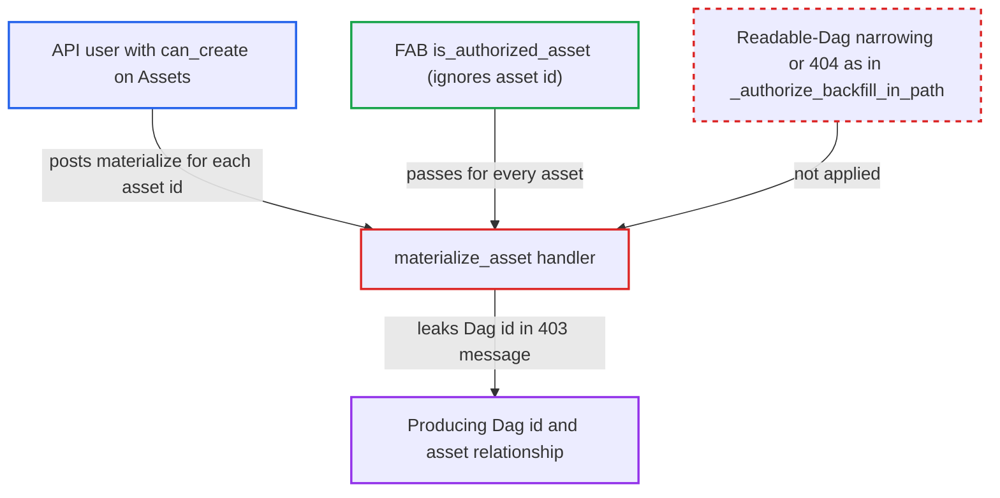

# Materialize asset 403 message discloses producing DAG id hidden from caller

| Field | Value |
|---|---|
| ID | `find_01LjFzW9hVM8tY2UJENbnvtV` |
| Severity | **Low** |
| Status | open |
| CWE | CWE-209 — Information exposure |
| Created | 2026-10-27T21:13:09.233612Z |
| Claude Security | https://claude.ai/security/findings/find_01LjFzW9hVM8tY2UJENbnvtV |

## Description

A logged-in API user can learn the ids of Dags they are not allowed to see, and which asset each Dag produces. Exploiting it needs a FAB role with `can_create` on Assets (the default User role has it) and per-Dag RBAC. The handler `materialize_asset` puts the producing Dag's id in its 403 message.

1. **attacker** sends `POST /api/v2/assets/{asset_id}/materialize` with body `{}` for an asset id. The route is gated only by `requires_access_asset(method="POST")`, and the FAB check ignores which asset is meant, so `can_create` on Assets passes for every asset id. ([`airflow-core/src/airflow/api_fastapi/core_api/routes/public/assets.py:434-464`](https://github.com/cx-benchmark/airflow/blob/a462d683469bb9f55646b0515ef84c41e16650fb/airflow-core/src/airflow/api_fastapi/core_api/routes/public/assets.py#L434-L464))
2. **FAB auth manager** approves the asset-level check for any asset id. `is_authorized_asset` looks only at the `Assets` resource type and ignores `details`, so the attacker can step through all asset ids. ([`providers/fab/src/airflow/providers/fab/auth_manager/fab_auth_manager.py:531-534`](https://github.com/cx-benchmark/airflow/blob/a462d683469bb9f55646b0515ef84c41e16650fb/providers/fab/src/airflow/providers/fab/auth_manager/fab_auth_manager.py#L531-L534))
3. **the handler `materialize_asset`** looks up the producing Dag from `TaskOutletAssetReference`. The caller never names the Dag. The 404 and 409 branches already show whether the asset has zero, one or several producers, before any Dag-level check. ([`airflow-core/src/airflow/api_fastapi/core_api/routes/public/assets.py:434-464`](https://github.com/cx-benchmark/airflow/blob/a462d683469bb9f55646b0515ef84c41e16650fb/airflow-core/src/airflow/api_fastapi/core_api/routes/public/assets.py#L434-L464))
4. **the handler `materialize_asset`** checks `is_authorized_dag(POST, RUN, dag_id)` for the producer, and it fails. For `RUN` on a specific Dag, FAB requires PUT on that Dag, so a user without access to that Dag is refused. ([`providers/fab/src/airflow/providers/fab/auth_manager/fab_auth_manager.py:483-514`](https://github.com/cx-benchmark/airflow/blob/a462d683469bb9f55646b0515ef84c41e16650fb/providers/fab/src/airflow/providers/fab/auth_manager/fab_auth_manager.py#L483-L514))
5. **the handler `materialize_asset`** returns a 403 whose detail contains the resolved `dag_id`. The message reads `User is not authorized to trigger a run for Dag: {dag_id} that materializes this asset`, which gives the hidden Dag id to a caller who may not read that Dag. ([`airflow-core/src/airflow/api_fastapi/core_api/routes/public/assets.py:466-478`](https://github.com/cx-benchmark/airflow/blob/a462d683469bb9f55646b0515ef84c41e16650fb/airflow-core/src/airflow/api_fastapi/core_api/routes/public/assets.py#L466-L478))

## Assessment

The attacker is an authenticated API user whose FAB role grants `can_create` on Assets (the default User role includes it) but whose Dag permissions cover only some Dags. The deployment must use per-Dag RBAC, and the producer Dags must lie outside the attacker's scope. The attacker sends `POST /api/v2/assets/{id}/materialize` with body `{}` for each asset id; the ids are sequential integers. No victim action is needed. The 404 and 409 responses also show whether an asset has zero, one or several producers.

Impact: The attacker learns the ids of Dags they may not read and which asset each one produces, for assets with a single producer. They also learn producer counts from the 404 and 409 responses. This breaks per-Dag read isolation for names and lineage. It exposes no code, runs, XComs, logs or credentials, and gives no write access, because the run is refused.

## Recommendation

`materialize_asset` puts the server-resolved producer `dag_id` in its authorization-failure response without checking whether the caller may read that Dag. The other asset routes narrow results to readable Dags, so this route is inconsistent with them.

Fix criteria: A caller who may not read the producing Dag gets a response that names no Dag id. The response is either indistinguishable from the not-found case or a generic refusal, following the `_authorize_backfill_in_path` pattern. A caller who may read the Dag may still get the descriptive message. Test: as a FAB user with Assets create but no access to producer Dag P, the materialize response body does not contain `P`. The status and body also do not differ by whether P exists.

## Evidence

**https://github.com/cx-benchmark/airflow**

- [`airflow-core/src/airflow/api_fastapi/core_api/routes/public/assets.py:466-478`](https://github.com/cx-benchmark/airflow/blob/a462d683469bb9f55646b0515ef84c41e16650fb/airflow-core/src/airflow/api_fastapi/core_api/routes/public/assets.py#L466-L478)
- [`airflow-core/src/airflow/api_fastapi/core_api/routes/public/assets.py:434-464`](https://github.com/cx-benchmark/airflow/blob/a462d683469bb9f55646b0515ef84c41e16650fb/airflow-core/src/airflow/api_fastapi/core_api/routes/public/assets.py#L434-L464)
- [`providers/fab/src/airflow/providers/fab/auth_manager/fab_auth_manager.py:531-534`](https://github.com/cx-benchmark/airflow/blob/a462d683469bb9f55646b0515ef84c41e16650fb/providers/fab/src/airflow/providers/fab/auth_manager/fab_auth_manager.py#L531-L534)
- [`providers/fab/src/airflow/providers/fab/auth_manager/fab_auth_manager.py:483-514`](https://github.com/cx-benchmark/airflow/blob/a462d683469bb9f55646b0515ef84c41e16650fb/providers/fab/src/airflow/providers/fab/auth_manager/fab_auth_manager.py#L483-L514)
- [`airflow-core/src/airflow/api_fastapi/core_api/datamodels/assets.py:114-150`](https://github.com/cx-benchmark/airflow/blob/a462d683469bb9f55646b0515ef84c41e16650fb/airflow-core/src/airflow/api_fastapi/core_api/datamodels/assets.py#L114-L150)
- [`airflow-core/src/airflow/api_fastapi/core_api/services/ui/dependencies.py:450-471`](https://github.com/cx-benchmark/airflow/blob/a462d683469bb9f55646b0515ef84c41e16650fb/airflow-core/src/airflow/api_fastapi/core_api/services/ui/dependencies.py#L450-L471)
- [`airflow-core/src/airflow/api_fastapi/core_api/security.py:565-586`](https://github.com/cx-benchmark/airflow/blob/a462d683469bb9f55646b0515ef84c41e16650fb/airflow-core/src/airflow/api_fastapi/core_api/security.py#L565-L586)
- [`chart/values.yaml:3420`](https://github.com/cx-benchmark/airflow/blob/a462d683469bb9f55646b0515ef84c41e16650fb/chart/values.yaml#L3420)

