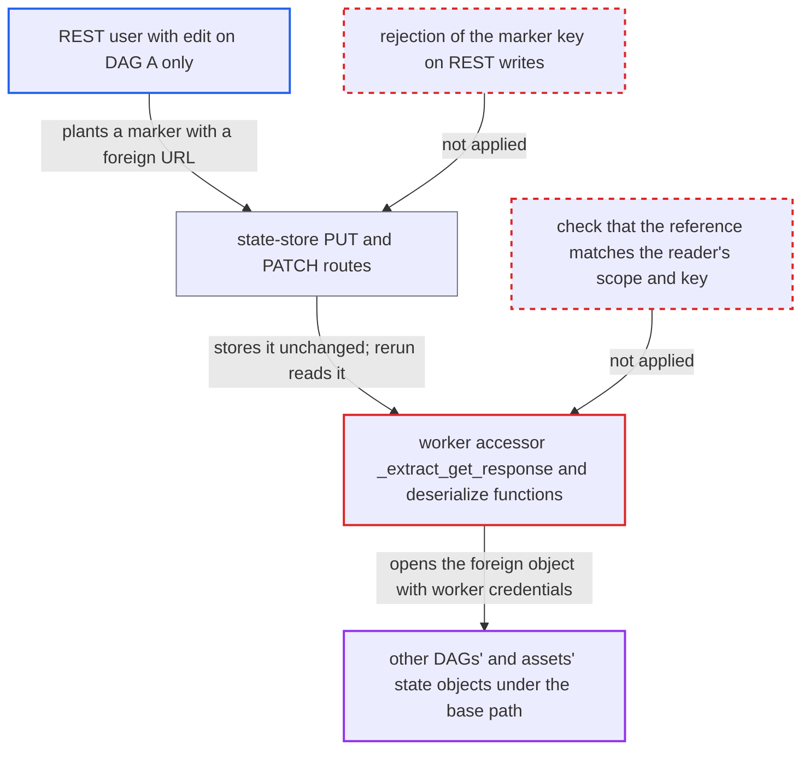

# Object-storage state backend trusts REST-written state references, letting a single-DAG user read other DAGs' state

| Field | Value |
|---|---|
| ID | `find_01B1jFehqELrUb39ZYzaLtFs` |
| Severity | **Low** |
| Status | open |
| CWE | CWE-639 — Insecure direct object reference |
| Created | 2026-10-27T21:18:45.518691Z |
| Claude Security | https://claude.ai/security/findings/find_01B1jFehqELrUb39ZYzaLtFs |

## Description

A user with edit rights on a single DAG (DAG A) can read state values that belong to other DAGs and to assets. The attacker writes a fake state reference through the REST API, and a rerun of DAG A's task makes the worker fetch the foreign object. This needs `StateStoreObjectStorageBackend` to be enabled. The cause is that `deserialize_task_state_store_from_ref` and `deserialize_asset_state_store_from_ref` follow any stored URL under the base path, and the REST `state-store` write routes accept the marker `__airflow_state_ref__`.

1. **attacker (REST user with task-instance edit on DAG A)** reads DAG A's own state marker through the REST GET. The marker shows the object-storage base path, and the backend's object paths follow a fixed pattern with no secret part, so the attacker can build a path to another DAG's object. ([`providers/common/io/src/airflow/providers/common/io/state_store/backend.py:83-98`](https://github.com/cx-benchmark/airflow/blob/a462d683469bb9f55646b0515ef84c41e16650fb/providers/common/io/src/airflow/providers/common/io/state_store/backend.py#L83-L98))
2. **attacker** writes a state value holding the marker `__airflow_state_ref__` through `PUT` or `PATCH` on the task `state-store` route. The route stores `json.dumps(body.value)` unchanged and nothing in it rejects the marker key, so the URL can point at another DAG's object, such as `<base>/<dag_B>/<run_id>/<task_id>/-1/<key>`. ([`airflow-core/src/airflow/api_fastapi/core_api/routes/public/task_state_store.py:269-328`](https://github.com/cx-benchmark/airflow/blob/a462d683469bb9f55646b0515ef84c41e16650fb/airflow-core/src/airflow/api_fastapi/core_api/routes/public/task_state_store.py#L269-L328))
3. **attacker** calls `clearTaskInstances` with `keep_task_state=true`. The task state rows are kept, so DAG A's task reruns with the planted marker still in place. ([`airflow-core/src/airflow/api_fastapi/core_api/routes/public/task_instances.py:1318-1322`](https://github.com/cx-benchmark/airflow/blob/a462d683469bb9f55646b0515ef84c41e16650fb/airflow-core/src/airflow/api_fastapi/core_api/routes/public/task_instances.py#L1318-L1322))
4. **worker accessor `_extract_get_response`** treats the planted dict as a trusted backend reference and dereferences it. Any stored dict that carries `__airflow_state_ref__` is unwrapped and its URL is passed on to the deserialize functions. ([`task-sdk/src/airflow/sdk/execution_time/context.py:755-770`](https://github.com/cx-benchmark/airflow/blob/a462d683469bb9f55646b0515ef84c41e16650fb/task-sdk/src/airflow/sdk/execution_time/context.py#L755-L770))
5. **backend function `deserialize_task_state_store_from_ref`** opens the foreign object with the worker's storage credentials. `_is_storage_ref` only checks the scheme and that the URL lies under the base path, and every DAG's and asset's object is under that base, so the foreign URL passes. ([`providers/common/io/src/airflow/providers/common/io/state_store/backend.py:116-122`](https://github.com/cx-benchmark/airflow/blob/a462d683469bb9f55646b0515ef84c41e16650fb/providers/common/io/src/airflow/providers/common/io/state_store/backend.py#L116-L122))
6. **DAG A's task code** receives the foreign content as the value of its own state key and surfaces it. The attacker reads it from the task log or XCom, for example when `ResumableJobMixin` logs the value it read. ([`task-sdk/src/airflow/sdk/bases/resumablejobmixin.py:143-172`](https://github.com/cx-benchmark/airflow/blob/a462d683469bb9f55646b0515ef84c41e16650fb/task-sdk/src/airflow/sdk/bases/resumablejobmixin.py#L143-L172))

## Assessment

The attacker is a REST user who has task-instance edit on one DAG (DAG A), for example through a per-DAG role in FAB or Keycloak. The workers must use `StateStoreObjectStorageBackend`, which is enabled with `[workers] state_store_backend`. DAG A must have a task that reads a state key and logs or returns it, such as one using `ResumableJobMixin`. A second way in is the asset route, `PUT /assets/{asset_id}/state-store/{key}`. A user with asset edit can plant the same marker in asset state, and every consuming DAG then reads it. The report also names a possible extension that it did not verify, because `universal-pathlib` was not installed. If its `is_relative_to` is lexical and keeps `..`, a `file://` base (documented as a development option) with a `<base>/../..` reference could reach arbitrary JSON files on the worker.

Impact: The attacker can read other DAGs' task-state values, any asset's state values (such as external job ids, checkpoints and durable-agent journal entries), and any other JSON object under the base prefix that the worker's storage credentials can read. The content reaches the attacker only through what DAG A's code surfaces. Writes and deletes stay in the caller's own scope, so only reads are affected.

## Recommendation

(1) `deserialize_task_state_store_from_ref` and `deserialize_asset_state_store_from_ref` open whatever URL the database row holds after only a base-prefix check. The stored reference, not the reader's scope, decides which object the worker reads.

Fix criteria: A read resolves only to the object the backend would have written for the reading task's or asset's scope and key. Either the path is derived from scope and key and the stored URL is ignored, or any stored URL that differs from that path is rejected, after canonicalization and with `.` and `..` segments rejected. A planted marker pointing at another DAG's object, at another asset's object, or at `<base>/../x.json` gives an error or `None`, never the foreign content.

(2) The public REST `state-store` write routes accept the internal `__airflow_state_ref__` marker, which workers treat as a trusted pointer produced by the backend.

Fix criteria: Values written through the REST API cannot be read by workers as backend references. Payloads carrying the marker key are rejected or escaped, or API-written rows are otherwise told apart from backend-written ones. A REST-written `{"__airflow_state_ref__": ...}` is never dereferenced by the worker-side accessor.

## Evidence

**https://github.com/cx-benchmark/airflow**

- [`providers/common/io/src/airflow/providers/common/io/state_store/backend.py:216-242`](https://github.com/cx-benchmark/airflow/blob/a462d683469bb9f55646b0515ef84c41e16650fb/providers/common/io/src/airflow/providers/common/io/state_store/backend.py#L216-L242)
- [`providers/common/io/src/airflow/providers/common/io/state_store/backend.py:116-122`](https://github.com/cx-benchmark/airflow/blob/a462d683469bb9f55646b0515ef84c41e16650fb/providers/common/io/src/airflow/providers/common/io/state_store/backend.py#L116-L122)
- [`task-sdk/src/airflow/sdk/execution_time/context.py:755-770`](https://github.com/cx-benchmark/airflow/blob/a462d683469bb9f55646b0515ef84c41e16650fb/task-sdk/src/airflow/sdk/execution_time/context.py#L755-L770)
- [`airflow-core/src/airflow/api_fastapi/core_api/routes/public/task_state_store.py:269-328`](https://github.com/cx-benchmark/airflow/blob/a462d683469bb9f55646b0515ef84c41e16650fb/airflow-core/src/airflow/api_fastapi/core_api/routes/public/task_state_store.py#L269-L328)
- [`airflow-core/src/airflow/api_fastapi/core_api/routes/public/task_instances.py:1318-1322`](https://github.com/cx-benchmark/airflow/blob/a462d683469bb9f55646b0515ef84c41e16650fb/airflow-core/src/airflow/api_fastapi/core_api/routes/public/task_instances.py#L1318-L1322)
- [`airflow-core/src/airflow/api_fastapi/core_api/routes/public/asset_state_store.py:178-197`](https://github.com/cx-benchmark/airflow/blob/a462d683469bb9f55646b0515ef84c41e16650fb/airflow-core/src/airflow/api_fastapi/core_api/routes/public/asset_state_store.py#L178-L197)
- [`providers/common/io/src/airflow/providers/common/io/state_store/backend.py:83-98`](https://github.com/cx-benchmark/airflow/blob/a462d683469bb9f55646b0515ef84c41e16650fb/providers/common/io/src/airflow/providers/common/io/state_store/backend.py#L83-L98)
- [`task-sdk/src/airflow/sdk/bases/resumablejobmixin.py:143-172`](https://github.com/cx-benchmark/airflow/blob/a462d683469bb9f55646b0515ef84c41e16650fb/task-sdk/src/airflow/sdk/bases/resumablejobmixin.py#L143-L172)

