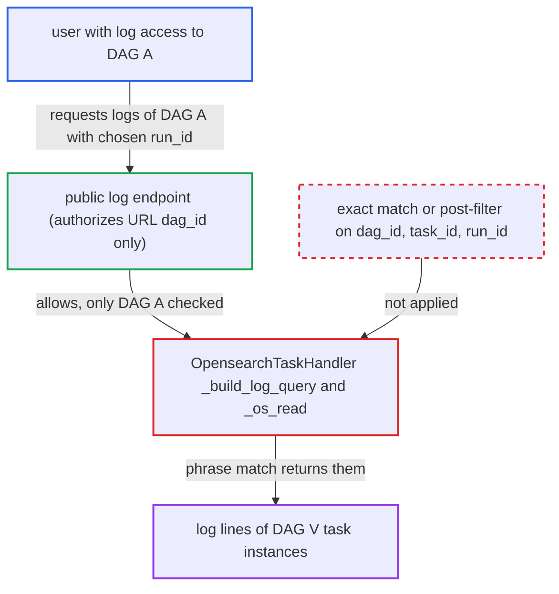

# OpenSearch task-log lookup by ambiguous log_id phrase match returns other DAGs' logs

| Field | Value |
|---|---|
| ID | `find_01Ay8YUsgNF716CYETyXbaff` |
| Severity | **Low** |
| Status | open |
| CWE | CWE-863 — Authorization bypass |
| Created | 2026-10-27T21:41:09.780102Z |
| Claude Security | https://claude.ai/security/findings/find_01Ay8YUsgNF716CYETyXbaff |

## Description

A user who may read task logs for one DAG can read log lines of task instances in other DAGs they are not authorized for. Only task instances whose rendered `log_id` collides with, or contains, the attacker's own are exposed. The attacker needs log access and trigger rights on a DAG whose name overlaps a hyphenated victim DAG. The cause is `_build_log_query`, which selects documents with a `match_phrase` on an unescaped hyphen-joined `log_id` and never filters the hits.

1. **attacker** triggers their own DAG `A` with a chosen `dag_run_id`. `dag_run_id` is a free-form string, so the attacker can set it equal to a predictable scheduled `run_id` of DAG `V`, which they cannot read. ([`airflow-core/src/airflow/api_fastapi/core_api/datamodels/dag_run.py:228-231`](https://github.com/cx-benchmark/airflow/blob/a462d683469bb9f55646b0515ef84c41e16650fb/airflow-core/src/airflow/api_fastapi/core_api/datamodels/dag_run.py#L228-L231))
2. **the handler `_render_log_id`** renders the task's `log_id` by joining parts with `-`. The template `{dag_id}-{task_id}-{run_id}-{map_index}-{try_number}` does not escape `-`, which is legal in `dag_id`, `task_id` and `run_id`, so different task instances can render the same or overlapping strings. ([`providers/opensearch/src/airflow/providers/opensearch/log/os_task_handler.py:570-601`](https://github.com/cx-benchmark/airflow/blob/a462d683469bb9f55646b0515ef84c41e16650fb/providers/opensearch/src/airflow/providers/opensearch/log/os_task_handler.py#L570-L601))
3. **attacker** requests `GET /dags/A/dagRuns/{run_id}/taskInstances/{task}/logs/1`. The endpoint checks access only for the `dag_id` in the URL, which is `A`, so the request is allowed. ([`airflow-core/src/airflow/api_fastapi/core_api/routes/public/log.py:86-110`](https://github.com/cx-benchmark/airflow/blob/a462d683469bb9f55646b0515ef84c41e16650fb/airflow-core/src/airflow/api_fastapi/core_api/routes/public/log.py#L86-L110))
4. **the function `_build_log_query`** selects documents with a `match_phrase` query on `log_id`. On a `text`-mapped field the phrase is tokenized on hyphens and matches any document whose tokens contain it, so DAG `V`'s documents match too. ([`providers/opensearch/src/airflow/providers/opensearch/log/os_task_handler.py:280-294`](https://github.com/cx-benchmark/airflow/blob/a462d683469bb9f55646b0515ef84c41e16650fb/providers/opensearch/src/airflow/providers/opensearch/log/os_task_handler.py#L280-L294))
5. **the handler `_os_read`** returns every hit and renders it without checking `dag_id`, `task_id` or `run_id`. Nothing compares the hits to the requested task instance, so DAG `V`'s log lines appear in the response to the attacker. ([`providers/opensearch/src/airflow/providers/opensearch/log/os_task_handler.py:711-745`](https://github.com/cx-benchmark/airflow/blob/a462d683469bb9f55646b0515ef84c41e16650fb/providers/opensearch/src/airflow/providers/opensearch/log/os_task_handler.py#L711-L745))

## Assessment

The attacker is an authenticated UI or API user with task-log read access, and the right to trigger runs, on DAG `A`. They have no access to DAG `V`. `V`'s `dag_id` must end with `-A`, or `V`'s `task_id` must end with `-` plus `A`'s task name, and the two DAGs must share a task name. The attacker cannot create this naming relation, but hyphenated names such as `team-pipeline` and `pipeline` commonly produce it. The attacker triggers `A` with a `dag_run_id` equal to one of `V`'s predictable scheduled `run_id`s and lets the task finish. From Airflow 3.4 the query is `ti_id OR (log_id AND NOT exists ti_id)`, which protects only documents that carry `ti_id`. Documents written by Airflow 2.11 to 3.3, by shippers tailing log files, or by pipelines that drop the field are still selected by `log_id` alone. The token-overlap case relies on OpenSearch `match_phrase` on a `text` field with the standard analyzer, which the report states as an assumption. The exact-string collision holds for any mapping.

Impact: The attacker reads log content of task instances in DAGs they are not authorized for. Logs often hold business data, hostnames, paths and error output, and secret masking reduces but does not remove credential exposure. Only the colliding task instances are reachable, so the exposure is partial. Nothing is modified and no service is disrupted.

## Recommendation

The handler treats an unescaped hyphen-joined `log_id` as the unique key of a task instance and selects it with an analyzed `match_phrase`. Documents of other DAGs' task instances therefore satisfy the query and are returned to a caller authorized for only one DAG.

Fix criteria: A log read for task instance X returns only X's documents. This is done with an exact (keyword or term) match on an identifier that is unambiguous for all legal `dag_id`, `task_id` and `run_id` values, or by post-filtering hits on exact `dag_id`, `task_id`, `run_id`, `map_index` and `try_number`. Index documents for DAG `prod-etl`/task `load`/run `R` and DAG `etl`/task `load`/run `R`, and also `etl-prod`/`load` against `etl`/`prod-load`, each with and without `ti_id`. A read of either must return none of the other's lines.

## Evidence

**https://github.com/cx-benchmark/airflow**

- [`providers/opensearch/src/airflow/providers/opensearch/log/os_task_handler.py:280-294`](https://github.com/cx-benchmark/airflow/blob/a462d683469bb9f55646b0515ef84c41e16650fb/providers/opensearch/src/airflow/providers/opensearch/log/os_task_handler.py#L280-L294)
- [`providers/opensearch/src/airflow/providers/opensearch/log/os_task_handler.py:570-601`](https://github.com/cx-benchmark/airflow/blob/a462d683469bb9f55646b0515ef84c41e16650fb/providers/opensearch/src/airflow/providers/opensearch/log/os_task_handler.py#L570-L601)
- [`providers/opensearch/src/airflow/providers/opensearch/log/os_task_handler.py:711-745`](https://github.com/cx-benchmark/airflow/blob/a462d683469bb9f55646b0515ef84c41e16650fb/providers/opensearch/src/airflow/providers/opensearch/log/os_task_handler.py#L711-L745)
- [`airflow-core/src/airflow/api_fastapi/core_api/routes/public/log.py:86-110`](https://github.com/cx-benchmark/airflow/blob/a462d683469bb9f55646b0515ef84c41e16650fb/airflow-core/src/airflow/api_fastapi/core_api/routes/public/log.py#L86-L110)
- [`airflow-core/src/airflow/api_fastapi/core_api/datamodels/dag_run.py:228-231`](https://github.com/cx-benchmark/airflow/blob/a462d683469bb9f55646b0515ef84c41e16650fb/airflow-core/src/airflow/api_fastapi/core_api/datamodels/dag_run.py#L228-L231)

