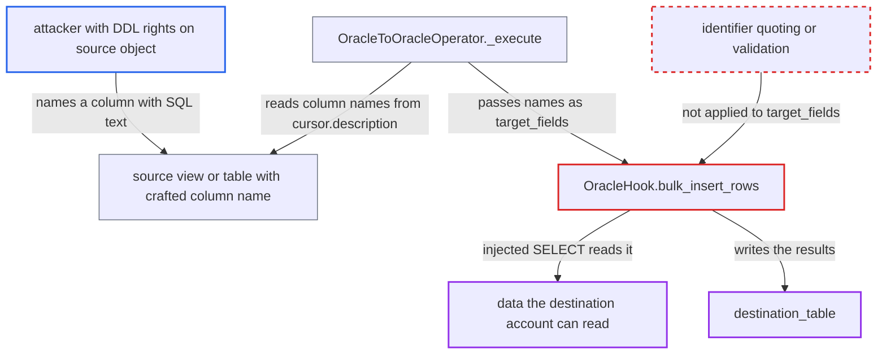

# OracleToOracleOperator splices source result column names into destination INSERT statement

| Field | Value |
|---|---|
| ID | `find_01MUMbiVQzRPYSiEpLsgQctN` |
| Severity | **Low** |
| Status | open |
| CWE | CWE-89 — SQL injection |
| Created | 2026-10-27T21:42:29.287377Z |
| Claude Security | https://claude.ai/security/findings/find_01MUMbiVQzRPYSiEpLsgQctN |

## Description

Someone who can define a view or table on the source Oracle database can make the destination Oracle database run an extra `SELECT` and write its results into `destination_table`. The `SELECT` runs with the Airflow destination account's rights. It works only when a Dag reads that object with `SELECT *` or similar, so the attacker's column names reach `OracleToOracleOperator`. `OracleHook.bulk_insert_rows` pastes those names unquoted into the `INSERT` text.

1. **attacker with DDL rights on the source database** creates a view or table with a column named like `X)select :1||p from s--`. Oracle quoted identifiers can hold almost any character, and this name is 23 bytes, so it fits even the old 30-byte limit.
2. **a scheduled Dag task using `OracleToOracleOperator`** runs `source_sql` that selects from that object with `SELECT *` or `v.*`. Because the column names are not listed or aliased in `source_sql`, the source server supplies them, and the attacker chose them. ([`providers/oracle/src/airflow/providers/oracle/transfers/oracle_to_oracle.py:73-84`](https://github.com/cx-benchmark/airflow/blob/a462d683469bb9f55646b0515ef84c41e16650fb/providers/oracle/src/airflow/providers/oracle/transfers/oracle_to_oracle.py#L73-L84))
3. **the operator's `_execute` method** builds `target_fields` from `cursor.description` and passes them to `dest_hook.bulk_insert_rows`. The names come from metadata the source server returns, and they are passed on for each fetched chunk without any check. ([`providers/oracle/src/airflow/providers/oracle/transfers/oracle_to_oracle.py:73-84`](https://github.com/cx-benchmark/airflow/blob/a462d683469bb9f55646b0515ef84c41e16650fb/providers/oracle/src/airflow/providers/oracle/transfers/oracle_to_oracle.py#L73-L84))
4. **`OracleHook.bulk_insert_rows`** joins the field names into the statement `insert into {table} ({cols}) values (:1, ..., :n)` without quoting. The payload closes the column list and adds its own `SELECT`, its own `:1` bind satisfies the bind count, and `--` comments out the rest. ([`providers/oracle/src/airflow/providers/oracle/hooks/oracle.py:418-455`](https://github.com/cx-benchmark/airflow/blob/a462d683469bb9f55646b0515ef84c41e16650fb/providers/oracle/src/airflow/providers/oracle/hooks/oracle.py#L418-L455))
5. **the destination connection** prepares and executes the statement as the Airflow destination account. The statement is now an `INSERT ... SELECT` of the attacker's choosing, and it runs once per row chunk with the row values as binds. ([`providers/oracle/src/airflow/providers/oracle/hooks/oracle.py:418-455`](https://github.com/cx-benchmark/airflow/blob/a462d683469bb9f55646b0515ef84c41e16650fb/providers/oracle/src/airflow/providers/oracle/hooks/oracle.py#L418-L455))
6. **the injected `SELECT`** reads data the destination account can read or call and writes the result into `destination_table`. The write target stays fixed to `destination_table`, and a prepared statement runs only one statement. ([`providers/oracle/src/airflow/providers/oracle/hooks/oracle.py:418-455`](https://github.com/cx-benchmark/airflow/blob/a462d683469bb9f55646b0515ef84c41e16650fb/providers/oracle/src/airflow/providers/oracle/hooks/oracle.py#L418-L455))

## Assessment

The attacker needs rights to create or alter a view or table on the source Oracle database, and no Airflow access or victim action. A deployed `OracleToOracleOperator` must read that object with `SELECT *` or similar, so the column names are not listed or aliased by the Dag author. Names the Dag author lists or aliases explicitly in `source_sql` are the author's own and are not affected. The attack fires when the scheduled task runs. A second place with the same flaw is `OracleHook.insert_rows`, which joins `target_fields` unquoted. Its callers in scope take `target_fields` from operator arguments, so it matters only if names from a remote source are passed in. The report says this rests on python-oracledb (>=2.3.0) returning description names unquoted and skipping `--` comments when it counts binds.

Impact: The attacker gets one `INSERT ... SELECT` of their choosing per chunk, run as the Airflow destination account. They can copy anything that account can read or call into `destination_table`, or leak it through timing seen from the source. They can also add rows and values derived from destination data to `destination_table`. Writes stay fixed to that table. Expensive subqueries could load the destination, but the report sees no more than limited availability loss.

## Recommendation

(1) `OracleHook.bulk_insert_rows` and `insert_rows` join `target_fields` into the SQL text unquoted, so a name containing SQL syntax becomes code on the destination.

Fix criteria: Each target field reaches the statement as a single Oracle identifier. It is either quoted, with embedded double quotes rejected or escaped, or checked against a strict identifier pattern and refused if it fails. Test: pass a target field such as `X)select :1 from dual--`. The call must fail validation or treat it as one quoted column name, and it must never run a subquery.

(2) `OracleToOracleOperator` trusts column names reported by the source server and uses them as SQL identifiers on a different database.

Fix criteria: Column names taken from `cursor.description` pass identifier validation or quoting before they reach the destination statement. Test: transfer from a source view whose column alias contains `)`, `--` and `select`. The task must fail, or insert into a column with that literal name, and run nothing else on the destination.

## Evidence

**https://github.com/cx-benchmark/airflow**

- [`providers/oracle/src/airflow/providers/oracle/hooks/oracle.py:418-455`](https://github.com/cx-benchmark/airflow/blob/a462d683469bb9f55646b0515ef84c41e16650fb/providers/oracle/src/airflow/providers/oracle/hooks/oracle.py#L418-L455)
- [`providers/oracle/src/airflow/providers/oracle/transfers/oracle_to_oracle.py:73-84`](https://github.com/cx-benchmark/airflow/blob/a462d683469bb9f55646b0515ef84c41e16650fb/providers/oracle/src/airflow/providers/oracle/transfers/oracle_to_oracle.py#L73-L84)
- [`providers/oracle/src/airflow/providers/oracle/hooks/oracle.py:346-348`](https://github.com/cx-benchmark/airflow/blob/a462d683469bb9f55646b0515ef84c41e16650fb/providers/oracle/src/airflow/providers/oracle/hooks/oracle.py#L346-L348)
- [`providers/oracle/provider.yaml:125`](https://github.com/cx-benchmark/airflow/blob/a462d683469bb9f55646b0515ef84c41e16650fb/providers/oracle/provider.yaml#L125)

