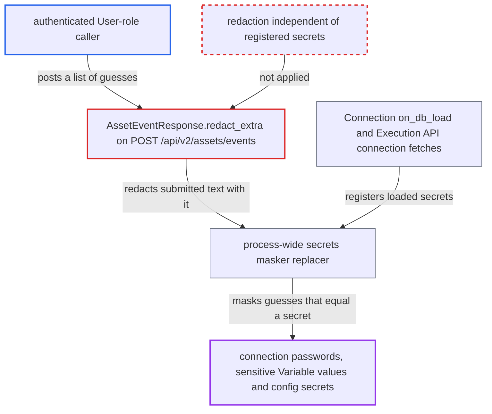

# Process-global secrets masker in API responses gives a guess oracle for hidden secrets

| Field | Value |
|---|---|
| ID | `find_01GgCcvBKrrxioW1qiJguws4` |
| Severity | **Low** |
| Status | open |
| CWE | CWE-204 — Observable response discrepancy |
| Created | 2026-10-27T21:23:25.988353Z |
| Claude Security | https://claude.ai/security/findings/find_01GgCcvBKrrxioW1qiJguws4 |

## Description

An authenticated user with only the default FAB `User` role can test guesses for secrets they are not allowed to read. These include connection passwords, sensitive Variable values, the metadata DB password and sensitive config values. The response shows `***` wherever a guess equals a secret. This happens because `AssetEventResponse.redact_extra` and two similar response models redact caller-written text with the process-wide secrets masker. The oracle confirms only whole values and leaks no prefixes.

1. **the API server worker** registers secrets in the process-wide masker as it loads them. `Connection.__init__` and the `@reconstructor` `on_db_load` register each connection password and its URL-quoted form whenever a row is loaded, and nothing resets the set between requests. ([`airflow-core/src/airflow/models/connection.py:253-257`](https://github.com/cx-benchmark/airflow/blob/a462d683469bb9f55646b0515ef84c41e16650fb/airflow-core/src/airflow/models/connection.py#L253-L257))
2. **the Execution API** loads connections for task fetches inside the same app. It is mounted in the same app by default, so routine task activity fills that worker's masker with connection passwords. ([`airflow-core/src/airflow/api_fastapi/execution_api/routes/connections.py:75-88`](https://github.com/cx-benchmark/airflow/blob/a462d683469bb9f55646b0515ef84c41e16650fb/airflow-core/src/airflow/api_fastapi/execution_api/routes/connections.py#L75-L88))
3. **the attacker** posts an asset event with many guesses in one string. The attacker sends `POST /api/v2/assets/events` with the `asset_id` of any asset and `extra` such as `{"note": "guess1 guess2 ... guessN"}`, under a non-sensitive key. ([`airflow-core/src/airflow/api_fastapi/core_api/routes/public/assets.py:389-431`](https://github.com/cx-benchmark/airflow/blob/a462d683469bb9f55646b0515ef84c41e16650fb/airflow-core/src/airflow/api_fastapi/core_api/routes/public/assets.py#L389-L431))
4. **the model `AssetEventResponse`** passes the submitted `extra` through the global redactor. `redact_extra` uses the same masker whose pattern set was filled by other requests and by startup. ([`airflow-core/src/airflow/api_fastapi/core_api/datamodels/assets.py:220-223`](https://github.com/cx-benchmark/airflow/blob/a462d683469bb9f55646b0515ef84c41e16650fb/airflow-core/src/airflow/api_fastapi/core_api/datamodels/assets.py#L220-L223))
5. **the method `_redact`** replaces every registered secret found in the string with `***`. For a string under a non-sensitive key it calls `self.replacer.sub(replacement, item)` and keeps the rest of the text, so only guesses that equal a secret are masked. ([`shared/secrets_masker/src/airflow_shared/secrets_masker/secrets_masker.py:420-425`](https://github.com/cx-benchmark/airflow/blob/a462d683469bb9f55646b0515ef84c41e16650fb/shared/secrets_masker/src/airflow_shared/secrets_masker/secrets_masker.py#L420-L425))
6. **the attacker** reads the response and sees which guesses became `***`. Each masked guess equals a secret the API never returns to this user. There is no rate limit, so the attacker can repeat this with new lists.

## Assessment

The attacker is an authenticated FAB `User`, a default role with no connection or variable rights. That role holds `can_create` on Assets, and FAB checks only the resource type. The attacker lists assets with `GET /api/v2/assets` and then posts an asset event. Connection passwords are testable only after the serving worker has loaded them, through routine task fetches via the Execution API or Op/Admin views such as `GET /connections`. The attacker cannot control that, and each uvicorn worker keeps its own set. Two other routes exist for users with Op-level rights. They write a Variable value (`VariableResponse.redact_val`) or a connection `extra` (`ConnectionResponse.redact_extra`) containing guesses, then read it back. Secrets shorter than `[logging] min_length_masked_secret` (default 5) and the literal `airflow` are never registered, so they cannot be tested.

Impact: The attacker can learn whether chosen strings equal connection passwords, sensitive Variable values, the metadata DB password or sensitive config values. Large batches of guesses make weak or reused secrets recoverable. Random high-entropy secrets are not recoverable this way, and the oracle leaks nothing beyond whole-value equality. There is no integrity or availability gain.

## Recommendation

The response models `AssetEventResponse`, `VariableResponse` and `ConnectionResponse` redact caller-written content with the global masker's literal-pattern replacer. That replacer is filled by other principals' requests, Execution API fetches and startup, so the selective `***` shows whether the text contains a secret the caller may not read.

Fix criteria: Redacting caller-supplied fields in API responses no longer depends on which secret values the process has registered. It is either based only on the key or field, or it gives the same output whatever secrets the worker holds. To verify, load a connection with password `S` in the worker. Then a `User` who posts an asset event containing `S` under a non-sensitive key must get the value back unchanged or uniformly masked. An Op who writes a Variable or connection `extra` containing `S` must get the same result. In no case may only `S` be replaced.

## Evidence

**https://github.com/cx-benchmark/airflow**

- [`airflow-core/src/airflow/api_fastapi/core_api/datamodels/assets.py:220-223`](https://github.com/cx-benchmark/airflow/blob/a462d683469bb9f55646b0515ef84c41e16650fb/airflow-core/src/airflow/api_fastapi/core_api/datamodels/assets.py#L220-L223)
- [`airflow-core/src/airflow/api_fastapi/core_api/routes/public/assets.py:389-431`](https://github.com/cx-benchmark/airflow/blob/a462d683469bb9f55646b0515ef84c41e16650fb/airflow-core/src/airflow/api_fastapi/core_api/routes/public/assets.py#L389-L431)
- [`providers/fab/src/airflow/providers/fab/auth_manager/security_manager/override.py:305-316`](https://github.com/cx-benchmark/airflow/blob/a462d683469bb9f55646b0515ef84c41e16650fb/providers/fab/src/airflow/providers/fab/auth_manager/security_manager/override.py#L305-L316)
- [`shared/secrets_masker/src/airflow_shared/secrets_masker/secrets_masker.py:420-425`](https://github.com/cx-benchmark/airflow/blob/a462d683469bb9f55646b0515ef84c41e16650fb/shared/secrets_masker/src/airflow_shared/secrets_masker/secrets_masker.py#L420-L425)
- [`shared/secrets_masker/src/airflow_shared/secrets_masker/secrets_masker.py:604-641`](https://github.com/cx-benchmark/airflow/blob/a462d683469bb9f55646b0515ef84c41e16650fb/shared/secrets_masker/src/airflow_shared/secrets_masker/secrets_masker.py#L604-L641)
- [`airflow-core/src/airflow/models/connection.py:253-257`](https://github.com/cx-benchmark/airflow/blob/a462d683469bb9f55646b0515ef84c41e16650fb/airflow-core/src/airflow/models/connection.py#L253-L257)
- [`airflow-core/src/airflow/api_fastapi/execution_api/routes/connections.py:75-88`](https://github.com/cx-benchmark/airflow/blob/a462d683469bb9f55646b0515ef84c41e16650fb/airflow-core/src/airflow/api_fastapi/execution_api/routes/connections.py#L75-L88)
- [`airflow-core/src/airflow/api_fastapi/core_api/datamodels/variables.py:42-53`](https://github.com/cx-benchmark/airflow/blob/a462d683469bb9f55646b0515ef84c41e16650fb/airflow-core/src/airflow/api_fastapi/core_api/datamodels/variables.py#L42-L53)
- [`airflow-core/src/airflow/api_fastapi/core_api/datamodels/connections.py:112-119`](https://github.com/cx-benchmark/airflow/blob/a462d683469bb9f55646b0515ef84c41e16650fb/airflow-core/src/airflow/api_fastapi/core_api/datamodels/connections.py#L112-L119)
- [`airflow-core/src/airflow/settings.py:553`](https://github.com/cx-benchmark/airflow/blob/a462d683469bb9f55646b0515ef84c41e16650fb/airflow-core/src/airflow/settings.py#L553)
- [`airflow-core/src/airflow/models/variable.py:85-88`](https://github.com/cx-benchmark/airflow/blob/a462d683469bb9f55646b0515ef84c41e16650fb/airflow-core/src/airflow/models/variable.py#L85-L88)

