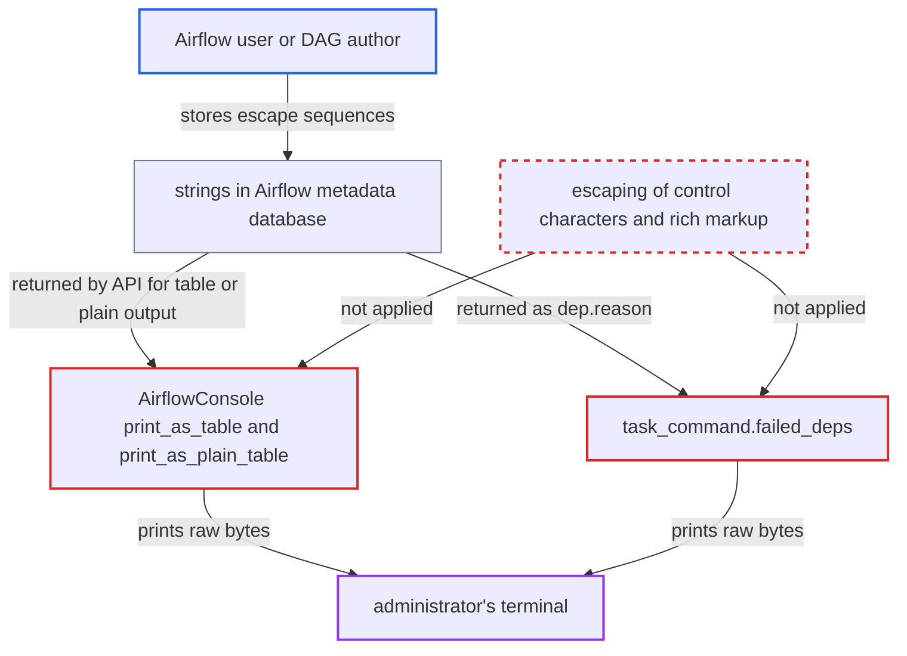

# Server-supplied strings rendered to terminal unsanitized in table/plain output and failed-deps

| Field | Value |
|---|---|
| ID | `find_019BsPYQPWFXvPGbV8r4Yx7j` |
| Severity | **Low** |
| Status | open |
| CWE | CWE-150 — Terminal escape injection |
| Created | 2026-10-27T21:13:04.420886Z |
| Claude Security | https://claude.ai/security/findings/find_019BsPYQPWFXvPGbV8r4Yx7j |

## Description

A low-privilege Airflow user or DAG author can change what an administrator sees in `airflowctl`, or plant deceptive links. On some terminals the attacker can also write to the clipboard. This needs the administrator to run `-o table` or `-o plain`, or the `tasks failed-deps` command. The code prints server-supplied strings without removing ESC and other control characters and without turning off rich markup.

1. **Airflow user or DAG author** stores a string with terminal escape sequences or rich markup in data they can write. Examples are a variable or pool description, a DAG-run note, a task id, an XCom value or import-error text, depending on what the attacker may edit.
2. **administrator** runs an auto-generated list or get command with `-o table` or `-o plain`. These commands send their response through `AirflowConsole().print_as(..., output=args.output)`, so every returned string field reaches the output code. ([`airflow-ctl/src/airflowctl/ctl/cli_config.py:977-982`](https://github.com/cx-benchmark/airflow/blob/a462d683469bb9f55646b0515ef84c41e16650fb/airflow-ctl/src/airflowctl/ctl/cli_config.py#L977-L982))
3. **`AirflowConsole.print_as_table` and `print_as_plain_table`** pass each field to rich as text with markup enabled. `print_as_table` uses `str(value)` of each field and `print_as_plain_table` hands `tabulate` output to `Console.print`. The rich 13.x control-code stripping removes only BEL, BS, VT, FF and CR, so ESC sequences and markup such as `[link=https://evil]https://airflow.corp/sso[/link]` pass through. ([`airflow-ctl/src/airflowctl/ctl/console_formatting.py:69-90`](https://github.com/cx-benchmark/airflow/blob/a462d683469bb9f55646b0515ef84c41e16650fb/airflow-ctl/src/airflowctl/ctl/console_formatting.py#L69-L90))
4. **`task_command.failed_deps`** prints `dep.name` and `dep.reason` with plain `print`. This happens whatever the output format. The reason text contains pool names and upstream task ids that other users control. ([`airflow-ctl/src/airflowctl/ctl/commands/task_command.py:85-88`](https://github.com/cx-benchmark/airflow/blob/a462d683469bb9f55646b0515ef84c41e16650fb/airflow-ctl/src/airflowctl/ctl/commands/task_command.py#L85-L88))
5. **administrator's terminal** interprets the raw escape sequences and markup. The terminal can rewrite displayed output, show deceptive hyperlinks, set the window title or, if the terminal allows it, write the clipboard.

## Assessment

The attacker is an Airflow user who can write some entity that the CLI later prints. Variable values and descriptions, pool descriptions and connection descriptions need the matching edit permission. DAG descriptions, task ids, XCom values and import-error stack traces come from DAG authors. Per the Airflow security model, DAG authors are trusted to run code on workers but not on an administrator's workstation. DAG-run notes need DAG-run edit permission on that DAG. The administrator must then view the data, for example with `airflowctl variables list -o table`, `pools list -o plain` or `tasks failed-deps`. The default `json` output escapes control characters and `yaml` quotes them, so those two formats are not affected. The attack therefore needs the non-default output format or the `failed-deps` command.

Impact: The attacker can alter what the administrator sees: hide or forge rows, fake success messages and show deceptive links. On terminals that allow it, the attacker can also write the clipboard, which could lead to the administrator pasting attacker text into a shell. The code itself reads no data from the workstation.

## Recommendation

Strings from the API are written to the terminal through rich with markup enabled and without removing C0/C1 control characters. This covers `print_as_table` and `print_as_plain_table` and the plain `print` in `failed_deps`. Data written by other Airflow users can therefore carry terminal control sequences to the operator.

Fix criteria: All server-derived strings written to the terminal in `table` and `plain` output and in `failed-deps` have ESC (0x1b) and other C0/C1 control characters removed or visibly escaped. They are not interpreted as rich markup, for example by using `rich.markup.escape` or rendering them as `Text` objects. To verify, return a variable whose description contains `\x1b]0;x\x07`, `\x1b[2J` and `[link=https://evil]ok[/link]`. Confirm that the `-o table` and `-o plain` output has no raw ESC byte and no live hyperlink.

## Evidence

**https://github.com/cx-benchmark/airflow**

- [`airflow-ctl/src/airflowctl/ctl/console_formatting.py:69-90`](https://github.com/cx-benchmark/airflow/blob/a462d683469bb9f55646b0515ef84c41e16650fb/airflow-ctl/src/airflowctl/ctl/console_formatting.py#L69-L90)
- [`airflow-ctl/src/airflowctl/ctl/commands/task_command.py:85-88`](https://github.com/cx-benchmark/airflow/blob/a462d683469bb9f55646b0515ef84c41e16650fb/airflow-ctl/src/airflowctl/ctl/commands/task_command.py#L85-L88)
- [`airflow-ctl/src/airflowctl/ctl/cli_config.py:977-982`](https://github.com/cx-benchmark/airflow/blob/a462d683469bb9f55646b0515ef84c41e16650fb/airflow-ctl/src/airflowctl/ctl/cli_config.py#L977-L982)

